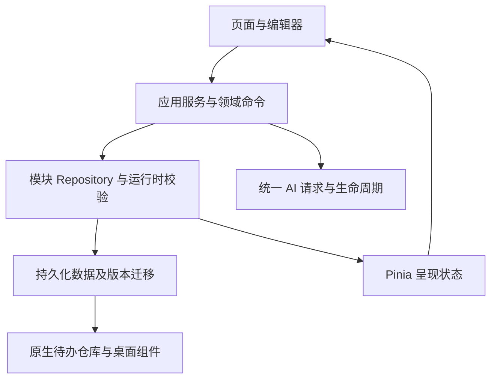

# ForMyself 全面检查记录 v1

检查日期：2026-10-03（北京时间）。代码基准：`b2d4fdf`。本轮为审查与测试，没有改动业务源码、原始资料、已有交付包或远端仓库。

结论：常规操作和现有自动检查总体可用，但异常读写时的数据保护存在实测缺陷。建议优先修复数据丢失路径、主密码更换事务与金额校验，再统一 UI 交互、网络请求和存储架构。现有 297 项 JS/组件测试通过，不能据此认定所有功能和异常路径都通过。

本记录位于 `docs/`，作为工作过程与改造依据；不是待用户确认前生成的正式 Office/PDF 成品。

## 1. 范围、资料与验证方法

- 阅读当前 `src/`、`android/`、`tests/`、构建配置、CI、README、HANDOFF 及已有验收记录。
- `raw/` 中的私人加密备份只清点文件长度与摘要，没有解密、复制记录或使用其凭据。缺少真机型号、启动器型号及正式发布要求，均不自行补充。
- 使用独立 Chrome 用户目录、独立本地端口和程序生成的合成记录。AI 请求用本机 mock，不向服务商发送私人资料，也没有调用收费模型。
- 在 TEMP 下创建空白 API 30 / API 37 AVD，不使用原有个人或验收 AVD 的数据。原生测试与交互只操作本轮隔离实例。
- 证据统一保存在 [本轮 QA 目录](qa/app-audit-20261003/)。测试脚本只用于这些隔离环境，不应连接用户日常使用的浏览器或设备。
- 判断分为 **实测复现**、**源码/配置证据**、**改进建议**、**待确认**；后两类不能当成已发现的故障。

## 2. 本轮测试结果

| 检查 | 结果 | 证据/说明 |
|---|---|---|
| `npm run check` | 通过 | Node 249/249；组件 48/48；类型检查、生产构建通过 |
| ESLint | 0 错误、56 警告 | `project-check.log`；主要现有代码规范/未使用变量警告 |
| 四种宽度的 10 个主页面 | 40 个布局样本无横向溢出 | 320、390、768、1440 CSS px；`browser-baseline.json`；这不等于所有弹窗、长内容均无问题 |
| 体重 | 新增、编辑及 19 kg 拒绝通过 | `browser-flows.json` |
| 心情 | 合成事件新增通过 | 同上；真实 AI 共情未请求 |
| 省钱 | 正常计划、正常存入通过；负数校验失败 | 同上 |
| 每日待办 | 每日重复、新增、完成、仅本次修改保留打卡、撤销通过 | `browser-flows-continuation.json` |
| 日程 | 新增通过 | 同上；复杂规则主要由现有 Node 测试覆盖 |
| 密码库 | 新增及列表遮罩通过 | 同上；真机生物识别显示/复制未验证 |
| 完整备份 | v10 导出及覆盖恢复通过 | 恢复体重、密码库与待办的合成记录；没有把备份内容或合成密码写入证据文件 |
| 锁屏 | UI 隐藏通过；解锁后可返回 | 受保护内存清理检查未通过，详见问题 13 |
| 四种预设主题 | 切换通过 | `browser-extra.json`，主色变量跟随更新 |
| 减少动画 | 待办进度过渡缩短至约 0 | 计算值为 `0.00001s`，来自全局减少动画规则 |
| 数据故障注入 | 复现 4 种数据保护缺陷 | `storage-faults.json`，详见问题 01～03 |
| AI 故障注入 | 复现重复 401 请求、遗漏截断检查、推理文本回退 | `ai-faults.json`；无超时仅由短时挂起观察加源码确认 |
| 月度总结切月 | 失败 | 10 月请求的结果显示在 9 月页面，`browser-extra.json` |
| 大量省钱计划 | 500 项全部挂载，18,223 个 DOM 节点 | 单次更新到双帧约 465ms；宿主机同时运行模拟器，不能当真机性能指标 |
| 应用 Debug 与测试 APK | 通过 | `:app:assembleDebug :app:assembleDebugAndroidTest`，`android-app-build.log` |
| 全项目 `assembleDebugAndroidTest` | 失败 | Cordova 插件测试模块 Kotlin 1.8.22 与 jdk8 1.6.21 重复类；应用自身测试 APK 通过，不能混为一谈 |
| Android lint | 失败 | 4 错误、68 警告；`android-lint-results.xml` |
| API 30 原生待办 | 4/4 通过 | `android-instrumentation.log` |
| API 37 原生待办 | 4/4 通过 | `android-api37-instrumentation.log`；APK 安装使用 `-g` 授予运行时权限，不代表拒绝权限场景通过 |
| API 30 / WebView 83 启动 | 失败，白屏 | `native-browser.json`；JS `Unexpected token '='`；Vue 未初始化 |
| API 37 / WebView 145 启动与待办 | 通过 | `native-flows.json`：初始化、新增、完成、后台立即锁定、返回仍锁定 |
| API 37 真实软键盘 | 保存按钮保持可见 | `native-keyboard.json`：系统 `mInputShown=true`，可视高度降至约 602 CSS px；截图是 WebView 可视区，不含 IME 自身 |
| npm 官方源全依赖审计 | 16 个受告警影响的包 | critical 2 / high 11 / moderate 3；是包数，不是 16 个已被利用的漏洞 |
| npm 官方源 `--omit=dev` | 2 个 high 包 | nanoid、postcss 由 Vue 编译器链引入；不直接等于发布到浏览器的运行时代码受攻击 |

过程中的脚本选择器错误已经修正，按功能段继续完成检查，不算 App 故障。第二个 AVD 曾因复制已经被模拟器重写的配置而误启动 API 30，相关日志更名为 `misconfigured-api30-instance-*`，不能作为 API 37 证据。该实例首次提醒测试失败、重测通过，保留两份结果；原因没有确定。真正 API 37 的证据以 `ro.build.version.sdk=37`、Android 17 / WebView 145 核对。

## 3. 优先修复的问题

优先级定义：P1＝可能丢失数据、破坏安全边界或阻断主要功能；P2＝影响交互、结果正确性或长期维护；P3＝体验完善。没有把尚未实施的方案写成已确认结论。

### 01 · P1 · 密码库解密失败会覆盖原密文【实测复现】

定位：`src/stores/passwordVault.js:41`、`:79`、`:86`。

合成密码库包含 1 条记录，用错误的解密密码调用存储加载器后，`loadError` 已设置，但 `finally` 仍把 `isDataLoaded` 设为 true；`records=[]` 触发 watcher，将空数组用本次尝试的密码重新加密写入原键。结果：原密文变化，本次尝试密码可解出 0 条记录。

这不是“在锁屏输入错误密码即可删除密码库”的结论：锁屏验证器会先拒绝错误输入。实际风险发生在存储损坏、密码更换不完整、迁移或受保护数据加载失败时。

建议：加载失败时禁止持久化；加载/恢复期间暂停 watcher；区分 `ready` 与“读流程结束”；保存原密文或隔离损坏数据，提供重试/恢复入口。可以沿用聊天 store 的 `canPersist=false` 防护。验收必须断言失败前后密文逐字不变。

### 02 · P1 · 更换主密码的事务遗漏部分写入失败【实测复现】

定位：`src/services/masterPasswordChange.js:9`、`:15`；`src/stores/passwordVault.js:152`。

密码库重加密同时写记录与分类。注入“分类写入失败”，记录密文已经成功写成新密码版本，但 `reencryptor` 没有整体返回成功，所以不会进入 `completed` 回滚集合。验证器提交未发生；旧密码无法解开记录，新密码却可以解开。

建议：每个重加密步骤自身具备部分失败回滚；所有文件/键先写临时区、验证后提交；使用事务日志在进程被杀后继续或回滚。换密期间暂停自动保存。只在整个数据集合验证完成后切换验证器；不能仅把失败函数提前加入数组就视为解决了断电问题。

### 03 · P1 · 日程加载失败主动覆写，体重加载失败继续开放写入【实测复现】

定位：`src/features/schedule/scheduleStore.js:56`、`:65`；`src/stores/weight.js:10`、`:18`、`:27`。省钱的相似路径见 `src/stores/debt.js:33`（本轮未对该模块单独注入读取失败）。

损坏 JSON 的日程在 `loadSchedules()` 的 `finally` 中立即 `persist()`，原内容被默认空集合覆盖；无需用户再编辑。体重读取失败也标记为加载完成，新增记录后覆盖原内容，UI 没有读取失败状态。

建议：统一存储状态为 idle/loading/ready/error；读取失败保持只读，保留原始字节与恢复副本，不在失败路径保存默认值。把聊天与待办现有的错误保护扩展至各模块。

### 04 · P1 · 普通记录保存不等待落盘，失败缺少用户反馈【实测/源码证据】

定位：`src/components/WeightView.vue:122`；`src/stores/weight.js:22`；省钱、心情存在同类 watcher 保存模式。

模拟体重写入失败后，内存出现新记录，但界面没有保存失败/重试提示，落盘由异步 watcher 承担。不能把“画面显示出来”视为已安全保存。读取与写入的全局串行队列也不等于跨多个键的事务。

建议：让 repository 命令返回明确的持久化结果；UI 在成功后确认保存，失败保持编辑内容并提供重试。后台 flush 覆盖所有模块，对配额不足、存储不可用、连续快速写入、进程终止增加行为测试。

### 05 · P1 · 省钱金额缺少有效性校验【实测复现】

定位：`src/components/DebtListView.vue:325`、`:346`、`:370`。

界面成功接受 -100 元目标及 -25 元“存入”。目前主要检查空值，再 `parseFloat`；编辑路径也没有完整金额检查。

建议：目标金额必须为有限正数；存入金额的负数处理要有明确业务语义。若支持取出，单独设操作类型，不能把负数混入“存入”。采用整数分处理金额，统一精度、上限、空白名称和日期校验；导入/恢复也走相同规则。

### 06 · P1 · 备份/密码库加密的口令派生强度不足【源码证据】

定位：`src/composables/settings/useBackupSettings.js:231`；`src/stores/passwordVault.js:26`；`src/features/chat/chatStorage.js:14`；安装包 `crypto-js/evpkdf.js:39`。

主密码验证器确实使用 210,000 次 PBKDF2，但 `CryptoJS.AES.encrypt(text, password)` 的口令加密走另一路：默认 EvpKDF 使用 MD5、1 次迭代，CBC 加密也没有独立认证标签。验证器的强度不能自动保护导出的密文。没有声称本轮成功破解或篡改了任何备份。

建议：新加密封装使用随机盐、经性能校准的口令派生、随机 nonce 与 AES-GCM 等认证加密。保留旧格式读取能力，独立管理加密封装版本，避免破坏备份 v1～v10 的业务 schema。验证错误密码、篡改、截断、迁移和换密失败。

CryptoJS 的默认模式和口令行为见[官方文档](https://cryptojs.gitbook.io/docs)；认证加密建议见 [Web Crypto 文档](https://developer.mozilla.org/en-US/docs/Web/API/SubtleCrypto/encrypt)。

### 07 · P1 · WebView 支持范围与启动失败提示缺失【实测复现】

定位：`vite.config.js:5`；`index.html:13`；`android/variables.gradle`；历史验收 `docs/20261001-todo-v4-verification.md`。

API 30 原镜像的 WebView 83 启动白屏；当前生产 bundle 包含 `??=`，错误定位到主 bundle 第 2 行第 7233 列。API 37 / WebView 145 则启动正常。历史记录已经说明 API 30/31 镜像需更新 WebView 后才验收，不应只按 Android API 数字宣称兼容。

建议：确定最低 WebView 版本；要么配置构建 target/必要 polyfill 并验证旧内核，要么在加载主 bundle 前提供可运行的升级说明。CI/验收矩阵同时记录 Android API 与 WebView 版本。当前 Vite 默认面向 Chrome 111+ 等现代浏览器，见 [Vite 官方构建说明](https://vite.dev/guide/build.html)。

### 08 · P2 · 月度 AI 总结存在切月竞态【实测复现】

定位：`src/components/MonthlyReportView.vue:62`。

10 月生成期间切换到 9 月，返回“旧月份总结”后直接写入同一 `aiSummary`，9 月页面显示了 10 月的结果。

建议：请求绑定年月与数据指纹，提交响应前再次核对；切月取消旧请求，或按年月存储结果。验收覆盖切月、数据编辑、连续生成与离开页面。

### 09 · P2 · AI 请求缺少统一超时和失败分类策略【实测/源码证据】

定位：`src/services/aiEngine.js:51`、`:230`、`:250`。

`askAI` 不传 abort signal，也没有统一截止时间；mock 永久挂起时请求保持 pending。300ms 观察只证明请求尚未返回，不单独证明无限等待；无超时来自源码检查。401 流式失败还会再发一次非流式请求，本轮计数为 2。

建议：统一总超时、流空闲超时、取消机制与错误码；401/403/参数错误不重复请求，仅对确实不支持流式等条件回退。针对网络中断、429、5xx 设置有限重试与清晰状态，避免用户无限等待。

### 10 · P2 · 非 SSE 回退遗漏截断检查，空回答会取推理文本【实测复现】

定位：`src/services/aiEngine.js:78`、`:219`。

服务商返回 JSON 且 `finish_reason=length` 时，流式入口把半截内容当成功。`message.content` 为空时，代码从 `reasoning_content` 的最后一条非过滤行取内容；本轮“内部推理”合成文本被接受为答案。不能依靠少数中文关键词判断推理是否适合展示。

建议：所有返回分支共用响应校验器；无正式答案时返回 EMPTY_RESPONSE 或重新请求，避免显示内部推理；流式/JSON 两条路径都校验 finish reason。

### 11 · P2 · 自定义 AI 地址未限制 HTTPS【源码/接口 mock 证据】

定位：`src/services/aiEngine.js:5`；`src/components/settings/SettingsAi.vue:14`。

运行时接受 HTTP 地址，Authorization 仍准备发送 API Key。本轮只在 mock 中验证请求参数，没有真实发送。HTTPS 页面或 Android 策略可能阻止请求，因此不能宣称所有平台都会明文传输。

建议：默认要求 HTTPS 并用 URL parser 校验地址；若支持本机 HTTP 代理，作为明确选项呈现并限制范围。补充各供应商的 endpoint 能力配置，减少字符串/模型名判断。

### 12 · P2 · Android 自动备份与“仅本地”口径需要明确【配置证据】

定位：`android/app/src/main/AndroidManifest.xml:4`；`src/stores/weight.js`、`src/stores/debt.js`、`src/features/mood/moodStore.js`；README 的数据安全说明。

Manifest 允许系统备份，没有配置 fullBackupContent / dataExtractionRules。普通生活记录以 JSON 存入 Preferences，密码库和聊天才有应用层加密。系统备份在条件满足时可能包含这些数据；本轮没有执行云备份，也没有证明发生了上传。

建议：确认是否允许系统云备份/设备迁移，再编写排除规则与准确隐私说明；检查安全凭据、验证器、生物识别绑定与加密文件的迁移一致性。Android 12+ 与旧版需分别覆盖规则，见 [Android 官方 Auto Backup 说明](https://developer.android.com/identity/data/autobackup)。

### 13 · P2 · 锁屏后受保护明文仍驻留 store【实测/源码证据】

定位：`src/stores/auth.js:243` 附近 `lockApp`；`src/composables/useAppController.js:419` 附近 `ensureProtectedDataReady`；密码库/聊天 store 的 encryptionPassword。

锁屏遮罩和主密码清空都正常，但已解密密码库、聊天内容和各自用于加密的口令仍驻留内存；受保护状态保持 ready。这是防御加强点，不是已经发现锁屏 UI 绕过。获得同源脚本执行权限的代码仍能访问 store。

建议：定义 flush → 停止请求/后台操作 → 清除敏感状态 → 锁定的生命周期；重新解锁后重建受保护状态。清空操作不能触发 watcher 将空内容保存。JS 无法保证完全抹除字符串，避免承诺绝对内存擦除。

## 4. UI、无障碍与体验

### 14 · P2 · 关闭的抽屉和弹窗焦点处理【实测复现】

定位：`src/App.vue:170`；`src/components/WeightView.vue:256`；`src/components/AppFeedbackHost.vue:36`；`src/styles/app.css:76`。

- 抽屉关闭后只是移到屏幕外，没有 inert/aria-hidden；其导航项仍可聚焦。本轮成功把焦点放进关闭的抽屉。
- 体重弹窗没有 dialog 角色；弹窗打开后 Tab 从触发按钮移动到了背景“健康与趋势设置”。
- 全局按钮 outline 被清除，没有统一 focus-visible 样式。

建议：统一 AppDialog / AppSheet，提供初始焦点、焦点圈定、关闭后焦点恢复、背景 inert、Escape/返回键与滚动锁；关闭的导航必须退出焦点序列。Teleport 已正确解决层级问题，可以保留。交互要求参照 [W3C Dialog Pattern](https://www.w3.org/WAI/ARIA/apg/patterns/dialog-modal/)。

### 15 · P2 · 输入标签和语言元数据不完整【实测/源码证据】

定位：`index.html:2`；`src/components/settings/SettingsAi.vue:13`；日程/密码库搜索与聊天输入。

页面语言设为 en，但界面主体为中文。AI 的三个输入虽然有视觉 label，却没有 for/id 关联或 aria-label；搜索与聊天输入也有仅 placeholder 的情况。心情选项使用点击 div，键盘操作与选中语义需要补充。

建议：设置 zh-CN；让每个输入具有正式 accessible name；心情选择使用 button/radio group，补充 aria-pressed/checked 和键盘交互。

### 16 · P2 · 辅助文字对比度与小触控区【测量/源码证据】

定位：`src/styles/app.css:19`；`src/features/chat/ChatView.vue` 的“去配置”；`android/app/src/main/java/com/yubin/formyself/TodoWidgetSpacing.java` 及原生勾选布局。

- 全局 muted 文字 #7D8491 与白底的计算对比度为约 3.76:1，低于普通小字号文字的 4.5:1 目标。全页面背景合成对比度尚未逐项测量，不能直接宣称所有文字都失败。
- 390px 样本的聊天“去配置”按钮约 45×18 CSS px。WCAG 的 24px 最小目标还存在间距等例外，需按上下文检查。
- 原生测试确认组件勾选图标触控布局为 40×32dp、行高 32～40dp，低于 Android 推荐的 48dp 触控区。紧凑排版本身是已有用户方向，需要在保留观感的前提下提供更易点击的布局/模式。

建议：把正文与装饰文字分开；扩大点击区域但保留图标尺寸；为高字号/易用模式提供更大的行距。参考 [W3C Target Size](https://www.w3.org/WAI/WCAG22/Understanding/target-size-minimum.html) 与 [Android 无障碍指南](https://developer.android.com/guide/topics/ui/accessibility/apps)。

### 17 · P2 · 首页跨日与模块信息一致性【源码证据/建议】

定位：`src/components/HomeView.vue:37`、`:302`；`src/components/MonthlyReportView.vue:17`。

首页日期只在创建/挂载时更新，KeepAlive 下重新进入或跨午夜不会自动更新日期依据；月度报告的 now 也固定在创建时。本轮没有实等跨午夜。

建议：共用时钟/业务日期服务，在激活、恢复、跨日时刷新；测试 23:59→00:01、时区变化与月底。待办已经有跨日刷新逻辑，应让首页、日程和报告使用一致来源。

UI 进一步改进建议（需要用户选定后实施）：

1. 首页提供紧凑布局和模块排序。390px 首屏主要被问候区、三个记录卡及待办占据，健康/省钱/日程详情需要继续滚动；这属于信息密度取舍，不是布局错误。
2. 用一致的标题、分组、日期工具栏与主要操作位置整理各模块。每日待办的深色卡是既有明确设计方向，可以保留其视觉辨识度。
3. 明确“每日待办”与“日程里的待办”的文案区别，避免新用户不知道应在哪里建立事项；不自动合并两份数据。
4. 视主要使用频率考虑固定常用入口；其余模块保留抽屉。桌面宽屏可考虑常驻导航与双列内容，目前 1440px 主要仍为居中的单列移动版。

## 5. 架构与工程改进

### 18 · P2 · 模块边界已建立，仍存在大型视图与弱类型边界【源码证据】

已有优点：mood/chat/schedule/todo 已按 feature 分目录；统一 storage keys、串行写队列、导航历史、集中 AI engine、延迟加载、组件测试均已存在。待办有 Android 原生 CAS 冲突重放，聊天有临时文件验证和备份恢复。建议继续演进这些基础，不必推倒重写。

规模样本见 `source-metrics.json`：ChatView 1,695 行、HomeView 1,129 行、chatCompanion 995 行、ScheduleView 918 行。Settings 已拆子组件，但仍把大 context 以通用 Object 传给多个组件。tsconfig 设置 `checkJs=false`，当前类型检查不能覆盖大部分 JS 领域契约。

建议：

- 按领域拆出 editor、list、calendar、timeline；视图只负责呈现与交互。
- 模块依赖尽量从 application service 注入，逐步减少 store↔service↔store 的耦合。
- 优先给金额、日期、备份 DTO、repository 命令、AI 返回值引入类型与运行时校验，之后再扩展组件类型。
- 导航保留统一入口；若确认维护 Web/PWA，再接浏览器历史/URL，处理刷新、深链接和返回。仅因为使用 Pinia 导航，不能认定必须立刻换 Router。

建议的演进关系（不是已实施的架构）：

### 19 · P2 · 数据增长后的存储与渲染成本【实测/建议】

Preferences 承担生活记录与配置 JSON，deep watcher 会保存整个集合；大量省钱计划直接渲染所有卡片。本轮 500 项样本挂载 500 张卡、18,223 个 DOM 节点。聊天文件已脱离 Preferences，是正确的分流方向。

建议：配置保留 Preferences；大集合评估 SQLite/IndexedDB 或具有索引和事务能力的存储；按实体/批次写入，提供迁移校验、回滚和旧备份导入。列表分页/虚拟化、按日期索引、聚合缓存应先用真实量级基准验证，再决定是否引入数据库。Android 待办迁移必须保留当前原生与 JS 的统一仓库，避免双数据源。

[Capacitor 官方明确将 Preferences 定位为轻量键值存储](https://capacitorjs.com/docs/apis/preferences)，建议大量数据/复杂查询使用数据库方案。

### 20 · P2 · 测试与 CI 未覆盖本轮失败路径【配置/实测证据】

定位：`.github/workflows/quality.yml`；`tests/`；`android/app/src/main/res/values/widget_schedule_styles.xml:40`。

Android CI 当前只 assembleDebug，不执行 lint、仪器测试和 WebView 启动验收。本轮 lint 的 4 个错误均来自 API 26 的 autoSize 属性写在通用 values，而 minSdk 为 24。推荐移到 values-v26 或做明确条件资源；没有在 API 24/25 实测崩溃，不能写成已经崩溃。

部分 Node 测试读源码匹配文字，适合静态约束但无法证明存储失败与 UI 生命周期行为。应保留必要约束测试，并增加真实行为测试：损坏/错密不覆盖、部分提交回滚、金额边界、响应竞态、焦点、旧 WebView 启动。

建议 CI 增加 `:app:lintDebug`、明确作用域的 `:app:assembleDebugAndroidTest` 和代表性模拟器仪器测试；纳入小型端到端用例及产物兼容检查。不要直接对第三方插件所有测试 APK 一键构建并把其失败误判为 App 构建失败。

### 21 · P2/P3 · 依赖、发布配置和文档口径【审计/源码证据】

- 全依赖审计 16 个包；两个 critical 包为 Vitest 和 tar。锁定 Vitest 3.2.4，官方通告描述的是测试/UI 服务监听时的文件读取与执行风险；本轮 `vitest run` 通过，不意味着已被利用。详情见 [Vitest 官方安全通告](https://github.com/vitest-dev/vitest/security/advisories/GHSA-5xrq-8626-4rwp)。
- `--omit=dev` 仍包含编译器链的 nanoid/postcss。应核对 bundle 可达性与触发输入，按依赖链升级并回归；不要使用强制自动修复造成不受控的主版本升级。旧 @capacitor/assets 还包含独立旧版 sharp/CLI，根项目升级不一定会修复嵌套副本。
- 默认 npm 镜像的 audit 接口返回 404；本轮改用 npm 官方源完成只读审计，没有改项目 registry 或锁文件。CI 可显式使用可用的审计源。
- `versionCode=1`、`versionName=1.0`。这符合现有 Debug 测试包的发布记录，但若转为正式渠道分发，应确定递增规则、Release 签名与构建可追溯性。签名配置资料未提供。
- README 仍主要描述三模块、独立备份和旧目录；目前已经增加密码库、日程、聊天、待办和完整备份。它声称支持 PWA，但当前没有 manifest、Service Worker 或离线壳，不能视为完整 PWA 交付。更新 README/HANDOFF 的安全与功能描述，明确 Android 优先还是双端维护。

## 6. 建议的实施顺序与验收

| 阶段 | 内容 | 验收重点 |
|---|---|---|
| 第一阶段：保护数据 | 问题 01～05；repository 成功/失败契约；加载期间禁写；换密事务 | 错密、损坏、部分写入、配额不足、进程终止后原记录可恢复；负数/非法金额有明确信息 |
| 第二阶段：请求与兼容 | 加密封装迁移、WebView 支持范围、月度竞态、AI 超时/错误策略 | 旧备份正常导入；篡改/错密拒绝；旧内核显示升级提示或可用；切月不串结果；取消/超时可恢复 |
| 第三阶段：统一交互 | 对话框/抽屉焦点、输入语义、对比度、触控区、业务时钟 | 键盘与返回键完整可用；不同屏幕/字号下主要操作可达；跨午夜、时区、月底一致 |
| 第四阶段：架构与工程 | 领域类型、列表/索引/存储优化、CI 原生检查、文档与版本 | 数据迁移不丢记录；真实量级基准；lint 和关键 E2E 纳入持续验收 |

正式实施前需用户复核：

1. 是否以“保护数据与修正功能”作为第一阶段；首页重排、导航和紧凑模式的视觉取舍。
2. 最低 Android/WebView、主要真机与启动器；是否继续正式支持 Web/PWA。
3. 系统备份/迁移的隐私口径、正式渠道与签名要求。

## 7. 尚未完成的验证边界

- 真机生物识别、剪贴板、OEM 后台限制、各启动器组件触感/动画、大字号长期使用：资料/设备未提供。
- v8 桌面动画压力测试：已有文档明确未稳定通过；本轮没有重新完成整套录屏压力矩阵，仍保留该限制。
- API 24/25、API 31、本轮未测的 WebView 版本、正式 Release 包与商店流程：未验证。
- 实际服务商鉴权、CORS、限流、收费与不同模型响应：使用 mock，没有进行真实供应商端到端调用。
- 全部表单的 200% 字体、完整屏幕阅读器、全页面对比度与交互目标例外规则：没有完整验收，不宣称达到 WCAG 合规。
- 所有应用数据的备份 schema 容错、恢复时被杀进程、跨浏览器多窗口写入：尚未穷举；正常恢复、现有兼容测试和本轮明确故障用例已完成。

以上是测试范围的边界，不隐藏失败项，也不将历史验收替代为本轮通过。

收尾核对：浏览器、开发服务和本轮两个模拟器均已关闭；原始加密备份 SHA-256 与检查前一致。自动审批审查拒绝删除本轮 TEMP 测试目录，返回策略阻止、未提供具体原因，因此未删除 `formyself-audit-20261003-chrome` 和 `formyself-app-audit-20261003-avd`。这些目录只用于本轮合成数据；仓库 QA 证据有意保留。
