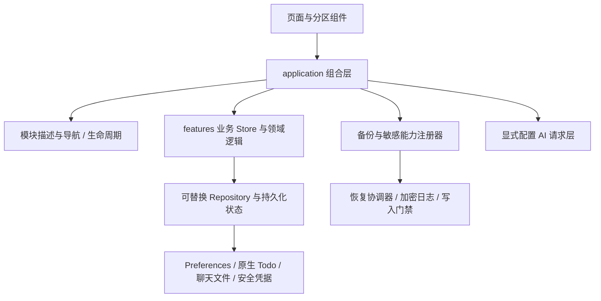

# 架构拓展性计划实施前后对比

日期：2026-10-27（北京时间）。任务：拉取远端最新更新，核对架构计划实施前后的实际差异。本文为源码与验收证据的复核记录，不新增产品功能。

## 范围与执行计划

1. 检查本地工作区，固定实施前基线并获取远端 main。
2. 阅读原始架构检查、六阶段计划、各阶段验收和对应实际源码。
3. 从模块接入、数据保护、备份恢复、敏感模块、仓库、类型与工程验证进行对比。
4. 核对性能比较的真实基线、历史 CI 与当前代码关系，执行适合本次同步的本地检查。
5. 将来源和结论补充到 docs，确认 raw 未被修改，不生成新的正式安装包。

实施前：`ceda70f1e14e288c7b697b0e7123d6deee9cb895`。这是原始架构检查和本次本地同步前共同使用的基线。

远端完成版本：`995a37e41f1835f75025fb3ca24bd9b745a94311`，远端 main 比基线领先 6 个提交，P1–P6 分别独立提交。本地 main 已完成快进同步，交付前再次通过 `git ls-remote` 确认远端指针相同。提交范围共 222 个文件、12,184 行新增、4,668 行删除，包含文档、测试和验收素材。

| 阶段 | 提交 |
| --- | --- |
| P1 | `29fb70a` |
| P2 | `ff4e0bc` |
| P3 | `f073039` |
| P4 | `e92cf62` |
| P5 | `f3ced1c` |
| P6 | `995a37e` |

## 主要结论

原来已经是 Vue 3 + Pinia + Capacitor 的模块化单体，有 features 目录、统一存储适配、安全凭据、Todo 仓库、异步页面和自动检查。本次继续沿用这些基础，新增 application 组合层、模块与能力注册器、统一普通数据失败保护、持久化恢复协议及真实原生验收。

实际收益主要是：新增业务时公共代码改动面缩小；受保护模块的加载、释放和改密通过统一接口编排；存储与完整恢复的失败路径有明确保护；更换驱动和验证接口更容易。新增普通模块、敏感模块和历史备份协议仍各有显式接入工作。

## 六阶段差异

| 阶段 | 实施前 | 完成后 | 对后续扩展的影响 |
| --- | --- | --- | --- |
| P1 普通数据保护 | 日程读取失败后可能写空；体重失败后继续编辑可能覆盖旧记录。各 Store 加载与保存状态分散 | `createStorePersistence` 统一加载、保存、错误、flush 和重试；成功读取后才提交内存；保留最新待写值；页面显示错误与重试 | 新模块可复用失败语义，减少复制 watcher 时遗漏保护。未落盘内存草稿仍有强杀丢失边界 |
| P2 完整恢复 | 恢复编排位于设置 composable，主要依靠进程内旧快照补偿，缺少跨重启恢复日志 | `restoreCoordinator`、认证加密恢复日志和启动写入门禁；提交前中断恢复旧快照，提交后中断保留目标快照；回滚失败保持阻断与恢复材料 | 多模块恢复有可复用协议；新增参与者不用自行重写整套恢复流程。属于应用级补偿与中断恢复 |
| P3 模块接入 | App、菜单、导航白名单、标题、模块设置与生命周期分别维护名单 | `moduleRegistry` 集中页面元数据；导航从 Settings 分离；`moduleLifecycle` 与普通模块组合根管理初始化、订阅、前后台及清理 | 页面接入无需继续增加 App 渲染条件分支；测试验证额外普通模块的导航及 flush |
| P4 敏感能力与备份 | 加载、释放、改密和备份主要固定认识密码库、聊天两种模块 | 备份与敏感能力注册器统一 export/validate/restore/flush 和 load/release/reencrypt；增加第三种合成参与者验证 | 第三种敏感业务有统一接入契约；加载及备份会检查就绪状态，失败写入全部结算后处理回滚 |
| P5 仓库与职责边界 | 普通 Store 直接访问 Preferences；AI 请求层读取全局 Settings；设置通过大 context 传递；部分业务散落通用目录 | 可注入 Repository；共享日期；应用层组合生活上下文；AI 显式配置与应用适配器；设置分区 model；省钱/体重/密码库归入 feature；拆分聊天与首页组件 | 平台驱动替换、隔离测试和局部业务修改更容易；类型与 lint 对部分跨层边界形成门禁 |
| P6 原生与整体验收 | CI 的 Android 侧主要只构建；JS 与 Java 重复规则缺少同一预期夹具 | JS/Java 共用 8 组规则夹具；CI 执行 instrumentation 与真实 WebView Playwright；增加强停恢复、widget 接收器、深链及生命周期实测 | 扩展原生规则和跨端能力时更容易发现分歧；验证由可编译提升到部分真实运行路径 |

## 实际结构变化

图为主要职责关系，省略兼容入口及个别直接调用，不代表所有旧服务都已完成同等程度的解耦。

## 用新增模块举例

新增一个“习惯记录”普通模块时，原来需要同步修改 App 页面条件、菜单、路由、标题、设置范围、启动/后台保存以及备份恢复。现在页面元数据放进 `moduleRegistry`，生命周期在组合根注册，业务实现自身的 Store/Repository；需要备份时再接入备份参与者和格式兼容层。提醒、首页卡片和原生桌面能力仍要按具体业务实现。

新增一个加密笔记模块时，除页面外可以通过敏感能力接口参加认证后加载、后台释放及改密回滚，不必向会话管理器继续增加第三套业务分支。但生产完整备份 v12 仍明确映射现有字段，新增数据类型必须设计文件格式及旧版本兼容规则。

## 验证能力前后

下表来自已提交的基线与 P6 实测记录；不等同于本轮在此 Windows 环境重新执行全部原生检查。

| 指标 | 计划前 | P6 验收 |
| --- | ---: | ---: |
| Node 测试 | 260 | 285 |
| Vitest 组件/集成测试 | 99 | 156 |
| ESLint 错误 / 警告 | 0 / 55 | 0 / 47 |
| 类型检查 | Vue 渐进检查 | 增加 strict 契约检查及负向类型样例 |
| Android 自动化 | CI 主要构建 | 8 项常规 instrumentation 通过；1 项可选 launcher fixture 跳过 |
| 真实 WebView Playwright | 该基线未执行本轮架构验收 | 20 项必需检查通过 |

历史 CI [40453981333](https://github.com/Zhoubin601/ForMyself/actions/runs/40453981333) 的 Web 与 Android 作业状态已经通过 GitHub 实时读取确认，验证源码为 `1fa44d184bb2e5a6c804b35704da5d1e7a3b8d9c`。进一步分别读取候选与当前 main 的完整 Git tree，按文件 blob SHA 逐项比较：`src/` 148 个、`android/` 124 个、`tests/` 65 个、`scripts/` 38 个、`.github/` 1 个文件均相同，根目录工程配置与依赖锁也相同。真实原生验收驱动未改变，差异位于说明文档、验收资料和交付包。该 CI 对应的产品与测试代码与当前 main 一致；本轮没有重跑原生验收。

## 性能口径

性能比较使用 P2 完成后的 `ff4e0bc` 对照最终构建，衡量的是模块拆分前后，不覆盖整个计划从 `ceda70f` 开始的全部成本。相同主机、Chromium 154、新上下文，预热一次后各测三次取中位数，使用合成记录。

| 浏览器路径 | 拆分前 | 完成后 | 变化 |
| --- | ---: | ---: | ---: |
| 启动到锁屏 | 314.700 ms | 313.500 ms | -0.4% |
| 保存 100 条集合 | 6.660 ms | 4.730 ms | -29.0% |
| 保存 10,000 条集合 | 394.600 ms | 317.200 ms | -19.6% |
| 100 条编解码 | 0.335 ms | 0.305 ms | -9.0% |
| 10,000 条编解码 | 33.502 ms | 37.348 ms | +11.5% |

以上不能解释为实体手机启动或 Native 落盘的性能保证。当前样本没有超过预定 20% 回归调查线；早期万条编解码超线样本和调查记录仍保留。完整导入导出、所有真机内存场景的统一前后对照资料未提供。

## 保留的边界与后续判断

1. 注册点已集中，但页面描述、普通/敏感生命周期、备份参与者依然分别注册；完整备份继续显式维护 v12 字段。不能写成只注册一次即任意插件化。
2. 多数普通数据仍是 Preferences JSON 整集合写入，未实施 SQLite/IndexedDB、按实体增量更新、索引或多端冲突协议。Repository 建立了替换入口，迁移方案还需真实量级与查询需求驱动。
3. strict 类型主要作用于新增契约和实际导入的 `@ts-check` 工厂；遗留 JS 整体仍 `checkJs=false`，模块 ID 等部分契约约束仍宽泛。
4. 聊天和首页组件确有拆分，但部分行数下降来自样式外移；不能按行数下降比例推断复杂度改善。
5. AI 依赖已解耦，协议仍以兼容 chat/completions 为主；不同协议适配与真实服务商可用性尚未验证。
6. CI 未加入 `:app:lintDebug`；现有 JVM 模板测试仅为算术样例，领域和存储证据主要来自 instrumentation。
7. 实体手机、生物识别、厂商启动器触控、私人备份及旧设备签名覆盖安装需要用户环境复核；本轮无需这些资料即可完成源码对比。
8. 有未完成恢复日志时，应先用支持日志的版本完成恢复并确认一致，再回退旧代码。

## 来源

- 原始架构检查：`docs/20261026-architecture-extensibility-review-v1.md`。
- 原计划：`docs/20261026-architecture-remediation-plan-v1.md`。
- P1–P6 验收：`docs/20261026-architecture-stage-1-verification-v1.md` 至 `docs/20261026-architecture-stage-6-verification-v1.md`。
- 基线/P6 结果：`docs/qa/architecture-20261026/verification-summary.json`、`p6-verification.json`。
- 性能原始记录：`docs/qa/architecture-20261026/performance/browser-results.json`。
- 当前与基线源码、测试、CI 配置；早期维护重构与 10 月 3 日审查仅用作历史背景。
- 远端来源名称：GitHub / Zhoubin601/ForMyself；链接：`https://github.com/Zhoubin601/ForMyself`；引用日期：2026-10-27。外部访问仅用于用户要求同步的同一仓库及其 CI，未增加第三方研究资料。
- `raw/` 仅核对目录存在情况，不读取私人备份内容；`memory-bank/` 资料未提供。

## 本轮本地同步与检查

- 同步：`git fetch origin refs/heads/main:refs/remotes/origin/main` 后执行 `git merge --ff-only origin/main`，返回 Fast-forward，无合并冲突。获取时一次性禁用凭据助手并使用 HTTP/1.1，没有修改持久 Git 配置。
- 依赖补丁：`npm.cmd run postinstall` 返回 0，通知、生物凭据及 Preferences 持久化补丁均验证成功。
- 本地质量检查：`npm.cmd run check` 返回 0；Node 285/285、Vitest 18 文件/156 项通过，lint 0 错误/47 警告，Vue 与 strict 契约类型、生产构建通过。环境为 Windows、Node 24.14.1、npm 11.11.0；Vite 8.0.16、Vitest 3.2.4、TypeScript 5.9.2、vue-tsc 3.0.6 与锁文件一致。
- 本轮沿用已有 node_modules；新增原生 E2E 依赖 playwright-core 本地尚未安装，没有运行 Android/E2E 或重新测量性能。历史原生与性能结果已单独核对来源，继续以相应验收环境为准。
- 安装包：同步获得 `output/20261027-ForMyself-architecture-p6-debug-v1.apk`，11,070,300 字节，SHA256 与 P6 验收记录一致。本轮没有重新构建 APK，也没有覆盖其他历史包。
- 原始资料：raw 文件数与 SHA256 前后相同；未解析私人备份，未改动 raw。范围内 AGENTS.md 未变化，memory-bank 未新增。
- 本轮新增/修改仅为本对比文档、四份 docs 过程索引及核验摘要；没有新增业务代码变更或执行提交/推送。
- 本轮核验摘要：`docs/qa/architecture-comparison-20261027/verification-v1.json`；本地检查日志：同目录 `local-check-v1.log`（按既有规则忽略，不参与 Git 提交）。

本轮对比无阻塞未完成项。实体手机、真实生物识别、厂商桌面、私人备份和签名覆盖安装保留为用户环境复核项。
