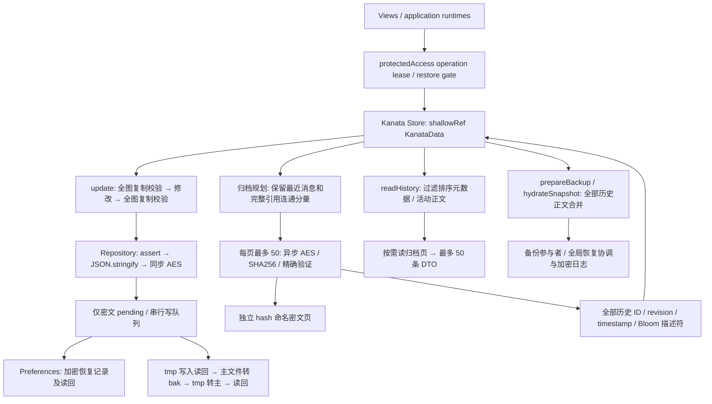

# Kanata SQLite / SQLCipher M0 技术验证报告 v1

日期：2026-11-03（北京时间）。分支：**M**。验证基线及证据生成时 HEAD：`ac74f0b817ac32f65d9f5e506f094b1515477cc6`。后续提交推送授权见 [2026-11-04 交接记录](20261104-kanata-sqlite-m0-handoff-v1.md)，实际提交以 Git 历史为准。

> 后续设备补测：按用户要求，现已安装并启动 Android 14 软件模拟器，两套原生 SQLCipher 4.17.0 测试通过，WebView 桥接受独立可复现崩溃阻塞。见 [模拟器补测记录](20261103-kanata-sqlite-m0-emulator-verification-v1.md)。下文保留首轮主机/构建证据及当时 NOT RUN 状态；新增设备状态以补测记录为准。M0 总结论仍为 BLOCKED，未进入 M1。

**M0 最终结论：BLOCKED。是否进入 M1：NO。**

本轮已交付隔离原型、真实主机加密/故障实验、1k/10k/100k 对照工具与原始证据，以及两套 Capacitor 版本的 Android App Debug/AndroidTest 构建。没有 Android 设备，不能完成插件桥接运行、SQLCipher 4.17.0 设备取证、受保护密钥生命周期与真机性能门禁。原插件 API 还存在已确认的持久 secret 生命周期缺口，不能原样接入生产。BLOCKED 不是候选安全通过，也不是允许先实施 M1。

## 1. 前置检查、范围与证据入口

用户明确授权“拉取最新 M 分支开发”后，执行 fetch 并从远端 M 建立本地 M。切换前工作区干净。仓库原来只配置 main 的 fetch refspec，首次 `--track` 切换失败；随后无覆盖地执行 `git switch --no-track -c M origin/M`，状态恢复为干净 M。本地与远端 HEAD 一致，左右差异 0/0。见 [Git 证据](qa/kanata-sqlite-m0/evidence/git-baseline.json)。

阅读依据：AGENTS、架构说明书、M 迁移计划、P1–P7 连贯计划、package/lock、当前 Kanata Store/Repository/归档与校验器、实际密码/受保护会话/备份/恢复源码。具体文件清单与执行方案在 [QA README](qa/kanata-sqlite-m0/README.md)。历史 P7 成绩只作为门槛来源，没有冒充本次测试。

本轮未改生产 `src/`、`android/`、package/lock；没有 M1 正式 Schema、M2 Repository 重构、Store 访问模式变更、用户数据删除、全局密码体系重写、Kanata 分支修改、合并或发布。新增 `qa_messages` 只是可丢弃性能测试形状，不是领域 Schema。所有数据均合成，未读取私人聊天或备份。

代码与证据：[QA 目录](qa/kanata-sqlite-m0/README.md)、[命令记录](qa/kanata-sqlite-m0/evidence/commands.md)、[正式主机原始结果](qa/kanata-sqlite-m0/evidence/host-final.json)、[性能全部指标](qa/kanata-sqlite-m0/evidence/performance-summary.json)、[安全实验](qa/kanata-sqlite-m0/evidence/sqlcipher-security.json)。

## 2. 当前实际架构

实际读路径：`kanataRepository.read()` 按主文件、bak、tmp 和经指纹约束的恢复记录选择内容，完整解密、JSON.parse、图校验；Store.load 再 `validateKanataData` 复制校验，`archives.inspectAll` 检查页目录/尺寸，有 pending 时成功 flush 后才 ready。错误或未来版本不会变成空数据写回。

实际写路径：Store.update 对完整当前图形成 detached draft，修改前后校验，commit 后持久化，返回时还复制；Repository.write 再 assert、完整 `JSON.stringify`、`encryptPassphraseAes`，然后记录加密恢复材料、tmp/bak 切换和精确读回。因此单条普通新增仍重写**整个当前主头**，并不重加密所有已有归档正文。主头含全部历史消息元数据，规模仍随历史总量增长。

加密源码 `shared/crypto/passphraseAes.js` 保持 OpenSSL `Salted__` / 8-byte salt / EVP-MD5 / AES-256-CBC / PKCS7 / Base64 旧协议。主头同步执行；历史页在有 WebCrypto 时使用异步 AES 内核，但仍兼容同一旧派生/封装。没有将这些旧派生值当 SQLCipher raw key。

归档现状并非“所有十万条正文始终常驻”：历史面板的显式整理调用 `archiveHistory`，按会话保留最近 200，来源引用、回复连通分量可能要求更多保留，超过页上限的组件不会强行归档；恢复导入对 >1000 条/会话自动整理。普通 update 没有每次自动归档。Pinia 持有完整当前 KanataData、活动正文和**全部**历史描述符/消息元数据。`readHistory` 使用有界正文读和 cursor，但每次仍筛选/排序当前图的活动消息与描述符。不能把已有真分页说成没有分页，也不能把它说成主头已常数内存。

备份的 `hydrateSnapshot` 会将各页返回数组合并为完整 messages 并排序，`preparedBackup` 临时持有全量图；恢复与全局日志也存在大对象路径。SQLite 只替换文件层无法解决这些内存成本。

真正应解决：全图复制/严格校验的重复遍历、主头全量序列化/加密/恢复副本读写、历史元数据常驻和排序、备份/恢复重建完整图。SQLite 的索引和局部事务有机会改善这些路径，但必须连同后续访问模型和生命周期改造；它不会自动消除校验、权限、引用审计或备份成本。

## 3. 候选插件、准确版本与 Android 构建

**实际版本差异：** package.json 写 `^8.3.1`，生产 lock 的 core/android/cli 都是 **8.4.1**，filesystem 为 8.1.2。没有把计划文字当安装事实，也没有降级生产锁。隔离 QA 分别固定 8.3.1 和 8.4.1。

核实时间为本报告日期。首选插件 npm 稳定版 **8.1.1**，peer `@capacitor/core >=8.0.0`，MIT。[官方 README](https://github.com/capacitor-community/sqlite/blob/v8.1.1/README.md)、[发布页](https://github.com/capacitor-community/sqlite/releases/tag/v8.1.1)、[Changelog](https://github.com/capacitor-community/sqlite/blob/v8.1.1/CHANGELOG.md)、[npm 元数据](qa/kanata-sqlite-m0/evidence/npm-sqlite-8.1.1.json) 已交叉检查。v8.0.0 明确引入 Capacitor 8 支持，v8.1.1 发布于 2026-08-06，更新 Android SQLCipher 到 4.17.0。tag 对象 `ba342d4c12d0c6c07dc98e2d7a1cfe7c17047ce8`，解引用提交 `3f3f71606c8f292a3d6d841937bcfc5b5c45aeb5`。

实际 Android 依赖为 `net.zetetic:sqlcipher-android:4.17.0@aar`、androidx.sqlite 2.4.0、room 2.6.1、security-crypto 1.1.0-alpha06、biometric 1.1.0；Java 21、AGP 8.13.0、compile/target 36、min 24，与项目构建基线相符。AAR 包含 arm64-v8a、armeabi-v7a、x86、x86_64。SQLCipher AAR 约 4.01 MB（压缩）；隔离 Debug APK 约 13.17 MB，**不是对生产 APK 增量的测量**。原始尺寸/哈希及依赖清单见 evidence。

| QA 组合 | 安装 / cap sync | App Debug | App AndroidTest 包 | 设备运行 |
|---|---|---|---|---|
| Capacitor 8.3.1 + sqlite 8.1.1 | PASS | PASS | PASS | BLOCKED |
| Capacitor 8.4.1 + sqlite 8.1.1 | PASS | PASS | PASS | BLOCKED |

构建证据：[8.3.1](qa/kanata-sqlite-m0/evidence/android-8.3.1-result.json)、[8.4.1](qa/kanata-sqlite-m0/evidence/android-8.4.1-result.json)。两者为独立包名 `com.formyself.qa.m0`，关闭系统备份/设备迁移，未向生产注册插件。未安装或发布 APK。

真实修正：根 lock 的 npmmirror tarball 被环境拒绝；仅在 work 副本换为官方 npm 域名，保留原版本/integrity 并运行全部 postinstall。Java 首次未用 proxy，随后发现只有 JRE；补齐 JDK 21 和 CA 后继续。原生测试缺显式 androidx.sqlite 编译依赖，先试 2.6.2 与插件实际 2.4.0 冲突，改为与插件一致的 2.4.0。未限定根级 `assembleAndroidTest` 还构建无关生成 Cordova 库测试并出现 Kotlin duplicate classes；最终使用目标 App 的 `:app:assembleDebug :app:assembleDebugAndroidTest`，两套成功。失败记录保留，未删除测试或放宽产品门槛。

SQLCipher POM 推荐的 androidx.sqlite 为 2.6.2，但插件以 `@aar` 加载并显式固定 2.4.0。编译成功尚不能排除运行时差异；需设备验证，不擅自改生产依赖。

许可证：插件 MIT；所取 SQLCipher Community 源码为 BSD 3-clause 风格，保留版权/许可/免责声明。已保存 [插件许可](qa/kanata-sqlite-m0/evidence/capacitor-community-sqlite-LICENSE)、[SQLCipher 许可](qa/kanata-sqlite-m0/evidence/SQLCipher-LICENSE.md) 和 Maven POM。正式发布还需聚合 AndroidX/其他传递依赖及二进制 notices，核对 SQLCipher 官方出口声明；本轮不是发行合规放行。

## 4. SQLCipher 真加密与故障验证

主机使用 QA-only `sqlcipher3-binary==0.6.0`，实读 `PRAGMA cipher_version` 为 **4.12.0 community**，SQLite 3.51.1。它是真实 SQLCipher，不是 Node 普通 SQLite，也不是“把数据库再 AES 包一层”。其版本不同于 Android，不能互相替代验收。

`verify-sqlcipher.py` 五轮均验证：随机 256-bit raw key 创建数据库；正确密钥读取；错误密钥在实际读 schema 时拒绝；Python 标准 sqlite3 不能读取；DB/WAL/SHM 不含测试正文标记或测试密钥字节/hex；批量插入提交、显式事务回滚、另一连接写锁冲突；五次关闭重开；子进程已提交写 + 未提交写后真实 SIGKILL，重开保留前者并回滚后者；CRUD、WAL、`integrity_check=ok`、`cipher_integrity_check` 无错误。

这些都是主机结果。Android QA 页验证代码覆盖插件 create/open/close、CRUD、批写、事务提交/回滚、重复开关和完整性；原生测试覆盖 4.17.0 正确/错误密钥和普通 SQLite 拒读。**Android 测试代码已编译，但无设备，均 NOT RUN。** Android 强停、并发、完整性、secret 日志/偏好扫描、Keystore 失效及跨设备恢复仍 BLOCKED。

主机输出只记录受控状态、指标、指纹，不输出密码或密钥；正式 runner 在内存比对捕获 stdout/stderr 是否含随机 secret。密钥不放 argv/env/普通 Preferences。此证据不能证明 Android 插件或整个系统日志没有泄漏。

## 5. 密钥架构与原插件限制

源码证明：`CapacitorSQLite.setSharedPreferences()` 创建 `EncryptedSharedPreferences`，key 用 AES256-SIV、value 用 AES256-GCM；`UtilsSecret.putString("secret", passphrase)` 操作的是这个加密实例。它不是普通明文 Preferences。`Database.open()` 从该持久 secret 取口令。`createConnection/open` 没有按连接注入纯会话密钥的标准参数；`clearEncryptionSecret` 删持久记录，不等于证明内存内所有 key/String/缓存均已清零。该 secret 不是仅在当前 ForMyself 主密码会话内可用。

原样接入无法满足当前要求：随机 DEK 在主密码 KEK 解封后只活在受保护会话；进程重启不得绕过主密码恢复 DEK；锁屏/释放后关闭连接并释放可清除材料。反复 set/clear 加密偏好并不是可接受的生产绕过：存在崩溃窗口，且 setEncryptionSecret 会遍历数据库、在保存 secret 后可能失败。本轮 QA 修正了这条部分成功路径的清理，但未将它当生产方案。

建议方案（仅设计与 QA 算法，不接入全局 auth）：

1. 每库 CSPRNG 生成 32-byte DEK。包装记录 version、purpose、KDF/参数、16-byte salt、12-byte nonce、AES-GCM ciphertext/tag，AAD 认证元数据，绑定用途与库身份；生产还需明确 dbId/generation 防串库和防回退规则。
2. 独立 KEK：本轮 QA 选择 PBKDF2-HMAC-SHA256、600000 次、256-bit 输出，salt 加 `ForMyself/Kanata/KEK/v1` 域分离前缀；不复用现有 verifier、salt 或 EVP-MD5。密码保持现有 UTF-8 原文语义，不擅自 trim/normalize 或修改最短长度。参数是待真机校准的候选，**未冻结为生产配置**。Argon2id 需原生库/内存预算/跨平台验证，本轮未安装，不能声称已比较出优胜。
3. Keystore 只辅助保护设备内 envelope 或解锁缓存；不能作为便携备份唯一来源。跨设备凭主密码、公开 KDF 元数据和认证密文解封；不得导出设备 Keystore 私钥。
4. 优先在受控原生桥中解封并持有 DEK，JS 仅拿会话句柄；所有操作验证 protected session/operation lease、restore gate、generation，释放等待已授权写结算后关闭并清空原生 byte[]。JS/Java String 与 GC 的物理清零不能承诺；禁用敏感 bridge/debug 日志并实机取证。
5. 普通改密优先重新包装同一个 DEK，避免全库重写；如要求撤销曾泄漏的旧密钥/旧 envelope，则需要真实 DEK 轮换、SQLCipher rekey 或复制到新库，不能把 rewrap 当旧数据密钥撤销。既存外部旧备份仍可能受旧密码保护，需明确产品语义。

`key-envelope.test.mjs` 用随机密码/DEK 五轮验证正确解封、错误密码、salt/ciphertext/AAD 篡改、未知版本拒绝、重新包装保留 DEK，以及新候选准备不破坏旧封装。独立主机 wrap P50/P95 为 **91.361ms / 106.729ms**（5 次），见测试记录。**没有实现持久改密 journal、全局提交/回滚或跨设备 App 恢复；不能将这个算法测试称为全局改密通过。**

替代评估（未改路线）：

| 路线 | 已核实依据 | 取舍与本轮结论 |
|---|---|---|
| community sqlite 8.1.1 受控扩展 | Android 构建可用；密钥 API/加密偏好源码已读 | 需要会话密钥入口和清理/恢复实测；不得直接手改 node_modules，需可复现补丁或受维护分支。未实现。 |
| `@capgo/capacitor-fast-sql@8.2.16` | npm peer >=8、MPL-2.0；原生 connect 接 encryptionKey；SQLCipher 为 compileOnly 4.20.0 | 可避免标准 API 强制存 secret，但需显式提供 SQLCipher；含本地 HTTP SQL 服务与 token，扩大审查面。未构建/性能/设备验证，不能宣布替代成功。 |
| Capawesome SQLite | [官方文档](https://capawesome.io/docs/sdks/capacitor/sqlite/) 提供 open encryptionKey；0.5.x 支持 Capacitor 8，Insiders 私有分发 | 公共 npm 404 不能推断不存在；本环境无其许可/私有包，安装和源码核验 BLOCKED。 |
| 自建最小 Capacitor Native Plugin | 当前 JDK/AGP 与官方 SQLCipher AAR 构建已证实可用；[官方 raw key API](https://www.zetetic.net/blog/2019/06/07/technical-guidance-using-random-values-as-sqlcipher-keys/) 支持 32-byte 随机 key | 仅实现 session open/close、绑定查询、串行写/批事务、bounded cursor、integrity/WAL/生命周期。避免 HTTP 服务/全局 secret，但需要自行维护 JNI/ABI、日志、失败恢复和安全测试；风险主要在正确性验收，不能按少量桥代码估算全部成本。M0 尚未实施。 |

结论：SQLite/SQLCipher 路线值得继续验证；community 插件原 API **不具备直接生产采纳条件**。先在 M0 决定并验证安全 Driver/密钥入口，再谈 M1。

## 6. 性能方法、可比范围与局限

数据生成器 `m0-synthetic-v1-seed-20261103`：2 世界、8 个有消息会话（每世界 4 个私聊）、user/assistant 各半、相邻回复对、重复时间戳、64/128/256/1024 UTF-16 长度循环，中文/英文/emoji/组合字符混合。生成器及完整数据指纹/每会话 payload hash 在正式结果中。两侧使用相同消息；查询全历史验证每条 payload 与排序、总数、world/conversation 范围，未用真实数据。

JSON 侧运行当前生产 Store、Repository、AES、归档与校验器，注入真实临时 fs（fsync）和密文 journal 文件；SQLite 侧为 Node 经 stdin RPC 调用 Python SQLCipher，256 条事务批量导入、WAL/FULL、2 MiB 页缓存、auto-checkpoint 1000。它不是 Capacitor 桥，JSON journal 也不是 Android Preferences。SQLCipher 测试表保存完整 Message JSON，提取 ID/scope/time 索引，**没有生产全图校验/审计/跨表事务**。数字衡量“现有仓库 vs 有界数据库原型”方案成本，不是仅存储引擎的公平单变量测量，也不是完成 M2 后的产品预测。

SQLCipher 主机用随机 raw key；原插件用持久 UTF-8 口令，可能包含额外 SQLCipher KDF 打开成本。不能直接拿主机打开延迟预测插件。批写均从相同生成器生成数据，JSON 全图持有、SQL 分批生成是被评估访问模型的一部分；生成数据不在最近查询的独立 JS 进程中加载。

正式轮在 Gradle 和 npm check 结束后独立运行，每个规模、每个方案、每个场景 **5 次**，交替引擎顺序；保留有资源竞争的探索轮但不用于结论。冷启动是新 Node/Python 进程，包含打开/初始化，未丢弃 OS 文件缓存；热启动是同进程关闭重开。没有真机冷启动/冷盘/热状态定义证据。

记录 P50/P95（nearest-rank，5 样本 P95 为最大值）、CPU、RSS、JS heap/external/GC、DB/WAL 和关闭后的磁盘总量。RSS 是 10ms 外部采样与每进程 rusage 生命周期高水位；高水位相加为保守上界，不能当精确同时峰值。JS 只记录端点和 GC 可观察高水位，不是精确瞬时峰值；它的 Android 精确测量仍 BLOCKED。未强制 GC、降低 FULL 或取消加密。

以下均为 Linux 主机观察，非 Android / Capacitor 性能验收。单位 ms；P95 使用 nearest-rank，n=5 时即最大值。

| 消息数 | 操作 | JSON/归档 P50 / P95 | SQLCipher P50 / P95 |
|---:|---|---:|---:|
| 1000 | bulk_write | 157.656 / 170.744 | 38.916 / 39.470 |
| 1000 | single_write | 129.109 / 134.774 | 1.976 / 2.045 |
| 1000 | recent_50 | 1.053 / 1.092 | 1.654 / 2.125 |
| 1000 | history_page_50 | 0.349 / 0.430 | 1.434 / 2.296 |
| 1000 | locate_id | 1.408 / 1.707 | 1.461 / 1.600 |
| 1000 | single_update | 110.444 / 126.416 | 0.840 / 0.862 |
| 1000 | single_delete | 111.380 / 129.670 | 0.872 / 1.101 |
| 1000 | conversation_count | 1.593 / 1.626 | 0.274 / 0.476 |
| 1000 | cold_open | 98.088 / 106.222 | 18.280 / 27.504 |
| 1000 | hot_open | 74.645 / 83.347 | 0.545 / 0.614 |
| 1000 | close | 0.129 / 0.138 | 1.025 / 1.279 |
| 1000 | batch_read_all | 10.165 / 10.850 | 31.014 / 38.499 |
| 10000 | bulk_write | 1172.031 / 1460.585 | 428.026 / 545.112 |
| 10000 | single_write | 294.107 / 412.720 | 2.520 / 3.553 |
| 10000 | recent_50 | 1.324 / 1.841 | 1.849 / 3.257 |
| 10000 | history_page_50 | 0.610 / 1.511 | 2.045 / 2.170 |
| 10000 | locate_id | 10.510 / 13.156 | 1.456 / 4.862 |
| 10000 | single_update | 293.997 / 356.523 | 0.966 / 2.063 |
| 10000 | single_delete | 296.132 / 341.923 | 1.079 / 1.218 |
| 10000 | conversation_count | 1.504 / 2.446 | 0.826 / 0.938 |
| 10000 | cold_open | 220.316 / 314.800 | 20.983 / 27.384 |
| 10000 | hot_open | 203.658 / 253.917 | 0.681 / 0.766 |
| 10000 | close | 0.170 / 0.199 | 2.035 / 2.214 |
| 10000 | batch_read_all | 833.185 / 915.583 | 316.351 / 355.294 |
| 100000 | bulk_write | 10915.135 / 12014.963 | 4016.663 / 4172.056 |
| 100000 | single_write | 1561.609 / 1793.556 | 2.268 / 3.745 |
| 100000 | recent_50 | 2.703 / 4.132 | 1.954 / 2.374 |
| 100000 | history_page_50 | 1.626 / 1.881 | 1.493 / 1.926 |
| 100000 | locate_id | 16.249 / 18.511 | 1.491 / 2.206 |
| 100000 | single_update | 1598.913 / 1756.019 | 1.019 / 1.096 |
| 100000 | single_delete | 1518.934 / 1700.495 | 1.115 / 2.250 |
| 100000 | conversation_count | 4.392 / 7.665 | 5.070 / 5.589 |
| 100000 | cold_open | 1090.345 / 1390.480 | 21.590 / 24.063 |
| 100000 | hot_open | 979.232 / 1033.267 | 0.701 / 1.061 |
| 100000 | close | 0.156 / 0.220 | 1.670 / 2.520 |
| 100000 | batch_read_all | 9159.548 / 10110.239 | 3129.544 / 3528.003 |

| 消息数 | 方案 | 导入 RSS 上界 MiB | 查询进程 RSS 上界 MiB | 最近50后 JS heap 最大 MiB | 导入/查询 GC观察 heap 最大 MiB | 关闭后磁盘最大 MiB | DB / WAL 最大 MiB |
|---:|---|---:|---:|---:|---:|---:|---:|
| 1000 | json-archive | 106.10 | 166.98 | 21.59 | 78.84 | 2.33 | N/A（密文文件） |
| 1000 | sqlcipher | 80.88 | 76.41 | 13.18 | 14.46 | 1.08 | 1.08 / 1.28 |
| 10000 | json-archive | 271.32 | 309.23 | 44.17 | 142.62 | 15.18 | N/A（密文文件） |
| 10000 | sqlcipher | 84.15 | 84.81 | 13.16 | 16.12 | 11.20 | 11.20 / 4.32 |
| 100000 | json-archive | 867.34 | 695.93 | 142.30 | 634.09 | 138.29 | N/A（密文文件） |
| 100000 | sqlcipher | 97.16 | 88.40 | 13.21 | 18.31 | 112.21 | 112.21 / 4.40 |

原始每次操作的 CPU、内存、I/O 和 DB/WAL 全部保留于 [JSON](qa/kanata-sqlite-m0/evidence/host-final.json) 与 [汇总 CSV](qa/kanata-sqlite-m0/evidence/performance-summary.csv)。记录了云主机 CPU、内核、架构、Node/Python、cgroup 内存限制和 overlay 文件系统。物理存储介质/电源/温度未知，不伪装成手机参数。

### 100k 的有界读取证据

SQLite 查询进程只构造基础世界资料和单次 <=50 条响应，未调用全表 fetchall 或预加载 fixture；完整历史按 50 条迭代并即时 hash。最近与深历史均使用 `(created_at,id) < (?,?)`，索引前缀 world/conversation，EXPLAIN 与 VM 指令数保留；不含 OFFSET。`proof` 对近/深页分别断言 50 条且 VM <3000，防止“返回 50 但先扫描全表”的伪分页。全部会话遍历无丢失/重复，时间戳并列稳定，跨世界 ID 查询拒绝。正式轮 100k 近页、深页均为 **535 VM 指令 / 50 条**，三档都命中 `qa_scope_time` 范围索引。1k 近/深为 529/535，10k 为 529/529；没有随总数线性增长。

JSON 100k 原型导入后活动正文 1600 条，归档元数据 98400 条，1968 页：最近查询不需要加载全部正文，但仍在 JS 读入并持有这 98400 条元数据。不能宣称原 JSON 查询每次都会读十万正文。SQLite 主机原型证明了有界结果与索引访问的可行性；Android native → WebView 的实际分配/分页和未来 Pinia 改造仍未验证。

### 性能判断与拟议门槛

不要以“数据库一定快”下结论：小数据最近查询可能是原内存数据更快；全量遍历数据库的 RPC/逐页解析也可能更慢。局部写入避免全主头序列化和密文副本，预期更值得迁移。实际比例以本报告正式数字为准；没有 Android 提升倍数结论。正式主机 100k：单条写入 P50 为 JSON/归档 **1561.609ms**、SQLCipher 原型 **2.268ms**；最近50为 **2.703ms / 1.954ms**，不是与写入相同量级的收益。1k 最近50则为 **1.053ms / 1.654ms**，数据库原型更慢；1k 全遍历也是 JSON 更快。上述差异含完整 Store 校验与最小原型语义差异，不能换算成生产插件的提升倍数。

拟议补测配置冻结为 QA 基线：插件 8.1.1、Android SQLCipher 4.17.0，Capacitor 8.3.1/8.4.1 两组；WAL + FULL；查询 50、导入批量 256、2 MiB cache、1000 页自动 checkpoint。最终是否适用目标手机尚 BLOCKED。暂定真机 100k 目标：最近/历史页 P95 <=50ms、单条写/更 P95 <=100ms、打开及初始化 P95 <=1000ms，并要求局部写 P95 明显优于同机 JSON；这些是拟议新增目标，不是已通过或经设备冻结的门槛。

**P7 原门槛完整保留：Android 512 MiB、Android 完整改密 120 秒、Web 768 MiB，及全部需求/权限/备份恢复验收。** 本轮没有真机、Web 全链路容量或完整改密结果，不能依据主机内存推算 P7 PASS。

## 7. 备份、恢复、主密码兼容建议（不实施 M6）

实际参与者接入点是 `fullBackupRuntime` 对 `backupParticipants` 的 chat 适配，包含 ready/initialize/validate/prepareExport/export/restore/flush/singleExport/import；普通 backupParticipants 的 legacy chat 描述不是 Kanata 运行时接口。现有同步 export 返回完整 DTO，SQLite 直接在 export 中查全库仍会复现问题。后续需明确分块/迭代导出能力及类型、设置页认证/解析适配，不能仅换 Store 方法内部实现。

`restoreCoordinator` 是全局跨模块日志与写门禁的事务协调者：prepare 认证/flush/捕获 previous，持久加密 previous+target，经摘要绑定后 apply，失败回滚，commit marker 后清日志并同步提醒。它不是 SQLite 内部事务替代品。SQLite 暂存库导入成功不代表其他模块恢复完成；切换失败仍须保留全局阻断。

| 问题 | 具体建议 / 风险 |
|---|---|
| 活跃 WAL 一致性 | 不直接复制单个 .db。首选同一读事务快照下、原生有界游标逻辑导出；长读事务会使 WAL 增长，应设置预算/取消。若采用停写 checkpoint，必须拿全局受保护操作租约和写屏障，检查 busy、flush/checkpoint 成功并关闭全部连接，再校验导出。 |
| 数据库物理副本 | SQLCipher 可研究 `sqlcipher_export` 到另一加密库；版本/参数/user_version/业务摘要须验证。普通 SQLite backup API 不能未经 SQLCipher 对应版本验证直接假定可用。物理库副本只作受控内部快照，不是默认跨平台备份协议。 |
| 跨设备加密备份 | 版本化便携逻辑分块：manifest 含格式/schema、world/表计数、数据指纹、块顺序/哈希、KDF、备份 salt；独立随机 backup DEK，由密码 KEK 包装。各块 AES-GCM 唯一 nonce、AAD 绑定备份 ID/块序/表/版本；manifest 也认证，防重排/漏块。不得含明文密码/DEK，也不依赖原设备 Keystore。 |
| 恢复 | 认证校验 manifest 后，在临时加密库按批导入、验证全部计数/hash/完整性/引用；coordinator 持久记录旧/新库 generation 和其他模块恢复状态，再统一切换。中断保留旧库及日志；按 commit 选择重试或补偿，禁止空库兜底。 |
| 改密 | 继续 protectedModules.reencrypt 协调全部敏感模块，不能只更新 Kanata envelope 后提交 auth。普通变更先双槽准备新 envelope、读回校验，再与全局 verifier/其他模块提交协调，成功后逻辑退休旧 envelope/journal。真实 DEK 轮换另行设计 rekey/新库复制。 |
| 改密中断 | 当前 `changeMasterPasswordTransaction` 是内存 completed 列表 + 逆序补偿，不能声称已有完整持久全局改密日志。后续必须加经认证阶段记录、verifier 指纹/库 generation、重启决策、故障注入；回滚失败保留 recoveryRequired 与 suspendPersistence。此处仅指出扩展需求，没有重写它。 |
| 旧备份 | 当前新 Kanata 全备已是 v13、单项 Kanata v1；v1–v12 旧全备由 prepareKanataFullRestore 识别并 discard legacy chat、恢复非 chat，原 Kanata 在 preserve 模式保留。旧 chat 不迁入。未来新块格式必须沿用该矩阵和设置页认证映射，不能因 SQLite 再开放旧 chat 导入或丢非 chat 模块。 |

旧封装/旧物理备份如仍能解出相同 DEK，单纯重新包装不保证旧密码在离线副本失效；应用拒绝旧密码、逻辑退休、真实密钥撤销和闪存物理擦除是不同保证，M6 需明确并验证。M0 未实现这些系统。

## 8. 两轮自查及修正记录

两轮由同一执行者独立按不同清单复核；未调用额外 Agent，不声称外部安全审计。

**第一轮：技术、安全、异常。** 对照真实 API/加密源及失败证据检查，发现并修正：合成 assistant 错用了 participantIds[0]（实际是用户）、1k 分布不是每会话精确 125、新增消息的 SQL update/delete 使用了错误会话；全部改为真实 sender/计数/scope，冒烟及正式全量重跑。补充错误密码/普通 SQLite/强杀未提交回滚、并发 busy、输出 secret 内存扫描、envelope AAD/版本负例及域分离。密钥断言改用 timingSafeEqual 的布尔结果，避免失败时断言框架打印实际 DEK，并重跑通过。识别原插件 secret 持久路径、setSecret 部分成功，以及 QA 模板 allowBackup=true；修正隔离 App 备份排除、失败清理和自建合成库退休，保留 Android 运行 NOT RUN。修正 AndroidTest 编译依赖并真实重建两版本 App/Test。生产 Store/密码/备份 diff 为空。

**第二轮：需求、性能、证据。** 核对全部 3 规模 × 2 方案 × 12 场景 × 5 样本（含额外删除）、原始 payload hash、数据集指纹、CPU/RSS/heap/DB/WAL、冷热定义；补近/深 cursor 的 VM 指令与 EXPLAIN、世界错配拒绝。发现 /proc task/children 在此环境不可用导致早期 RSS 采样为 0，改为已知 Node/Python pid 单独采样；避免在有 children 的机器重复相加。发现探索轮与 Gradle/check 竞争，保留旧成绩但作废为验收依据，在所有构建/总检查结束后单独重跑正式轮。保留 JS 峰值观察限制，拒绝把端点当精确峰值。P7 原门槛逐项仍有效，无真机/原生运行/完整改密的项目均不标通过。

复测结果：根 `npm run check` 成功（590 项 Node 测试、42 文件/392 项组件测试、lint/typecheck/build），QA 主机加密与 envelope、正式性能及 Android App/Test 构建分别记录证据。原有测试成功仅表示基线回归，不代表新增原生安全能力通过。

## 9. 未解决项与 M0 验收矩阵

| 必要条件 | 状态 | 尚缺证据 |
|---|---|---|
| 当前源码调查、边界保护 | PASS | 原生产代码/依赖未改 |
| npm/peer/release/Android 源/许可证核对 | PASS（调查） | 正式发行传递 notices 仍待收口 |
| 两版本 Android Debug/QA 编译 | PASS（构建） | 原应用完整集成未实施；桥接稳定性不能由编译得出 |
| 插件设备 CRUD/事务/开关/并发/强停/WAL | BLOCKED | 无设备，Android 测试包未执行 |
| SQLCipher 真加密、正确/错误密钥/普通 SQLite | PASS（主机）/ BLOCKED（Android） | 4.17.0 目标构建的真实 DB/设备取证 |
| 主密码/DB key 不落普通偏好与日志 | 主机输出检查 PASS / Android BLOCKED | Android logcat/Preferences、Keystore 生命周期扫描 |
| 安全会话密钥与可移植 envelope | 原 API 有缺口 / BLOCKED | 确定受控接口/替代路线、Android KDF 与会话释放/重启/恢复验证 |
| 1k/10k/100k 五次对照 | PASS（主机）/ BLOCKED（真机） | 同目标手机、电源温度/介质/构建、Android P50/P95/RSS/CPU/JS峰值 |
| 100k 有界最近/游标查询 | PASS（主机原型）/ BLOCKED（Android产品） | native-WebView 传输/分配实测；生产访问模式未改 |
| 备份、改密兼容 | 分析完成 | 全局持久改密中断、分块恢复在后续设计/实现，M0 不声称系统已通过 |
| P7 全部门槛 | 保留、未放行 | Android 512 MiB / 120秒；Web 768 MiB 与完整需求场景 |

没有真机，也没有可运行 Android 模拟器；报告未提供或暗示任何模拟器/真机成绩。缺的不只是手机：原插件密钥接口、KDF 校准、原生生命周期、准确 JS 峰值与全局故障恢复也未闭合。M0 依赖/参数只冻结为可复现实验候选，未满足生产选型冻结门禁。

## 10. 最后七个问题

1. **SQLite 是否值得迁移？** 值得继续验证，尤其局部写与避免全主头处理；不能在未通过设备/安全门禁时决定正式迁移。
2. **当前插件是否适合？** 版本与构建可用；原样接入不适合当前严格的会话密钥要求。需要先在 M0 验证受控扩展或替代 Driver。
3. **SQLCipher 是否满足安全要求？** 主机证明真加密和核心故障语义；Android 4.17.0 及整个密钥生命周期仍 BLOCKED，不能完整回答已满足。
4. **相比 JSON 有无实测提升？** 有主机局部写等对照数字，也有不占优项目；不是 Android 实测提升，也不代表同等生产语义已实现。
5. **能否解决全量消息加载？** 有界索引查询的主机原型可行；必须完成之后批准的 Repository/Pinia/备份访问模型改造，单换底层无效。本轮没有改生产 Store。
6. **是否建议进入 M1？** **不建议，NO。** 先补齐 M0 的设备与密钥方案门禁，并等待用户检查本报告确认。
7. **BLOCKED 项？** 真实目标手机、Android 运行及 4.17.0 加密/日志/偏好取证、会话密钥 API、Keystore/重启生命周期、Android KDF、同机性能与精确内存、完整改密中断/恢复保证。保留原 P7 Android/Web 全部门槛。
