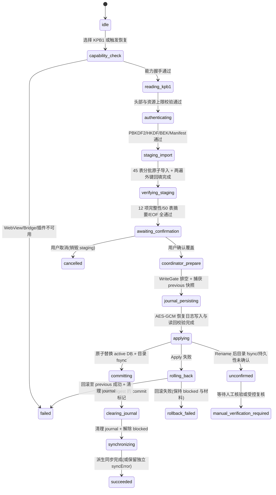

# Kanata SQLite M6-03 隔离恢复引擎与 RestoreCoordinator 深度集成任务书 v1

- **任务编号**：`KANATA-M6-03-RESTORE-COORDINATOR-2026-11-26`
- **日期**：2026-11-26（北京时间）
- **仓库**：`Zhoubin601/ForMyself`
- **执行分支**：`m6/encrypted-backup-recovery`
- **工作树路径**：`.worktrees/kanata-m5`
- **任务基线 SHA**：`b32ebb2366422bdb1a653f7bee45b56956b1722d`（与 `origin/m6/encrypted-backup-recovery` 一致）
- **前置阶段**：M0–M5、M6-00、M6-01、M6-02（含 FIX-02/03/04 稳定锁生命周期整改）已获签核 PASS。
- **阶段状态**：`IN_PROGRESS`（本文件为 M6-03 设计与实施任务书；交付后交由 GPT-6.2 独立终审，不自行标记 `CLOSED`）。

---

## 1. 第一轮源码审计结论

在基线 `b32ebb2366422bdb1a653f7bee45b56956b1722d` 核对全部实际接口后确认：

1. **现有恢复协调体系**：
   - `src/application/restoreCoordinator.js`：`createRestoreCoordinator({ journal, state, prepare, capture, apply, validate, validateRecovery, synchronize, journalRollback })` 暴露 `probe()`、`restore(input, password)`、`recover(password)`、`retrySynchronization()`。
   - `src/platform/storage/restoreJournal.js`：采用 `formyself/restore-v1.enc` / `restore-v1.commit` / `restore-v1.tmp` 与 PBKDF2-HMAC-SHA256 (210000) + AES-256-GCM 认证封装，提供 `inspect()`、`prepare(record, password)`、`commit()`、`clear()`。
   - `src/platform/storage/restoreState.js`：`restoreState` 为 Vue reactive 对象 `{ blocked, busy, message, syncError }`，由 `assertOrdinaryWriteAllowed()` 作为普通业务写门禁。
   - `src/application/fullBackupRuntime.js` 与 `src/application/kanataBackupRuntime.js`：负责 v1–v12 兼容（`legacyChat: 'discard'`）与 v13 Kanata 产品组合完整备份/恢复。
2. **现有便携备份与 Native 能力**：
   - `src/features/chat/backup/portable/`（M6-01）：纯协议层 KPB1 字节合同、53 表静态目录、`kanata-logical-v1` 流式编解码器与 `decodePortableContainer()`；`C01-05` 门禁明确约束 `src/main.js`、`fullBackupRuntime.js`、`kanataBackupRuntime.js`、`kanataBackup.js`、`useBackupSettings.js` 不得直接导入 `backup/portable` 或引用测试 profile `0xff01` / `KPB1/` 域常量。
   - `docs/qa/kanata-sqlite-m6/syntheticDebug/java/com/yubin/formyself/`（M6-02）：`KanataM6SchemeCImporter.java` 已具备 KPB1 流式解码、50 表校验、目标提交稳定锁（FIX-04，释放不 unlink）及 `UNCONFIRMED` 恢复报告；但在 M6-02 中所有表插入在同一事务内且 deferred refs 暂存 Java `ArrayList`，且未拆分为“分批原子 staging 引擎”与“RestoreCoordinator 接管切换”两阶段。
   - `android/app/src/main/java/com/yubin/formyself/KanataSqlitePlugin.java` 与 `MainActivity.java`：普通 APK 保持 `BuildConfig.KANATA_M2_SYNTHETIC = false`，`kanataCanonicalStorage = 'legacy'`。
3. **现有设置页与投影边界**：
   - `src/application/settingsModels.js`：`SETTINGS_SECTION_FIELDS.SettingsBackup` 精确投影字段；`src/components/settings/SettingsBackup.vue` 与 `src/composables/settings/useBackupSettings.js` 维护现有 `.json` 备份与恢复入口。
   - `android/variables.gradle` 已冻结 `androidxWebkitVersion = '1.14.0'`，但 `:app` 未直接声明 `androidx.webkit:webkit`，尚无 Native WebView / Bridge 握手探测插件。

---

## 2. 完整恢复状态机

---

## 3. 接口演进计划

1. **恢复日志与协调器安全增强（向后兼容 v1–v12/v13）**：
   - `src/platform/storage/restoreJournal.js`：`commit(expectedDigest?)` 支持校验 `record.digest === expectedDigest`（不传参数保持原有行为兼容），防止替换日志后提交错配（闭环 M6-00 H-04）。
   - `src/application/restoreCoordinator.js`：`createRestoreCoordinator` 新增可选钩子 `assertSession?: () => void`、`onPhase?: (phase: RestorePhase) => void`、`expectedCommitDigest?: boolean`；在每个 `await` 后重检 `assertSession()`（校验 owner、sessionRevision、恢复世代），并在提交时向 `journal.commit(digest)` 传入已验证的 `digest`。
   - `src/application/contracts.d.ts` 与 `tests/types/contracts.ts`：同步补充 M6-03 便携恢复协调器、世代描述符、运行时能力探测、UNCONFIRMED 人工核验状态与负向类型样例。
2. **工作包 A（KPB1 恢复解码器）**：
   - `src/features/chat/backup/portable/restoreDecoder.js`：复用 M6-01 `decodePortableContainer`，封装带进度、阶段回调、严格错误码和有界流式读取的 KPB1 恢复解码器。
   - Native：`KanataM6StagingRestoreEngine.java` 支持从 SAF `Uri` 或隔离本地文件以有界 64 KiB 流式读取并验证全部 13 类正负场景。
3. **工作包 B（SQLCipher 临时库分批恢复引擎）**：
   - Native：`docs/qa/kanata-sqlite-m6/syntheticDebug/java/com/yubin/formyself/KanataM6StagingRestoreEngine.java`
     - 独立 `.stage-restore-<taskId>-<nonce>.db` 临时 SQLCipher 库（SQLCipher Android 4.17.0 + M6-00 `KanataKeyEnvelope` 独立 DEK）。
     - 固定可信 Schema 005 目录（拒绝包内 DDL/SQL）。
     - 按表目录分批原子事务写入（默认 `batchSize = 500`，单批失败完整回滚）；`messages.reply_to_*`、`background_tasks.window_task_id`、`world_events.replaces_event_id` 存入 staging 临时表按批回填，保证 100k 消息下 Java Heap O(batchSize)。
     - 12 项全量校验：53 表结构、`application_id = 0x4b4e5441`、`user_version = 5`、Schema 005 指纹、3 运行表为空、`integrity_check = ok`、`cipher_integrity_check` 空、`foreign_key_check` 空、005 三张 ordinal 连续完整、`pause-sending-v1` 投影、`dataset_metadata` 身份、50 项表摘要逐表精确核对。
     - 产出不可变 `PreparedStagingArtifact` 与单批耗时/峰值 RSS/Java Heap/Native Heap/WebView RSS/数据库大小/每批最大驻留记录数指标。
4. **工作包 C & D（RestoreCoordinator 深度集成、崩溃恢复与 UNCONFIRMED 治理）**：
   - `src/application/kanataPortableRestoreCoordinator.js`：将 `KanataSqliteGenerationDescriptor` 接入真实 `createRestoreCoordinator` + `createRestoreJournal`（AES-256-GCM），实现：
     - `prepare()` 排空写门禁 + `capture()` 捕获已校验的 `previous` 世代副本 + `journal.prepare()` + `apply()` 幂等原子切换 + `journal.commit(digest)` + `journal.clear()` + 独立 `synchronize()`。
     - 每次 `await` 后重检 owner / sessionRevision / generation。
     - 完整支持全部 10 个崩溃中断点、`rollbackFailed` 持久 `blocked`、以及 `UNCONFIRMED` 检测、受控重验（持稳定 `.lock` + inode 校验 + SHA-256 + `fsyncDirectoryStrict`）与人工安全清理门禁。
   - Native 扩展 `KanataM6KillableWorkerService.java` 与 `KanataM6SyntheticPortablePlugin.java`：增加真实多进程 `Process.killProcess()` 恢复中断测试与有界恢复控制桥接。
5. **工作包 E（Android 运行时能力与 WebView 兼容性检测）**：
   - Native：`android/app/src/main/java/com/yubin/formyself/KanataRuntimeCapabilityInspector.java` 与 `KanataRuntimeCapabilityPlugin.java`（注册于 `MainActivity.java` 与 `KanataM6BridgeActivity.java`），使用 `WebViewCompat.getCurrentWebViewPackage(context)` 检测 Android API、WebView 包名与版本、Capacitor 8 最低门槛（硬门槛 55 / 默认 60）、插件注册状态、SQLite 激活状态、SAF 可用性，并提供 `handshake({ nonce })` 真实双向握手。
   - JS：`src/platform/runtime/backupCapabilityProbe.js`：在启动、进入加密备份页、恢复操作前、后台返回前台 4 个时机执行检测；Android 必须 `Capacitor.isPluginAvailable()` + 真实 `handshake` 通过方可宣称可用；Web 沿用现有加密文件适配器，不强制切换 WASM/OPFS。
6. **工作包 F（设置页交互）**：
   - `src/application/kanataPortableRestoreRuntime.js`：管理设置页便携恢复状态机与 UNCONFIRMED 列表（不直接引入 `backup/portable` 或 `0xff01` 测试常量，保持 `C01-05` 生产边界隔离）。
   - `src/composables/settings/useBackupSettings.js`、`src/application/settingsModels.js`、`src/components/settings/SettingsBackup.vue`：完整呈现能力状态、运行环境与 WebView 版本、文件选择、独立备份密码、恢复阶段与进度、稳定错误码与重试提示、取消操作、Coordinator 实际提交后的完成结果，以及 UNCONFIRMED 人工核验入口；卸载时清理所有监听与敏感状态。

---

## 4. 严格禁止事项核对

- 不触碰真实用户数据库、备份或归档；不执行真实数据迁移。
- 保持 `kanataCanonicalStorage = 'legacy'` 与普通 APK `BuildConfig.KANATA_M2_SYNTHETIC = false`。
- 不修改 Schema 001–005 或历史 checksum；不修改 KPB1 冻结合同与 M6-01 向量。
- 不提前实施 M6-04 主密码改密与密钥轮换；不修改 FIX-04 稳定锁文件（释放不 unlink）。
- 不修改 `android/variables.gradle` 的 `minSdkVersion = 24`；不把 WebView 52 标为支持。
- 不发布 APK、不合并到 `Kanata` 或 `main`、不修改其他生活业务模块。
