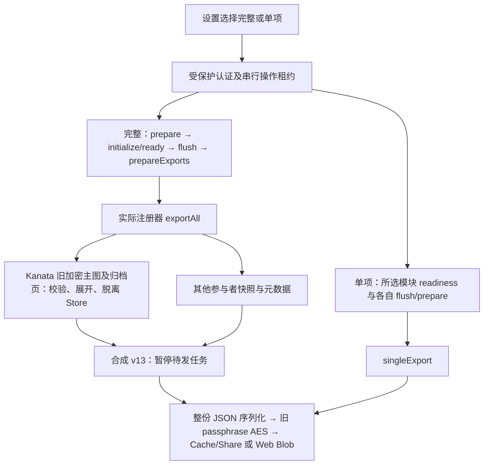
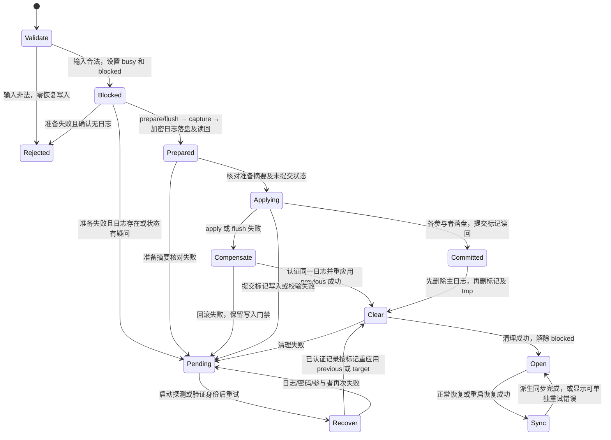

# Kanata SQLite M6-00 架构审计与设计输入 v1

日期为 2026-11-19（北京时间）。状态为提交独立复核的审计报告。M6-01 须等待独立复核结果及用户授权。

## 1. 双基线与证据口径

| 范围 | 固定提交 | 核对结果 |
| --- | --- | --- |
| 源码、测试、配置、既有验收记录和本文代码行号 | `2b6e8e3591385024576c6606cce2acc31dbaad2b` | 本地 `m5/json-archive-migration` 在既有 `.worktrees/kanata-m5`，审计前工作区干净 |
| M6 任务要求与阶段目标 | `b695226a8495d9129e9e95cf127bfbc4a61c92c4` | 用户批准双基线。Git 祖先检查退出 0，两笔后续提交各新增一份指定 Markdown，树差异仅此两份，源码、测试、配置零差异 |

规划来源为 [M6 总规划](https://github.com/Zhoubin601/ForMyself/blob/b695226a8495d9129e9e95cf127bfbc4a61c92c4/docs/20261119-kanata-sqlite-m6-encrypted-backup-recovery-plan-v1.md) 和 [M6-00 任务书](https://github.com/Zhoubin601/ForMyself/blob/b695226a8495d9129e9e95cf127bfbc4a61c92c4/docs/20261119-kanata-sqlite-m6-00-architecture-audit-task-v1.md)。本地依据包括 [AGENTS.md](../../../AGENTS.md)、[开发说明书](../../../架构接口与Agent开发说明书.md)、[开发背景](../../../memory-bank/development-context.md)、[M 迁移总计划第 6–10 节](../../20261103-kanata-sqlite-migration-plan-v1.md)、[M5-06 关账](../../20261119-kanata-sqlite-m5-06-closeout-v1.md)及 [M5-06 最终独立复核](../kanata-sqlite-m5/m5-06-final-independent-review-v1.md)。关账记录明确 M5-06 已关闭，M5 整体仍为 OPEN。总规划的前置阶段概述以此为边界。独立复核时应确认整体关账与 M6-01 授权的关系。

检查使用 `git status --short --branch`、`git worktree list --porcelain`、`git rev-parse HEAD`、`git diff --stat`、`git ls-remote`、`git merge-base --is-ancestor 2b6e8e3 b695226`、`git log --oneline 2b6e8e3..b695226`、`git diff --name-status 2b6e8e3 b695226`。通过按 SHA fetch 补齐规划对象，禁用标签、refmap 和 FETCH_HEAD 写入。主工作区 `main` 有既有文档改动、删除项和未跟踪文件，`kanata-m0` 有既有未跟踪 QA 证据，`kanata` 状态干净。报告留在原 M5 worktree。

本文用 **已实现** 标识源码中的行为，用 **文档约定** 标识阶段要求，用 **推断** 标识由代码边界推出的设计或风险，用 **待验证** 标识后续需试验的事项。测试引用均指固定提交，执行口径见第 10 节。

## 2. 源码与测试检查清单

| 检查项 | 源码定位 | 测试或证据定位 |
| --- | --- | --- |
| [x] 基础全备字段、版本映射和兼容 | `src/services/fullBackup.js:23–24,29–69,77–165,181–198`，`src/application/contracts.d.ts:105–122` | `tests/fullBackup.test.js:79–322`，包括逐版兼容循环 |
| [x] v13、单项 Kanata、归档和内部快照 | `src/features/chat/backup/kanataBackup.js:9–200`，`src/features/chat/kanataStore.js:223–253,339–374`，`src/features/chat/storage/messageArchiveRepository.js:20–124` | `tests/kanataBackup.test.js:13–92`，`tests/KanataProductRecovery.spec.js:103–181,253–285` |
| [x] 参与者、设置 UI、文件和认证 | `src/application/backupRegistry.js:3–56`，`src/application/backupParticipants.js:10–48`，`src/application/fullBackupRuntime.js:27–78`，`src/application/kanataBackupRuntime.js:22–97`，`src/application/moduleRegistry.js:22–29`，`src/composables/settings/useBackupSettings.js:35–280` | `tests/KanataBackupRuntime.spec.js:35–99`，`tests/KanataProductRecovery.spec.js:181–285` |
| [x] 协调器、日志、启动和恢复门禁 | `src/application/restoreCoordinator.js:6–95`，`src/platform/storage/restoreJournal.js:5–82`，`src/platform/storage/restorePayloadCodec.js:80–130`，`src/platform/storage/restoreState.js:3–6`，`src/main.js:16–26`，`src/composables/useAppController.js:536–548` | `tests/RestoreCoordinator.spec.js:38–172`，`tests/KanataProductRecovery.spec.js:151–181,285–329` |
| [x] 保护会话、凭据及改密 | `src/application/protectedModules.js:1–23`，`src/stores/protectedAccess.js:24–170`，`src/composables/settings/useSecuritySettings.js:38–80`，`src/services/masterPasswordChange.js:1–24`，`src/stores/auth.js:38–65,232–242`，`src/platform/security/secureCredentials.js:19–75` | `tests/ProtectedAccess.spec.js:61–154`，`tests/masterPasswordSecurity.test.js:15–136`，`tests/ProtectedDataRecovery.spec.js:135–179`，`tests/KanataProductRecovery.spec.js:329` |
| [x] SQLite 候选、原生桥、密钥和 Schema | `src/application/kanataSqliteCandidate.js:30–158`，`src/platform/storage/androidKanataSqliteDriver.js:40–186`，`src/platform/storage/kanataSqliteTypes.d.ts:31–66`，`src/platform/security/kanataSqliteKek.js:4–25`，`android/app/src/main/java/com/yubin/formyself/KanataSqlitePlugin.java:80–640`，`android/app/src/main/java/com/yubin/formyself/KanataKeyEnvelope.java:49–142`，`src/features/chat/storage/sqlite/kanataSchema.js:53–56,160–164,272–300`，`src/features/chat/storage/sqlite/kanataSchemaMigrator.js:13–125` | `tests/kanataSqliteDriver.test.js:28–72`，`tests/kanataSqliteSchema.test.js:29–108,206–271`，`android/app/src/androidTest/java/com/yubin/formyself/KanataSqliteTransactionTest.java` |
| [x] M5 合成导入、只读来源与逐表核对 | `src/features/chat/storage/sqlite/kanataDataMigrator.js:13–27,143–186,196–269,271–411,416–476`，`src/features/chat/storage/sqlite/kanataMigrationCoordinator.js:13–26,162–167`，`docs/qa/kanata-sqlite-m5/device.mjs:2–16,165`，`android/app/build.gradle:3–7,30–47,70–86,102` | `tests/kanataSqliteDataMigration.test.js:126–284`，`tests/kanataSqliteEncryptedLegacySource.test.js:82,181–300`，M5-06 关账第 2–4 节与独立复核第 4–6 节 |

## 3. 现行备份格式与导出数据流

### 3.1 完整备份版本矩阵

**已实现**。基础解析器按 `type` 与整数版本放行，并重建 v12 DTO。v3 起基础解析要求旧 chat 对象，v2 起规范化 schedules，Todo 依赖字段是否实际存在。表中注明版本演进的行来自对应测试。v9、v10 的历史发布内容未从当前分支规则逐版复原，兼容结论只覆盖当前解析与夹具。

| 线格式 | 基础兼容入口 `normalizeFullBackupSnapshot` | 产品完整恢复 `prepareKanataFullRestore` |
| --- | --- | --- |
| `formyself-full-backup` v1 | 日程和旧 chat 取默认空快照 | v1–v12 均需明确同意 `legacyChat: 'discard'`，保留现有 Kanata，恢复非 chat。v1 无日程时沿用空日程恢复 |
| 同类型 v2 | 读取日程，旧 chat 取默认空快照 | 同上，恢复规范化日程 |
| 同类型 v3 | 旧 chat 对象进入旧规范化器，夹具验证记忆和关系补齐 | 同上，旧 chat 不进入 Kanata 对象 |
| 同类型 v4 | 旧聊天兼容，夹具验证旧消息已读 | 同上 |
| 同类型 v5 | 夹具验证旧“她的世界”补齐，发送 outbox 清空 | 同上 |
| 同类型 v6 | v6 历史语义夹具覆盖旧互动/关系、数据和设置。旧心情等级可缺省 | 同上 |
| 同类型 v7 | 夹具验证心情等级目录、默认等级及记录映射 | 同上 |
| 同类型 v8 | 旧文件可缺省省钱分组，走默认分组 | 同上 |
| 同类型 v9 | 同一 v12 归一入口。逐版夹具无 Todo | 同上，缺 Todo 保留本机待办 |
| 同类型 v10 | 逐版夹具从 v10 带 Todo，实际判断依然是 own-property | 同上，有则恢复，无则保留 |
| 同类型 v11 | 缺 `requireAppUnlock` 默认开启，Todo 按存在性 | 同上 |
| 同类型 v12 | 当前基础 writer 输出。独立基础解析器拒绝 v13 及更高版本 | 同上 |
| 同类型 v13 | 由产品适配器专门生成与读取。非 chat 投影复用 v12 | `data.chat` 必须是合法且已展开的 KanataData。替换 Kanata 图。缺省 `taskPolicy` 仍强制应用暂停策略 |
| `kanata-chat-backup` v1 | 独立单项协议，含 `createdAt/taskPolicy/data` | 经单项解析与确认整体覆盖 Kanata。旧 `formyself-chat-backup`、不支持的类型或版本拒绝 |
| `kanata-restore-snapshot` v1 | 内部恢复镜像，`backup` 是带空 chat 哨兵的 v12 壳 | `mode: replace` 带真实已展开 Kanata，`preserve` 带 `kanata: null`，执行时省略 chat。历史内部 v1–v12 镜像走保留 Kanata 的恢复分支 |
| SQLite 便携格式 | **文档约定**为新格式。V3 是规划命名候选 | **推断**采用独立魔数/类型及独立版本轴。第 7 节给出并存设计 |

依据为 `src/services/fullBackup.js:137–165,190–198`、`src/features/chat/backup/kanataBackup.js:55–91,157–201`、`src/application/kanataBackupRuntime.js:57–76`、`tests/fullBackup.test.js:130–318`、`tests/kanataBackup.test.js:13–62` 与 `tests/ProtectedAccess.spec.js:189`。基础解析会校验归一化后的日期，缺失 `createdAt` 可触发 builder 的当前时间默认值。单项 Kanata 解析明确要求可解析日期。新格式应按其严格契约处理日期，兼容读取保持既有行为。

### 3.2 必须保留的字段和语义

- **旧线格式**保留 `type/version/createdAt/data/metadata/settings`。 `data` 保留 savings、weight、mood、passwords、schedules、todos（可缺）、chat。前四集合经对象数组校验，日程与待办走各自规范化。显式空 Todo 和缺 Todo 对恢复有不同影响。完整元数据包括 `metadata.savings.groups`，`metadata.mood.{builtInTags,defaultTags,trackingStartDate,customTags,definitions}`，`metadata.vault.categories`。设置保留通用便签、横幅、背景及效果、组件透明度、温馨小家开关和暂停时间、主题、AI URL/key/model、自动锁定时长和入口验证开关、提醒配置和 AI 缓存、健康配置及首页缓存。密码库记录和 API Key 已属于旧加密全备的数据语义。主密码、验证器和本机生物凭据独立保管。见 `src/services/fullBackup.js:29–69,77–165,181–198`、`src/stores/settings.js:390–445`。
- **v13 和单项 Kanata**保留世界、身份、角色卡及版本、实例、世界书、会话/成员/消息、记忆、关系、事件/Effect、审计、生活来源与精确来源 revision、授权、自治与任务、使用量等 KanataData。安全扩展随图保留，外层解析按既定投影生成，未知外层字段无普遍原样保留保证。活跃消息与已归档的正文经页校验后展开到同一图，移除页面描述符并将数据版本置 1。导出保全正文和关联，归档物理布局及页密文不进入包。大图恢复可在旧 Store 内重新分档，归档页身份可变化。见 `src/features/chat/kanataStore.js:223–253,339–374`、`src/features/chat/backup/kanataBackup.js:33–64,119–148`、`tests/kanataBackup.test.js:58–91`、`tests/KanataProductRecovery.spec.js:130–164`。
- **任务策略**将 reply/proactive/followup 的 pending/running/failed 转为 cancelled，其他 running 转为 pending，所有 leaseUntil 清零。应用在外部导出及读入，内部 previous 捕获和恢复保留原任务和租约。SQLite 导入前须对任务表、子关系、回执及调度依赖明确等价转换，并验证无自动重发。签名/逐表摘要应明确对应转换前或转换后的表示，避免把预期策略变化误判为损坏。见 `src/features/chat/backup/kanataBackup.js:46–77,125–148,157–188`、`tests/kanataBackup.test.js:37–45,82–90`。

### 3.3 生产路径与单项差异

**已实现**。完整操作要求 passwords、chat 两个敏感模块就绪，其他参与者经初始化、ready、flush 和 prepareExport。工作区普通模块有额外 readiness 检查，Todo 导出先 flush 并 reload。参与者默认 JSON 克隆，Kanata 的 detachedExport 转移已脱离 Store 的快照。并发 flush 全部结算并汇报失败。此流程按参与者取得快照，没有跨模块同一时点的数据库事务。页级并行有界仍会聚合为全图，之后组装整份 JSON 和加密结果。旧文件是 OpenSSL `Salted__` Base64、EVP/MD5 派生的 AES-256-CBC/PKCS7，解析侧整文件 FileReader→解密→JSON。它没有独立 AEAD 标签。产品恢复使用当前操作中的本机主密码解密。旧包跨设备须先有可认证且与包密码相同的主密码，旧 UI 没有单独的来源包密码输入。见 `src/application/kanataBackupRuntime.js:64–96`、`src/application/backupRegistry.js:13–37`、`src/composables/settings/useBackupSettings.js:39–40,91–151,153–195,280`、`src/shared/crypto/passphraseAes.js:4–5,15–69`。

| 单项 | 验证及写入语义 |
| --- | --- |
| passwords / chat | 页面映射分别加载本模块。passwords 追加或替换 records，单项无全备的分类元数据。Kanata 校验完整图且只许覆盖，取消零写入，新旧图不可直接合并 |
| savings / weight / mood / schedules | 无指定敏感模块时仍调用 authenticate。省钱追加/替换并规范化分组，体重追加/替换，心情读取单项快照后通过 Store 合并或覆盖记录及目录，日程先规范化后合并或覆盖 |
| todos | 单项 `formyself-todo-backup` v1 解析，确认后覆盖，取消终止 |
| 全部单项 | 注册器要求模块 ready，调用 import→flush→可选 synchronize。通用 singleImport 无统一 validate 调用。输入校验由设置解析及各适配器完成，单项旧路径没有完整 AES-GCM 恢复日志事务。SQLite 单项切库仍需使用协调器的隔离候选适配器 |

见 `src/application/backupRegistry.js:39–55`、`src/application/backupParticipants.js:13–47`、`src/application/fullBackupRuntime.js:34–50,70–78`、`src/composables/settings/useBackupSettings.js:164–267`、`src/features/todo/todoCore.js:193–194`、`tests/KanataProductRecovery.spec.js:235–274`。

## 4. RestoreCoordinator 及 AES-GCM 日志

**已实现**。产品组合在协调器内部使用 `journalRollback: true`。内部镜像先验证，冻结并登记私有身份。 `capture()` 在准备和 flush 后取得旧全量镜像。当前 `restoreAll` 先检查未知/缺失参与者并运行已注册的 validate，再并发恢复，等待所有 restore 和 flush 结算。部分持久化由协调器补偿。

文件位于 `Directory.Data` 的 `formyself/restore-v1.enc`、`formyself/restore-v1.commit`、`formyself/restore-v1.tmp`。封套 `{version:1,salt,iv,ciphertext}` 用 PBKDF2-SHA256 210000 派生 AES-256-GCM，随机 16 字节盐、12 字节 IV。逻辑记录为 `{version:1,previous,target}`，大载荷可用 gzip-json-v1 v2 载荷包裹（阈值 256 KiB，解压明文 256 MiB 上限），外层 GCM 仍一次收集并加密。prepare 先写 tmp、读回、rename、读回最终路径，返回密文 SHA-256。commit 标记写 `{digest}` 并读回，inspect 比对密文摘要。该标记是完整性关联，当前实现没有用密钥认证提交决定，也没有把 prepare 的摘要作为 commit 的入参。读回证明接口层可重读，Native 的目录落盘和断电耐久语义须另验。见 `src/platform/storage/restoreJournal.js:5–82`、`src/platform/storage/restorePayloadCodec.js:2–3,80–130`、`src/application/restoreCoordinator.js:10–24,49–92`。

| 故障位置 | 已实现结果 |
| --- | --- |
| 校验、prepare、tmp 写或 rename 前失败 | 输入校验失败无业务写。prepare 失败时仅在重新 inspect 确认无主日志后开放；无主日志的 inspect 清理残留标记和 tmp |
| 有 prepare、apply 尚未开始或执行了一部分，标记不存在 | 启动预先封锁，认证后统一重应用 previous。进程内 apply 失败也先对同一未提交摘要的 previous 认证及验证再补偿 |
| apply 已成功但 commit 返回错误 | 保持 blocked。重启依据持久化标记。有效匹配标记选 target，无标记选 previous，错配或坏标记继续 blocked |
| commit 有效、主日志仍在 | 选 target 并重新 apply/flush，清理及派生同步。要求参与者能够安全重入 |
| 主日志已删、附属清理未完成 | 进程内可能仍 blocked，重新 inspect 清理附属。冷启动无主日志即没有待恢复的业务写；不反向回滚刚提交的数据 |
| 错密、认证失败、日志丢读/损坏、回滚失败 | 保留现存材料、blocked。仅 busy 在 finally 复位。补偿失败传播 `rollbackFailed`。恢复 UI 走受保护操作 |
| 派生同步失败 | 业务提交已完成，设置 `syncError`，可单独重试同步。成功补偿后原 apply 错误仍向上抛。同步错误为进程状态，现行清理后强停没有独立的持久同步待办 |

见 `src/application/restoreCoordinator.js:26–95`、`src/main.js:16–26`、`src/composables/useAppController.js:536–548`、`tests/RestoreCoordinator.spec.js:38–172`。Android Todo 的普通原生写路径另见 `android/app/src/main/java/com/yubin/formyself/TodoRepository.java:96`，任何新日志入口须核对原生 gate，避免 JS 与原生可写时点不同。

## 5. 受保护模块与全局改密

**已实现**。注册器按顺序提供 passwords（密码库）、chat（Kanata 旧 Store），lazy resolve/load，检查 release、reencrypt、flush、suspendPersistence 和状态。 `runOperation` 串行排队，检查恢复门禁，认证并加载指定模块，将当前主密码和会话 revision 交给回调。锁定/后台失效立刻撤销 UI 和迟到加载权限，已开始的租约结算后释放 Store。候选自己的前台与恢复门禁更严格，会撤销候选连接。见 `src/application/protectedModules.js:1–23`、`src/stores/protectedAccess.js:60–90,102–170`、`src/application/kanataSqliteCandidate.js:45–89,149–158`。

| 顺序 | 当前操作 | 失败及补偿 |
| --- | --- | --- |
| 1 | 设置页验证旧密码或生物能力、校验请求，进入全模块操作租约 | 未获有效会话时终止，拒绝普通恢复期改密 |
| 2 | `passwords.reencrypt(new)` | 领取顺序已在入栈时记录，该步骤即使部分失败也调用自身 `reencrypt(old)`。等待已发出的相关写结算 |
| 3 | `chat.reencrypt(new)` | 先把归档页写成新密码下的独立页并核验，再重加密旧 JSON，Repository 读回并更新主/备。Store 发布新图与密码后退休旧页。chat 失败时先补偿 chat，再补偿 passwords |
| 4 | `auth.commitPasswordChange(new)` | 凭据校验器串行写后读回。写或核验报错尝试还原旧记录，再由全局事务反序补偿两模块。当前 verifier 还原路径未读回核验。生物凭据在 verifier 提交后尝试重新绑定，绑定失败提示手动密码登录 |
| 5 | 汇报结果 | 任一补偿失败仍继续补偿剩余参与者并设置 `rollbackFailed`。受保护会话置 `recoveryRequired`，模块状态置 error 并 suspendPersistence。此状态与全备 `restoreState.blocked` 独立，为进程内门禁。没有全局改密跨重启事务记录 |

见 `src/composables/settings/useSecuritySettings.js:38–80`、`src/services/masterPasswordChange.js:7–22`、`src/stores/auth.js:38–65,232–242`、`src/features/chat/kanataStore.js:257–337,455–465`、`src/features/chat/storage/kanataRepository.js:135–157,241–262`。测试覆盖逆序补偿、失败 verifier、等待迟到写、持久回滚错误和真实产品两模块改密（`tests/masterPasswordSecurity.test.js:70–101`、`tests/ProtectedDataRecovery.spec.js:135–179`、`tests/KanataProductRecovery.spec.js:329`）。

**推断**。SQLCipher 接入应延续同一个 chat 保护参与者及全局编排。若隔离实测证明只轮换密码 KEK 即可，应保留同一数据库 DEK，准备独立新封套并读回，用新密码验证打开同一数据库身份，保留可恢复的旧封套，等全局决定持久化后再退休。现有 `reencrypt(password)` 把失败步骤也用于补偿，适配器须有幂等的 old/new 准备和补偿语义。若后续再有参与者或 verifier 失败，恢复精确旧封套/代际并验证旧密码可访问同一数据，逆序补偿其他模块。先做持久化全局准备，再进行可能影响正常登录的写入。重启时在加载敏感模块前读取决定并阻断，恢复能力需要能处理混合密码的中间态。只有 verifier 代际和所有参与者收据一致才能解除门禁。若未来确需变更数据库 DEK，保留为经单独复核的路径，实测实现支持、原子性、WAL、磁盘开销、冷启动和恢复后再定。现有归档页面退休时点与无日志改密事务均需纳入强停演练。

## 6. SQLCipher 候选接入点与一致性导出

### 6.1 现状

- **已实现**。产品 `useKanataStore` 注入旧文件 Repository。候选使用 `syntheticOnly: true`，Native 还需 `BuildConfig.KANATA_M2_SYNTHETIC` 及 `com.yubin.formyself.m2qa`。M5 额外合成 catalog 要显式合成配置，QA 组合在 `device.mjs` 直接注入 Driver、migrator 和 source。M5 读取 ready/未 recovered/无 pending save 或错误的图，归档预检后以最高 50 条批次落表，实体、游标和计数同事务。回读验证目标后完成 manifest。加密旧源适配器在测试目录，生产 canonical 仍为 legacy。见 `src/features/chat/kanataStore.js:470`、`src/application/kanataSqliteCandidate.js:30–36`、`android/app/src/main/java/com/yubin/formyself/KanataSqlitePlugin.java:80,167–218`、`android/app/build.gradle:3–7,30–47,70–86`、`src/features/chat/storage/sqlite/kanataDataMigrator.js:271–334,364–476`、`tests/kanataSqliteEncryptedLegacySource.test.js:82,249–300`。
- **已实现**。桥仅有 prepare/unlock、begin/query/execute、commit/rollback、health、completeOpen、close。固定 no-backup 根中的 `kanata.db` 配 `envelope.json` 与 `creation.pending`，现有入口不支持任意恢复路径或第二个临时库。prepare 发挑战，unlock 绑定 owner/generation、token 和 KEK，得到 native lease。事务命令再绑定 transaction token，SQL 走固定 SHA-256 目录、参数类型和结果限额，串行 Native 执行。Driver 一次 open，校验 owner，statement 失败禁止 commit，回滚/关闭失败可 poison。候选可在同一会话复用连接，业务操作和事务权限仍逐次租用。见 `src/platform/storage/kanataSqliteTypes.d.ts:35–66`、`src/platform/storage/androidKanataSqliteDriver.js:40–186`、`android/app/src/main/java/com/yubin/formyself/KanataSqlitePlugin.java:147–150,241–290,401–459,490–560`、`tests/kanataSqliteDriver.test.js:28–72`。
- **已实现**。依赖为 SQLCipher Android 4.17.0。连接设置 WAL、synchronous FULL、foreign_keys、temp_store MEMORY、cache_size -2048、wal_autocheckpoint 1000、busy_timeout 5000。begin 是 `beginTransactionNonExclusive()` 所对应的写者事务。只读 preflight 检查 application_id、版本、预期结构、cipher/SQLite 完整性和外键。health 里 `checkpoint: 1000` 表示自动 checkpoint 配置，未返回已完成 checkpoint 的结果。在 src、原生插件和固定 SQL 目录入口检索中未发现已接入 Online Backup、VACUUM INTO、sqlcipher_export、显式 `wal_checkpoint` 或 rekey。库本身的 API 可用性待实测。见 `android/app/build.gradle:102`、`android/app/src/main/java/com/yubin/formyself/KanataSqlitePlugin.java:297–332,407–412,602–630`。
- **已实现**。Schema 001–005 固定，`user_version=5`，`application_id=0x4b4e5441`（1263424577）。`schema_migrations` 存 version/name/checksum，校验和覆盖版本、名称及有序 DDL，003 补充应用时间记录表 `schema_migration_applications`。M5 数据迁移进度单独存 `data_migrations`，含目标 Schema、源指纹、集合/cursor、计数、状态和扩展，manifest 与集合分开。 `dataset_metadata` 保存 user_id/data_version。005 的三张顺序旁表用于重现领域原序。导入需要区分业务行、由触发器派生的登记/顺序、Schema 日志与 M5 运行记录，不能把 M5 cursor 当作备份恢复进度。见 `src/features/chat/storage/sqlite/kanataSchema.js:53–56,160–164,272–300`、`src/features/chat/storage/sqlite/kanataSchemaHardening.js:39–69`、`src/features/chat/storage/sqlite/kanataSchemaArrayOrder.js:2–48`、`src/features/chat/storage/sqlite/kanataSchemaMigrator.js:13–125`、`src/features/chat/storage/sqlite/kanataDataMigrator.js:13–17,196–269`。

M5-06 历史证据在合成 Android API 34 / SQLCipher 4.17.0 环境验证 50 表、四个强停点、源密文与旧日志保持一致。55/1k/10k 有独立宿主逐表对拍。100k 报告记载约 912.31 秒及 561.5 MiB RSS，独立复核覆盖 47 固定表与关键计数/聚合，未重跑完整 100k 宿主导入。未入库的七份原始日志与 APK 仅有历史本机复核和指纹。这些是导入证据，尚无 M6 导出峰值、断电耐久或实体设备性能结论。

### 6.2 一致性与内存的设计输入

**推断**。逻辑路径在同一连接同一快照下使用固定表目录与复合 keyset，所有表的 counts/digest 也取自同一视图；每批独立提交的分页读取会跨版本，不能用于此目的。首选在后续比较专用只读快照与现有 `BEGIN IMMEDIATE` 的受控冻结导出。现有 begin 可在合成库验证同一事务的一致性，长时间持有会阻塞写者，需测锁等待、前台失效和 WAL 增长。对大字段逐段编码和校验字节上限，跨桥优先只传有界帧或进度。行数上限本身无法限制长正文、BLOB 或 JSON。全程执行有背压的读→编码→分块 AEAD→文件 sink，限制单次明/密文、临时中间件、并行缓冲和 manifest 指标体积，记录 JS/native RSS、最大桥报文、在途块、WAL/临时磁盘大小、锁等待和取消延迟。

**待验证**。物理路径优先验证 SQLCipher 4.17.0 AAR/native wrapper 是否暴露可逐页步进的 Online Backup，忙/重启和加密目标语义必须在候选合成环境证明。若能力不可用，再评估经证实的 freeze→完整 checkpoint→结束所有连接→证明无未合入 WAL→复制稳定单文件流程。要求有界 BUSY/失败且全时段持有独占所有权，检查 reader 阻塞、checkpoint 实际完成、sidecar 与重开；任一步不确定则放弃快照。只有主库文件、单次健康检查或 auto-checkpoint 配置都无法证明快照完整。涉及备份专用密钥或 SQLCipher 导出副本时还须验证 API 是否支持所需的独立加密目标。两条路径均用会话、世代与恢复门禁，取消后停止新工作，结算先前 I/O，仅处置本次拥有且可证明无引用的候选临时材料。分享或发布仅在验证后的完成文件上发生，既有包和源库保持可用。

## 7. 两种便携格式与跨设备决策

以下均为**推断**及候选设计输入。正式名称、算法、参数、压缩以及物理 key 传递方式留给后续经复核的格式任务书。

| 维度 | A. 固定目录的版本化逻辑记录流 | B. 一致的 SQLCipher 物理镜像流 |
| --- | --- | --- |
| 数据表示 | 按冻结的表/关系契约编码字段值与显式顺序。游标精确处理大 TEXT/BLOB、行内分段和 NULL/缺省。维护扩展原字节、稳定 ID/revision、顺序、来源、权限、审计和归档标记 | 从一致快照取得独立完整 SQLCipher 镜像，以文件偏移/长度编码。绑定 SQLCipher 兼容配置、库文件长度、Schema、身份及验证摘要 |
| 一致性与生成 | 单连接同一读视图、有序分批 export，逐表增量摘要。需定义触发器、依赖排序和逻辑表示 | 依赖经验证的 native 快照 API 或独占并完成 checkpoint 的稳定文件。流式读取固定字节块，磁盘需为快照、目标和回滚预留空间 |
| 便携性与密钥 | 包密码解出备份专用随机数据密钥，目标重建固定 Schema，以本机独立 DEK 加密。无需携带源数据库 DEK | 包密钥保护镜像传输和整包认证。另需能打开镜像的加密材料，候选为独立生成的镜像 DEK 受包密钥保护，或清晰受限的源 DEK 封装。须验证后者的密钥域暴露、SQLCipher 参数和兼容性 |
| 恢复与任务语义 | 认证后按固定导入器写临时库，显式应用已冻结的任务策略。触发器派生数据需对拍，依赖/约束失败回滚 staging | 分块复原并验证镜像，安全拒绝任意附加 SQL/结构。外部任务暂停应在导出副本或目标 staging 转换，分别证明物理输入摘要与最终语义。逐表计数/FK 等仍要实做 |
| 风险和选择条件 | 桥流量、超长字段、Schema 演进、触发器回放及原序保真。建议作为首个原型，条件是 50 表范围、派生行及 NULL/原序等价有证据 | 依赖实际 AAR/ABI、密码 key 解释和快照能力，物理版本耦合较强。如果实测证明跨设备开库、较低峰值及任务语义，B 可继续比较。团队尚未冻结选择 |

### 7.1 两方案共用的认证合同

- 独立魔数/类型、格式版本、容器/密码信封版本、算法套件、KDF 参数与盐、备份 ID、作用范围（全备或 Kanata 单项）、内容表示版本及必要能力。受认证 manifest 绑定 schema version、application_id、数据集指纹、模块/表目录、逻辑 counts、规定顺序及摘要范围。明确哪些运行表纳入，哪些由固定 Schema 或验证后的规则重建。避免将用户标识、引用 ID、表计数和数据摘要放到可识别的明文头。
- 每块独立 AEAD。认证输入绑定经验证的不可变头/manifest 标识、包 ID、流/表或段 ID、按序索引、类型、压缩标志以及明/密文长度。每个 key 下 nonce 全局唯一，多个流、头、尾、重试及恢复读取的 nonce 域分别核查。重开导出需明确防止同 key/nonce 重用。逐块 SHA-256 用于定位与一致性，认证标签和受认证的顺序承诺才承担防篡改。
- 将已验证序列、总块数、总明/密文长度、逐流/逐表总量和块摘要聚合绑定到受认证尾记录，严格要求实际 EOF。未知结束数量可在认证尾完成承诺，manifest 体积可通过增量摘要设计限制。读端要求下一序号/标识严格匹配，拒绝缺块、重复、换包、乱序、坏标签、早到 EOF、尾后字节以及超预算。零块也要有合法的认证终结。需要可重读的私有输入或受控密文 spool 时，先全包认证并持久化验证收据，再解包到隔离目标，二次读取逐块再认证。由此满足计划的“损坏包在目标写入前拒绝”，并防文件在验收与使用之间被替换。预算覆盖恶意长度、KDF 参数、解压膨胀、记录深度、大字段分段和整数安全范围。
- 公开头只保留识别和派生所需最小数据并在使用前限制长度、版本、算法及可接受资源范围。认证头、manifest 和包密钥封套应相互绑定。比较初版无压缩与有明确上限的逐块压缩，由合成容量验证决定。任何未认识的必需能力、强制字段、Schema 或表示版本均拒绝。可选保真扩展必须有规定的命名空间、长度和解析/保留规则。

### 7.2 版本并存与跨设备

建议先冻结独立容器路由原型。按确切签名分派旧 v1–v13/CBC、旧 Kanata 单项 v1、SQLite 便携包。已识别新格式的损坏或未知版本明确拒绝。任何旧 writer 继续产出既有类型与版本，新包分别明确 `scope` 与必需参与者。首个合成 Codec 可以仅支持 Kanata 单项试验，产品全备的后续设计须有受认证的非 chat 模块清单和版本化载荷，包括旧字段和 Todo 存在性。旧 v1–v12 读入不需建立目标 SQLite chat；v13 恢复保持旧图入口，未来转为候选 SQLite 的域映射需另证完整保真，禁止以 M5 合成夹具接受任意真实备份。接线顺序涉及 `moduleRegistry` 文件选择元数据、`useBackupSettings` 流式解析/认证/确认、应用组合根、`backupRegistry` 参与者以及 `contracts.d.ts` 和正负类型样例。普通 Web 保留旧加密仓库，未知 SQLite 包支持状态应能清楚提示。

跨设备流程用**导出时的备份密码**派生包 KEK，解封备份专用随机数据密钥（物理方案也可能解封镜像密钥）。目标设备使用独立的本机已授权会话和其当前主密码，将目标 DB DEK 封装在目标侧；新设备按已授权的本地凭据流程初始化。本机主密码和来源包密码可不同，包密码输入、目的地身份验证和恢复日志解密职责必须明确。旧备份使用旧入口语义，既有外部包随其导出密码保留，不随本机改密自动轮换。Keystore/生物识别适配器仅用于本机快捷解锁或安全凭据保存，跨设备包解密只依赖包中公开元数据和用户密码。备份不得带明文 SQLCipher DEK、主密码、凭据或设备绑定标识。

| 决策 | 已知证据 | 待验证并提交复核 |
| --- | --- | --- |
| KDF 与密码字节规则 | `src/platform/security/kanataSqliteKek.js:4–25` 为候选本地 v1 KEK，WebCrypto PBKDF2-SHA256 600000，UTF-8 密码，域前缀加 16 字节盐。日志与验证器目前默认 210000，职责及记录类型各异。旧备份用 EVP/MD5 | 冻结兼容平台的算法与参数白名单和最大成本。测低端 Android/Web 的耗时、内存、并发、非 ASCII 密码字节一致性和错误能力路径。已有参数仅描述现状 |
| 本地封套与包封套 | `android/app/src/main/java/com/yubin/formyself/KanataKeyEnvelope.java:49–119` 实现 v1 元数据、随机 32 字节 DEK、AES-256-GCM、确定的 AAD、AtomicFile fsync/读回/解封。native 凭据适配器使用独立命名空间，API Key 有读回链，Master Password 为生物凭据 | 候选方案各自确定包密钥与 DB DEK 隔离、包封套兼容测试向量、重试 nonce 分配、秘密驻留及错误清理。是否复用平台原语需双端互读及资源实测 |
| SQLCipher key 语义 | envelope 的 DEK 转为 67 字节 ASCII 的 `x'<64 hex>'`，作为 byte[] 传给 `openDatabase`。代码展示的是喂给当前 AAR 的参数形状。插件关闭时擦除 Java 数组，驱动清理衍生字节，桥上暂有 KEK 字符串 | 以目标 AAR/ABI、原生和重开结果证明 raw/key API 行为、镜像兼容、salt/profile/page 参数、错误 key 拒绝及关闭后访问。审查 JS 字符串与桥接缓冲、调试输出和 native sidecar |
| KEK 轮换与 rekey | 当前 JS 桥无两者。旧 Store 的 reencrypt 是 JSON/归档重加密。本地 key envelope 有 create/unwrap 和安全写原语 | 模拟同 DEK 新旧封套与 verifier 跨强停的持久决定、补偿及退休。是否需要 rekey 由威胁模型和实际支持决定，另验失败恢复、WAL、容量和权限 |

补充定位为 `src/services/masterPasswordSecurity.js:3,74–88`、`src/platform/storage/restoreJournal.js:19–37`、`src/platform/security/secureCredentials.js:19–75`、`android/app/src/main/java/com/yubin/formyself/KanataKeyEnvelope.java:132–142`、`android/app/src/main/java/com/yubin/formyself/KanataSqlitePlugin.java:132–140,258–290,301–318`、`src/platform/storage/androidKanataSqliteDriver.js:163–175`。

## 8. 临时 SQLite 恢复、切换及回滚设计输入

**文档约定**。先验证包和隔离目标，再进入现有协调器的统一受控 apply。强停于提交决定前选择 previous，提交后选择 target。无法验证材料、回滚或切换失败时保持 blocked。

**推断**。复用现有协调器、日志加密和写入屏障。当前候选 `run` 一遇 blocked/busy 即释放或拒绝连接，`RestoreCoordinator` 的 `capture` 是同步单快照，当前 `apply` 背后只有注册器 DTO 写入。接入需要限定于协调器调用栈的 restore capability，绑定操作身份、会话、验证后的 generation 和阶段，受限方法只允许 reopen/verify/select 已验证的隔离候选。它须支持启动 gate 内工作，普通查询、后台任务和页面不得持有该 capability。新增候选描述符用可验证、有限大小的引用替代大型 chat DTO。原 AES-GCM 日志继续携带非 chat 镜像；扩展经版本化验证的 previous/target 目录引用、备份 ID、schema/数据集摘要、对应本地封套身份及提交绑定。日志中不放绝对路径、密钥或可指向任意文件的引用。

| 步骤 | 保证与失败处理 |
| --- | --- |
| 1. 全包预检与 staging | 全包认证、预览/确认、代际绑定。目标使用专用随机目录/句柄、本机 DEK 封套、独立原生连接及分页/分块写入。仅跟随白名单结构，从受信目录安全解析，拒绝 alias/symlink 和路径逃逸。验证 `application_id`、Schema/迁移校验和、数据集指纹、表数量/摘要、FK、cipher_integrity_check 和 integrity_check，以及任务转换前后语义。源库保持可用，失败不碰 canonical |
| 2. 阻断、排空、记录 previous | 从 Coordinator 进入 blocked/busy，暂停普通写与调度，关闭并验收连接与在途工作状态。此时重新捕获当前 previous，不能使用 staging 开始时的过期世代。先验证两代目录都可独立冷开、封套与 DB 匹配且 sidecar 单独归属，再持久写加密 prepare、readback 并验证摘要。SQLite 侧若需关盘或 checkpoint，验证完整结果和耐久性，拒绝跨代 sidecar 复用 |
| 3. apply | 保留 previous 文件与封套。建议用受限、同卷、可验证的一次指针更新选中完整代际，并在 gate 下确认实际打开正确代际。单文件替换无法涵盖 DB、WAL/SHM 和封套一组的崩溃一致性。全备其他参与者继续经过真实 registry apply/flush，等待所有进行中操作结算后才进入 commit，无观察者能编辑混合态 |
| 4. commit、清理和恢复 | commit 绑定 exact prepared 事务和两代收据，严格核验成功后才允许清理日志与解门禁。prepared 仍在时启动按认证决定幂等重放相应全部参与者。若指针已切而无有效提交，必须能重新选回 previous，必要时完成非 chat 补偿。如果已提交，重启必须重放 target 且不改回旧代。坏记录或歧义保留材料，禁止自动选择“看起来能打开”的代际 |
| 5. 退休与同步 | 先证明决定及指针可在冷开后保留，再按阶段授权处理本次隔离临时材料。旧用户数据与旧备份永久保留至另有批准。派生同步按当前协调器契约单独重试。对清理与开放间强停补充收据或通过幂等冷启动重新校对派生状态 |

**待验证**。在隔离候选环境验证持久化指针的 atomic replace、文件/目录同步与 readback、同卷要求、App 强停和断电模型，分别注入 prepare 前后、目标落盘、切换前后、另一个参与者失败、commit 标记前后、清理前后、session 失效、WAL BUSY 窗口、空间不足、损坏 journal、同步失败。验收每一点以新运行时检查整组世代、业务内容、封套和 Todo/其他参与者状态，验证 blocked 期间无普通读写泄露或写入，业务完成后重试同步不二次导入。恢复读取当前代码会先在 UI 调用 prepareRecovery，随后协调器解封恢复记录再 prepare。须证明真正的半更新旧状态不会阻塞进入所需的内部恢复能力。见 `src/composables/useAppController.js:536–543`、`src/application/restoreCoordinator.js:49–92`、`src/application/kanataSqliteCandidate.js:45–64,149–158`。

## 9. 风险、最小拆分与开工门禁

风险针对新阶段接入。带“待验证”的项目描述证据缺口。

| 级别 | 风险及冻结条件 | 准确源码位置与测试依据 |
| --- | --- | --- |
| Blocker | 候选在恢复 gate 下主动撤销连接，而且桥只打开固定库。M6-03 前必须证明隔离 staging、内部协调能力和可启动的整代恢复，普通路径始终受限 | `src/application/kanataSqliteCandidate.js:45–64,149–158`，`android/app/src/main/java/com/yubin/formyself/KanataSqlitePlugin.java:147–150,241–290`。 `tests/kanataSqliteDriver.test.js:64` 当前验证恢复前拒绝 native open，未覆盖临时库切换 |
| Blocker | 候选原生快照 API 和 checkpoint 一致性没有项目验收。逐事务翻页会混合状态，WAL 主文件复制缺一致性证据。M6-02 选型须以真实并发合成数据验收 | `src/platform/storage/kanataSqliteTypes.d.ts:55–66`，`android/app/src/main/java/com/yubin/formyself/KanataSqlitePlugin.java:305–313,407–412,602–610`。 `tests/kanataSqliteSchema.test.js:248` 验事务升级隔离，M5 历史验收验导入 |
| Blocker | 改密补偿只有进程内顺序，rollbackFailed 的选择状态无冷启动记录。新封套与 verifier 的代际可能分离。M6-04 需要可恢复的全局决定与启动态 gate | `src/services/masterPasswordChange.js:7–22`，`src/stores/protectedAccess.js:110–137,161–170`，`src/stores/auth.js:38–65,232–242`。 `tests/masterPasswordSecurity.test.js:70–101` 与 `tests/ProtectedDataRecovery.spec.js:160–168` 覆盖进程内故障 |
| High | 日志的 commit 使用重新 inspect 找到的摘要，当前没有 exact prepare 入参或认证的提交决定。SQLite 加入代际引用后须绑定准备/提交和选择结果，验证介质耐久 | `src/platform/storage/restoreJournal.js:50–81`，`src/application/restoreCoordinator.js:58–72`。 `tests/RestoreCoordinator.spec.js:60–90,154–172` 覆盖早期替换、补偿、清理失败和错配，未覆盖 apply 至 commit 间材料变化及 native fsync |
| High | 直接沿用 v13 全图或全量 GCM 日志会失去内存上界。SQLite 部分使用认证的短描述符及有界分块，验证长字段、日志与完整非 chat 负载 | `src/features/chat/kanataStore.js:339–373`，`src/composables/settings/useBackupSettings.js:122–145,160–170,280`，`src/platform/storage/restorePayloadCodec.js:80–130`。 `tests/KanataProductRecovery.spec.js:130–164,225` 覆盖内容与能力失败 |
| High | 候选 native legacy preflight 搜查 `restore-v1.enc.commit`、`restore-v1.enc.tmp`，实际日志旁文件为 `restore-v1.commit`、`restore-v1.tmp`。主日志名匹配。新增接入前须核对 JS/Native 协议、启动门禁与孤儿文件解释 | `android/app/src/main/java/com/yubin/formyself/KanataSqlitePlugin.java:167–175`，`src/platform/storage/restoreJournal.js:5–7,50–55`，`android/app/src/main/java/com/yubin/formyself/TodoRepository.java:96`。 `tests/RestoreCoordinator.spec.js:154–172` 现为主机日志语义，未覆盖 Native 名称对齐 |
| High | SQLite 包需防止认证元数据与分块脱节。旧 CBC 与本地封套仅作为各自的兼容证据。包 KEK、nonce 生命周期、KDF 和 scoped manifest 必须证明可独立互读 | `src/shared/crypto/passphraseAes.js:4–5,48–69`，`android/app/src/main/java/com/yubin/formyself/KanataKeyEnvelope.java:81–119`。 `tests/fullBackup.test.js:102` 是旧加密往返，`tests/RestoreCoordinator.spec.js:98` 是日志 GCM 错密或损坏 |
| Medium | SQLite 切换要保全 005 原序、未知扩展、归档标记、任务暂停及来源 revision。物理与逻辑 hash 需分别定义，M5 哈希只提供参考目录和校验手段 | `src/features/chat/storage/sqlite/kanataDataMigrator.js:347–409`，`src/features/chat/storage/sqlite/kanataSchemaArrayOrder.js:2–48`，`src/features/chat/backup/kanataBackup.js:55–64`。 `tests/kanataSqliteSchema.test.js:171,206`、`tests/kanataBackup.test.js:37,69–91` 现有领域覆盖 |
| Medium | 全备协议有已注册参与者、线格式与设置 UI 三处分流。缺 Todo 的语义和旧 chat 保留均应成为回归。只改其中一处会造成不一致 | `src/services/fullBackup.js:181–198`，`src/application/kanataBackupRuntime.js:24–29,57–62`，`src/composables/settings/useBackupSettings.js:176–222`。 `tests/kanataBackup.test.js:21–30,52–62`、`tests/KanataProductRecovery.spec.js:235–274` |
| Low | 测试名仍使用 v6 或 v5→v6 历史叫法，实际断言当前 FULL_BACKUP_VERSION。证据索引以协议常量和断言为准 | `src/services/fullBackup.js:23–24`，`tests/fullBackup.test.js:79–84,238–253,304–318` |

| 阶段 | 最小工作与依赖 | 退出证据 |
| --- | --- | --- |
| M6-01 格式与合成 Codec | 待用户授权后创建并核对独立 `m6/encrypted-backup-recovery`，另立任务书。确定强类型格式、scope、预算、manifest/chunk/终结及包密码策略。先给合成 Codec 和隔离 sink，SQLCipher 平台能力保留为 M6-02 的待测输入 | 固定合成向量双向互读、错密/越界/未知必需字段/断尾/串包/重排/重复零目标写、取消及内存边界，列出 KDF/封套决策证据。旧格式路由回归 |
| M6-02 一致性导出 | 确认 A/B 可行性和 SQLCipher API/锁/WAL 语义，接固定有界导出、摘要及故障退出 | 同一快照下的源/包语义对照，真实候选 1k/10k/100k、长字段、并发修改/读者、忙 checkpoint、断连、空间不足和取消。记录峰值和锁/桥/磁盘上界 |
| M6-03 隔离恢复 | 验证 staging、完整性和两代引用，接 actual RestoreCoordinator，协调普通与 Native 的 gate。保持旧包入口 | 认证全包后才写 staging，完整校验后才切。prepare/apply/commit/clear 各点强停，验证恢复决定、跨参与者一致性、防自动发送、失败留材料、同步独立重试 |
| M6-04 改密轮换 | 将 Kanata 封套能力接回全局参与者，定义跨强停决定和旧材料退休，不提前启用 rekey | 对各参与者、verifier 和补偿逐个注入故障，记录旧/新密码冷开、旧包独立恢复、回滚失败的重启门禁及无秘密残留 |
| M6-05 故障矩阵与复核 | 全量产品兼容和隔离 Android 验收，核对 Web 适配与普通 APK 默认值，登记所有未覆盖项 | v1–v12/v13/单项/新包矩阵、宿主与隔离 Android 一致性、容量与故障复测、准确 SHA 及独立复核。沿用 M 总计划的 P7 门槛和阶段顺序 |

独立复核优先核验版本映射和非 chat 字段、Native 在写入门禁下的接入能力、改密冷启动的恢复真值、两种快照路径的可测条件。独立复核通过及用户另行授权后，才可为 M6-01 划定方案/参数验证和分支。本报告未裁定方案、KDF 参数、SQLCipher key 的库行为或 rekey 策略。

**文档约定**继续沿用 P7 的 Android 512 MiB、完整改密 120 秒和 Web 768 MiB 门槛。M6 的合成备份和恢复证据应记录测量口径和实测结果，完整 P7 性能及需求仍按其原验收流程判定。

## 10. 本轮执行、未覆盖范围与交付边界

| 执行命令 | 本轮结果 |
| --- | --- |
| `node --test tests/fullBackup.test.js tests/kanataBackup.test.js tests/masterPasswordSecurity.test.js` | 退出 0，54 通过，0 失败、0 跳过。Node v24.14.1，合成 fixture |
| `node node_modules/vitest/vitest.mjs run --cache=false tests/RestoreCoordinator.spec.js tests/KanataBackupRuntime.spec.js tests/KanataProductRecovery.spec.js tests/ProtectedDataRecovery.spec.js tests/ProtectedAccess.spec.js` | 退出 0，5 文件、78 通过。产品组合根/真实 JS Store 经测试注入的内存文件与 Preferences。解密错误 stderr 属负例；Native 故障语义仍待隔离设备证明 |
| Git 双基线差异、报告文件与引用核对 | 规划提交只新增指定两份文档。报告的 159 处代码和测试行号引用均在固定提交的 55 个文件行数范围内，8 个 Markdown 链接目标存在，差异空白检查通过。M5 worktree 唯一未跟踪项为本文 |

本轮为纯文档审计，未执行完整 `npm run check`、原生或 SQLite 运行测试、设备连接、构建、安装、instrumentation、数据库 checkpoint/rekey、生产 Store/canonical 接线或真实资料操作。历史 QA 里的 APK、数据库和未入库日志未访问。未更改业务、Schema、依赖、测试、原始资料及旧文件，未发布、创建分支、合并、暂存、提交或推送。交付后等待独立复核。
