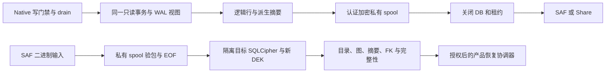
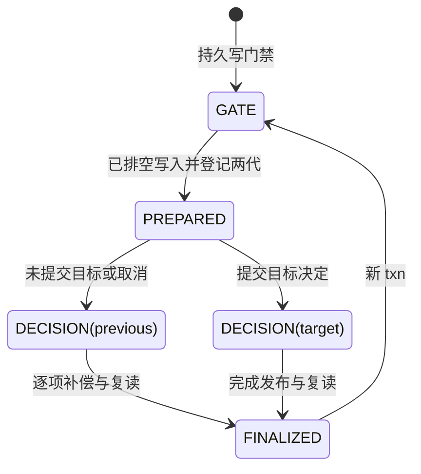

# Kanata SQLite M6-00 最终设计收口 v1

任务 KANATA-M6-00-CLOSEOUT-2026-11-20。日期 2026-11-20（北京时间）。实现分支 `m6/encrypted-backup-recovery`，核对的远端与本地工作树基线均为 `a301436259663999bd1cd6424e6e04ecb4662dc7`。

**建议采用 Scheme C。M6-00 建议通过设计准入，签核前状态为 CONDITIONAL PASS。** B-01～B-09 均有设计合同和分阶段硬门禁，H-01～H-06 均有明确处置。M6-01 合成参考实现的正式启动以同版本文档获得独立 GPT-6 PASS 为条件。签核状态见 [M6 路线](../../20261119-kanata-sqlite-m6-encrypted-backup-recovery-plan-v1.md)。Native 能力是 M6-02～05 和发行参数的硬门禁，设计收口未将其计为已实测。

## G-01 格式和范围

- 首发单项 Kanata 便携**覆盖**。Scheme C 将容器与 `kanata-logical-v1` 解耦，Native 持有 SQLCipher 数据面，Node/JS 提供同字节 oracle。包作用域与载荷类型均经认证。两个主机恢复同一包时分别生成新的本机 DEK。确认 UI 必须展示目标 scope 与覆盖效果，禁止默认合并及绕过产品协调器。
- 兼容矩阵见下。未来多模块完整便携备份用明确的新类型/版本与各参与者独立流、验证器、设置页分流和认证映射。M6-03 冻结同一个产品协调器的世代参与者接口，并做全量参与者及历史入口验收。新多模块 wire 另行批准，v1 读端拒绝该 scope 与未知 stream。

| 输入 | 保留语义 |
| --- | --- |
| `formyself-full-backup` v1–v12 | 保留版本归一化及缺字段行为。产品 Kanata 组合走历史聊天明确弃用确认，保留当前 Kanata，只恢复兼容 nonchat 参与者。 |
| `formyself-full-backup` v13 | 现有 Kanata DTO 覆盖语义，保留任务暂停投影与已展开归档。继续走原版本兼容路径。 |
| `kanata-chat-backup` v1 | 保留旧 JSON 单项覆盖、任务投影、合并拒绝，保留解析/认证入口。 |
| Scheme C 容器 v1 | 单项 `kanata-logical-v1`；新魔数先分流到有界二进制读取、本机授权分开。只有隔离目标验证和正式切换授权后可发布目标。 |

## G-02 加密与密钥

- 字节合同、参数 profile、错误分类和向量见 [M6-01 任务书](../../20261120-kanata-sqlite-m6-01-portable-backup-format-task-v1.md#2-外层字节合同)。PBKDF2-HMAC-SHA256 用严格 UTF-8 字节、随机 salt 与备份 ID，HKDF-SHA256 派生独立封装键。独立 CSPRNG BEK 经 AES-256-GCM 封装，帧键按用途和 stream 派生。AAD 绑定公开头、封套及帧头，帧 nonce 元组单射，禁止中断续加密。Footer 认证实际帧 transcript、流计数与表摘要，随后必须精确 EOF。v1 无压缩。
- 文件密码只授权包密钥，本机口令只授权存储会话及经验证的本机恢复。源本机 KEK/DEK、Keystore 材料、verifier 和生物凭据不进入包。事务认证键由本机可信存储持有，事务 AEAD/MAC 与便携/本机 DB 键均隔离。用受限缓冲和会话释放，记录稳定错误类别，不落盘明文口令和敏感行。
- 600000 次仅为待测候选和隔离测试 profile。发行 profile 必须在 API 24、25 及可用较新支持版本的字节、延迟与资源门禁通过后冻结。64 KiB 是候选 DATA 上限，另限制整行、单字段、文件、记录总数和缓冲。单帧内存通过不代表 SQLite/JNI 有界。

## G-03 一致性快照与私有 spool

1. 导出获得 Native Kanata snapshot owner，撤销旧操作租约、冻结任务调度，禁止普通写入并排空已进入提交的 writer。与恢复/改密的写门禁互斥。取得时写入连续性以最后成功 commit 为界，已确认写必进 snapshot。在同一连接 pin 一次真实读视图，同一只读事务完成 schema、表计数/行/摘要，使用固定主键或 ordinal keyset 分页；关闭快照后才解冻。连接必须保证只读，禁止为导出执行源 checkpoint、DDL、重加密或维护写。
2. WAL 有活跃事务时不复制主文件。M6-02 探针确认同连接读、普通/并发控制写、快照期间 WAL/锁行为。以单调时限、取消和 WAL/可用空间预算终止或清理；业务写在预算退出且确认只读任务已结算后恢复。专用 Native 导出/导入数据面，桥只传小命令/句柄，超长字段以已证明无截断的 Native 读取和绑定处理。任一平台不支持最大合法值时拒绝发布并保全原库，补做方案验证，不能改 schema 或静默截短。
3. 导出到应用私有 no-backup 密文 spool，负责文件所有权、完整认证和回读。先关闭 DB 与事务并释放敏感租约，再允许 SAF/Share。成功需二进制传输完成、关闭成功及 provider 可重读时验证字节。在无法证明原子发布的 provider 使用新目标名、保留已成功备份，部分文档按能力撤除或报告位置，永不标成功。临时分享使用仅本文件、限时可撤回的 uri 授权。
4. 导入先完成 picker 与本机授权并重新确认前台 epoch。Native 只读 SAF 一次，复制密文到私有 spool 并认证到 EOF；后续不依赖 URI，在同一受控私有副本上验证文件摘要并再解包，写入使用新 DEK 的隔离目标。支持短读、权限撤回、安全取消与过期；失败保留仍被事务引用材料，仅清除能证明属于本次且无引用的临时密文。prepare 前不得改 active。
5. Pause/锁屏/切换用户立即撤销 Native epoch 和前端租约，过期回调不能继续操作。已进入原子提交的动作由 durable record 判定，回调丢失先 query 再恢复。SAF、Share 或生物弹窗期间不得持有未完成的 SQLite 事务或跨 Activity 复用连接。冷启先查内部控制记录。

## G-04 持久化事务控制与冷启动

### 记录、锁与线性化

- Android Native 管理 app-private no-backup 控制根，使用专用跨进程锁串行持久化状态变更与最终业务写提交（enrollment 后的 SQLite、Preferences/文件、凭据、Todo/widget 及后台 worker 都需覆盖）。写许可带 owner、scope、generation、epoch，检查与写在同一次锁持有期。应用级批量写由 writer fence 和 in-flight 账结算。前台受保护会话和 Native 作业身份同时验证。仅锁 JS、检查文件存在、延时等待或让恢复写走普通 CAS 均违反合同。
- 控制根由安装登记与权威持久 head 两部分组成。登记绑定本安装、控制版本和受支持版本边界。head 是 Native 排他 CAS 管理、经认证的最新 `(sequence, recordDigest)` 引用，与控制记录独立存放于 no-backup 根。控制记录以完整认证字节的 SHA-256 寻址，发布后不可变。首次开户只走明确初始化，先安全保存密钥、登记、初始记录和 head。已登记但缺 head、密钥不可用、残件与登记冲突或 I/O 权限失败时不能按新安装建空。所有读取只接受 head 指定且 digest/seq 一致的记录，无权威 head 时不得扫描、猜测或从旧副本选取最高状态。
- 规范化、带版本的控制记录包含 `txnId`（随机 128-bit）、`kind`、`scope`、固定参与者清单和协议版本、owner、epoch、单调 transition sequence、previous & target generation、活跃指针、输入和引用摘要、进度及状态。每个不可变世代登记 root/file identity、schema/cipher/kek 绑定、材料摘要和组件校验。控制认证用独立 256-bit Native Keystore HMAC-SHA256 key，覆盖完整规范编码及安装/用途域；恢复日志的敏感载荷用独立 AEAD 密钥和唯一 nonce，绑定事务、角色和世代。OS Keystore 可用性与重启持续性由 N-05 实测。权威 head 的存储及更新路径属于本机信任根。旧记录单独替换、孤立决定、跨事务拼接、保留当前 head 的历史记录回放及过期 CAS 均拒绝。单独替换为较早且有效的权威 head 也可能在历史记录尚存时通过软件认证。Android Keystore MAC 与软件 seq 不提供硬件单调计数器，权威 head 被有效回滚超出本协议防回滚模型。系统备份排除 head，禁止把设备还原视为 head 更新。
- 状态转换由 `CAS(txnId, owner, epoch, expectedSeq, expectedDigest, next)` 管理，锁内重新读并认证当前 head 及所引用记录，核验安装身份、阶段与 `expectedDigest=SHA256(当前已认证规范记录字节)` 是否等于 head 的 recordDigest，并要求 expectedSeq 同 head.sequence。DECISION 另带不可变 `preparedDigest`（PREPARED 时固定），绑定参与者和两代材料。后续进度更新必须沿已登记链核对该摘要。Native 只接受允许的状态边和唯一方向，接管旧 owner 时先撤销旧 epoch 并证明作业终结，然后 CAS 产生新 epoch；不可夺取可信的在途持锁事务。
- 持有同一把锁时，先持久化新增世代材料，再发布不可变控制记录，最后更新权威 head。每步完整写同目录临时文件、`fsync(file)`、同卷原子 rename、`fsync(parent)` 后复读验证，新增目录另同步上级目录。head 的耐久安装是唯一线性化点，引用中同时绑定状态与活跃路由，其他指针为被阻断期间按记录重放的缓存。崩溃在 head 安装前留下的未引用候选只算 staging，不能据此改方向。rename/目录同步或应答不明时保持门禁，锁内按实际 head、记录及引用重新核验并补同步。验不出稳定版本即 blocked。读回可读性不足以证明掉电耐久。保留 head、当前记录与被引用的世代，垃圾回收只处理已证明无引用材料。
- Todo 与 Widget 读同一持久 fence。Native CAS 在共享锁内校验 revision 与 fence，普通 CAS 在任何 active gate 被拒，操作队列旧 epoch 同样拒。恢复能力只能提交匹配 txn 和 participant 的预期 revision，业务数据补偿仍递增 revision。门禁前已确认写必须包含于 previous，提交结果未知通过读回/幂等 operation id 结算。

### 状态与恢复

| 冷启动读到的状态 | 选择和下一步 |
| --- | --- |
| GATE | 阻断。可信记录证明未 apply，完成在途结算后以仅允许 previous 的 PREPARED 登记现行世代（target 缺席并标记 abort-only），再持久化 previous 决定和 FINALIZED。无法确认材料则继续 blocked。 |
| PREPARED，无持久决定 | 阻断。选择 previous，先持久化 previous 决定再按清单逆序补偿与回读。恢复路径用日志保存已 apply 进度及可验证前后标记。 |
| DECISION(previous / target) | 方向不可更改。无论回调、内存异常或磁盘写应答如何，重放同一方向，校验全部选定材料和参与者，持久化 FINALIZED 后才开普通入口。 |
| FINALIZED 完整可核验 | 正常使用选定世代。业务重放禁止介入；派生通知/组件同步账和无引用垃圾回收可单独重试。不能把 FINALIZED 的历史业务摘要当成后续普通写的固定数据哈希。 |
| 控制异常、密钥或材料缺失、未知版本、孤儿状态、失败补偿、持久状态不明 | 保留材料和诊断，保持 blocked。只允许经当前协议验证的重复恢复。禁止以确认 UI、静默删除或空库解决。 |

- 冷启由产品组合根和 Native 入口先探测，恢复专用认证跳过普通受保护模块加载、`prepareExports` 与业务 readiness。Native 基于已登记本机 verifier 或 G-06 选定槽认证，按 txn、参与者、操作、generation、epoch 和短时效发放不可伪造的内部能力。只开放登记材料核验、重放/补偿及发布已登记世代。普通 JS `recovering` 参数不授予权限。
- **旧日志盘点**统一检查 `restore-v1.enc`、`restore-v1.commit`、`restore-v1.tmp`，及曾被 Native 查找的 `restore-v1.enc.commit`、`restore-v1.enc.tmp`。新旧同时存在、残件冲突、旧 commit 缺主日志或不匹配均 blocked。升级前完成在原已知可信路径内的遗留事务；升级遇旧材料，提供专用兼容读取并验证 AEAD、分离旧候选与派生状态。旧 marker 是无密钥摘要，单靠它无法获得新协议的可信决定。无额外可信来源证明方向时保持 blocked，保留材料，由支持旧格式的受控恢复流程处理，禁止自动认证升级或改判。M6-05 验收现行旧日志正常恢复路径与异常组合。

## G-05 数据目录与语义

权威目录取基线 Schema 001～005 迁移。以下 ID 同时用于 v1 wire，数值由 53 张表名的 ASCII 升序确定。源校验及目标 staging 全程不改 DDL、关闭 FK 或禁用触发器。

| 类别 | 固定 ID 与表名 |
| --- | --- |
| 运行/迁移（3） | 10 `data_migrations`，41 `schema_migration_applications`，42 `schema_migrations`。 |
| 触发器派生（5） | 4 `baseline_array_order`，13 `effect_array_order`，15 `entity_ids`，16 `event_array_order`，35 `participants`。 |
| 业务（45） | 1 `archived_message_marks`，2 `autonomy_policies`，3 `background_tasks`，5 `card_versions`，6 `character_cards`，7 `character_instances`，8 `conversation_participants`，9 `conversations`，11 `dataset_metadata`，12 `domain_command_receipts`，14 `effect_baselines`，17 `event_audits`，18 `event_causes`，19 `event_life_sources`，20 `event_participants`，21 `event_sources`，22 `life_grants`，23 `lorebook_entries`，24 `lorebook_known_by`，25 `memories`，26 `memory_events`，27 `memory_known_by`，28 `memory_life_sources`，29 `memory_links`，30 `memory_policies`，31 `memory_sources`，32 `message_audits`，33 `message_life_sources`，34 `messages`，36 `preset_applications`，37 `relationship_events`，38 `relationships`，39 `role_binding_state`，40 `role_bindings`，43 `task_result_events`，44 `task_result_memories`，45 `task_social_participants`，46 `task_sources`，47 `usage_events`，48 `virtual_schedule_days`，49 `virtual_schedules`，50 `world_effects`，51 `world_events`，52 `world_identities`，53 `worlds`。 |

- 业务行按 [逻辑流规范](../../20261120-kanata-sqlite-m6-01-portable-backup-format-task-v1.md#3-kanata-logical-v1-字节合同) 保留每列。恢复 wire 顺序与依赖安装顺序解耦，用隔离加密 staging 和有界批次，禁止在 active 上解包。校验源码固定 catalog、application_id、版本和数据集指纹，进行 `integrity_check`、`foreign_key_check`、003 审计/实体登记核验及领域语义检查。运行表由本机可信迁移器生成，`data_migrations` 目标留空；来源若带未完成或无法核验迁移标记则拒绝。目标空迁移表不触发旧迁移。
- 导出派生行计数与规范摘要，目标经触发器重建，核验所有键、关联、分类与完整元组，不仅比较行数。实体与 `entity_ids`、身份/实例与 `participants` 逐项双向对应。源存在派生错误时不得用正确的空表或重算结果冒充源，拒绝并保留。
- 依赖图用 DDL 的 FK、触发器和领域引用做导入计划。先 metadata，`worlds` 再 identity 同事务，card 与 versions 同事务。建立实例、参与者、会话和成员后装消息；`messages.reply_to_message_id` 及 `reply_to_revision` 先置 NULL，`background_tasks.window_task_id` 先置 NULL，等同表所有目标身份与最终 revision 存在，再只更新引用列。保留 DDL 允许、作用域合法的前向引用和两节点环，拒绝自身环、跨 scope 或未来 revision；不修改 content 或 bump revision。延迟 FK `world_events.replaces_event_id` 同事务安装并用领域规则校验替换图；引用 audit/task/source edges 在最终版本就绪后安装。使用现有触发器和最后摘要证明两遍一致。
- 005 三张顺序表要求每个关联业务表按 world 与 ordinal 双向一一匹配、每 world 从 0 连续递增。源在同一 snapshot 验证后携带 ordinal，目标按 `(world_id, ordinal)` 插入业务行使既有触发器产生完整映射。v4 升 v5 不回填，缺失、洞、重复、孤儿、无法证明的原始顺序一律 `ARRAY_ORDER_INCOMPLETE`，保全来源。禁止按 PK、时间或 rowid 猜序，不做静默修复。
- `domain_command_receipts` 全量保留。按基线 `executeOnce()` 各具体调用点建立命令白名单与 scope 数组类型、长度、合法字符串和 result 类型表；key 必须是既有 `JSON.stringify(scope)` 规范字节，fingerprint 小写 64 hex，result 使用既有 ID 校验。现存结果须与具体命令所期望的类型/作用域吻合，允许该命令可能删除或替换的历史结果引用继续保留。拒绝未知命令或可证错配，不用当前编辑后的行重算请求 fingerprint。原重复合法请求返回原 ID，冲突请求拒绝。没有完整原请求时，不能用该收据证明历史命令作者。
- `background_tasks` 应用 `pause-sending-v1`：全部 `lease_until=0`；reply/proactive/followup 的 pending、running、failed → cancelled；其他 running → pending；其他状态原样。只投影导出行，不改源。进口重算并要求相等，暂停结果参加业务摘要。保留历史、续接边、幂等/租约之外元数据及 `notification_id` 作为历史字段。目标 OS 的通知所有权及映射另记一代，禁将旧机数字用于取消/重发旧提醒，分配新提醒也不得撞现有记录。完成后 runtime 重新评估来源版本、授权和 lease；恢复本机 previous 不再次套投影，旧租约仍撤销并由正常重启策略结算。测试无发送、重复调度、旧通知取消或外联副作用。
- `archived_message_marks` 连同全量 `messages` 和审计、引用导出；已归档正文仍是同一个消息 ID/世界/会话/版本且只能一份。目标核对每个标记的精确复合 FK、未标记消息和归档视图计数。旧 JSON 分页必须完整 hydrate 后走已有适配，损坏/缺失拒绝，不将标记视为正文或空集合。

## G-06 主密码变更

1. 与恢复共用 Native 持久 fence。完成旧主密码认证并排空旧 writer，登记旧 verifier、Vault、Kanata（canonical legacy 或经授权的 SQLite 世代；若还有需维持可读的候选，按独立参与者处理）和所有注册受保护参与者。当前注册顺序是 `passwords` → `chat`；新流程先以独立槽准备 Auth verifier，接着按上述参与者顺序准备数据和封套，验全部新旧材料可独立解开。释放旧 session，禁止运行时旧凭据继续取得 lease。
2. prepare 使用 A/B 双槽登记可访问的 previous/target，旧 Archive 页、Vault 与 verifier 保持可读。SQLite 解封旧 DEK，验证数据库身份；用新盐/nonce、与便携包域分离、以新主密码派生且认证绑定 generation/txn/slot 的本机 KEK 封装**同一个 DEK**，新旧槽独立读回并对比 DEK 和只读开库。保留旧封套 v1 读取。非 SQLite 复制写入所有页、校验索引及凭据，绝不先覆盖旧可读副本。封套事务槽明确登记，不能用 AtomicFile 的 `.bak/.new` 当作持久角色。
3. commit 先持久化决定和 verifier 方向，再凭方向发布参与者和 verifier。已准备但未决定的冷启仅接受旧 verifier 的口令，已决定 target 仅接受新 verifier；必要时要求重新输入选择方向的密码，冷启认证无需普通业务加载或生物凭据。持久记录无明文秘密。权威 verifier 槽立即决定普通认证，过渡期保持 blocked。
4. 生物凭据在 verifier 提交、业务复读后尝试刷新，刷新前禁用旧 token，写后读回并绑定新 verifier generation。生物凭据读取、删除或写失败时保持生物入口禁用，可继续用已确认的主密码入口。提交前失败选 previous，补偿逆序为 Kanata → Vault → verifier，逐项验材料与应用结果。提交后只能重放 target。rollbackFailed 或材料无法证明完整时跨重启 blocked。
5. retire 要求 FINALIZED 持久化、冷开复读全部选定参与者、旧授权和读句柄均撤销、无在飞事务引用、选定凭据稳定。清理仅退休旧 verifier/封套/页及已登记失效生物材料。不能核实鉴权隔离或引用状态则继续 blocked；确认只有无引用垃圾时审计并单独重试，旧密码不能普通进入。常规改密保留原 DEK，已泄露旧 KEK/封套或 DEK 的处置由独立 DEK 轮换方案覆盖。删除本机副本无法撤回离线副本。

## G-07 升级和生产隔离

- Legacy 与新 SQLite 世代共存。M6 合成实现和能力实验使用独立应用标识或明确隔离的 synthetic fixture/沙箱；验证构建配置、目录、凭据与调度边界。保留旧文件及原 canonical，禁止把存在有效备份、候选库或 M6 PASS 当成生产路由许可。Native 合成插件当前的 legacy 排斥是证据，不能靠放宽检查直接接产品。候选隔离与明确来源登记应先获准并实测。
- 升级前后保持旧读取器和 legacy 完整性；源与 staging 各自目录管理 DB/WAL/SHM/envelope，不搬单个侧文件跨代。若未来激活，必须单独批准目标环境、允许版本、数据保全、恢复可达性和 canonical CAS，事务选定后才可显式切换。
- 老程序不认识新协议，存放新文件不能防止旧二进制写 legacy。M6 保持独立身份，从部署上禁止旧生产 app 接管合成状态。任何后续真实同包名部署须先证明有可执行的版本/签名、安装回退和系统还原防护，或让所有可安装的兼容构建在启动及 Widget 入口识别并阻断未知状态；如果平台允许无防护旧版重用同数据，停止生产启用。备份/迁移/设备还原规则排除内部 spool、候选和事务材料，整代采用协调恢复。人工降级前须先由支持协议的版本处理挂起事务、验证并独立批准导出/恢复路径，禁止删日志、侧载降级以绕过 fence。

## 风险关闭矩阵

「准入」针对 M6-01 合成实现。B-01～B-05、H-01～H-06 取自 Neon 独立复核第 4 节，B-06～B-09 取自设计冻结前审查第 C 节。历史 QA 用例若有同名不沿用。下表列出后续必须取得的实现证据，验证责任未完成时阻止相应阶段退出或产品接入。C01 用例定义见任务书，F02～F05 是此表各行的故障门禁。

| ID / 原始问题 | 真实代码证据（见索引） | 最终设计合同 | 责任子阶段与必须通过的测试 | M6-01 准入 |
| --- | --- | --- | --- | --- |
| B-01 恢复先用普通模块加载，坏库与日志导致恢复死锁 | Boot/RC/Access/FB/KB；Candid/Native 拒绝日志和普通会话 | G-04 分离冷启认证、恢复能力、普通就绪。绕开普通加载但保留专用鉴权，限制已登记参与者与世代 | M6-03 F03-02/06。实际恢复入口分别破坏 Vault、旧 Kanata、Settings readiness；可核验恢复方向，普通调用仍拒绝；M6-05 回归 | 否，后续集成硬门禁 |
| B-02 系统 Activity 使 Native epoch 撤销，迟到回调与未知提交 | Native pause/revoke/commit，Candid watcher 与 UI guard | G-03/04 系统返回后新租约；导出关 DB 后分享；提交应答不明查持久决定 | M6-02 F02-02、M6-03 F03-09。取消、锁屏、旋转、快速 resume、commit 后未回调；零过期写入，能判方向 | 否，Native 硬门禁 |
| B-03 固定 SQL 桥、Cursor、长字段/不可变列 | Native 单 Java String 上限 262144 UTF-16，普通 query 聚合 JSON；Card 已有小参拼成单次 INSERT。S 的消息只在正文/删除变更时要求提高 revision | G-02/03 Native 数据面 + 有界字段/行/帧；桥只传控制。保留可合法长值和 NUL；现有路径不能作为备份传输 | M6-01 C01-02/04；M6-02/03 F02-03。262144/262145 UTF-16、2 MiB 上下、复合大行、最大合法卡和审计文本、跨块 UTF-8、分配与 RSS | 否，线合同已定，C01 为退出硬门禁 |
| B-04 改密崩溃形成新旧分裂，内存 blocked 消失 | PW 顺序补偿、Auth verifier/生物写入与 Store 提前退休页 | G-06 持久 prepare/commit/retire，双槽、定向认证、逆序补偿、旧材料延迟退休 | M6-04 F04-01～04。各参与者、封套、verifier 和生物每步强停或写成应答错，恢复后验证唯一认证方向和旧材料完整；失败持续 blocked；M6-05 回归 | 否，M6-04 硬门禁 |
| B-05 SQLCipher 快照原语和活跃 WAL 无实测 | Native READONLY preflight 与写事务存在，当前无快照导出；Gradle SQLCipher 4.17.0 | G-03 同一只读事务、固定 WAL 视图和写栅栏；物理方案只作为独立对照 | M6-02 F02-01/04。A/C、在途写和持 WAL reader，跨表不变量、源库逻辑零变化、预算和异常安全 | 否，阻断 Native 快照集成 |
| B-06 决定、清理与启动探测之间缺可信闭环 | RJ 缺主日志时清旁文件，RC 根据 marker 选择且清理，Boot 仅探测旧日志 | G-04 权威 head + MAC 控制 + 加密载荷 + 文件/目录同步 + 可信 FINALIZED；未知 blocked | M6-03 F03-03/04/05/07/08，M6-04 共用。断电点、孤儿 commit、ENOSPC、rename/sync/读回错误、清理乱序与计数；方向唯一或 blocked | 否，阻断恢复和改密集成 |
| B-07 普通 Todo CAS 和旧任务可越过恢复日志 | Todo 的 bridge CAS 与 widget 持久化路径不同，检查与实际写需统筹 | G-04 共用 Native fence 与 CAS 锁；排空并捕获所有已确认写；恢复票据限定，revision 单调 | M6-03 F03-01/03。预排队 CAS、widget 过检查后延迟、日志建立后普通 CAS、写成回调丢失；M6-05 旧版本/组件验收 | 否，阻断恢复集成 |
| B-08 DDL 合法两节点环与 005 缺失原序 | S 的立即自 FK 与版本触发器，Order 不回填；内存探针 E-04 | G-05 两遍、原 ordinal 与覆盖证明，缺序拒绝并保全。排除猜序和仅拓扑法 | M6-01 C01-02/05，M6-02 F02-03，M6-03 F03-02。双环、前向 FK、未来 revision、缺/空/洞 ordinal、正确后补的摘要 | 否，格式语义已定，C01 为退出硬门禁 |
| B-09 候选盘点与保留 legacy 冲突，可能读错 canonical | Candid 的合成开关、Native 目录拒绝 legacy、FB/Modules 使用现行旧 Store | G-07 两代/两身份登记、保留 legacy；禁止隐式激活；版本与数据隔离 | M6-03 F03-02/10 与 M6-05。双代同时存在、旧页/凭据、空/既有目的重启，降级与 OS 恢复不能越过不可识别 gate | 否，阻断产品切换 |
| H-01 53 表、业务收据、触发器与外键校验不全 | S/Hard/Order、DR 的收据直接返回，MR 只盘点 | G-05 45/5/3，保留并按命令校验；派生重建，精确摘要+FK+领域图 | M6-01 C01-02/05，M6-03 F03-02。53 表逐项、全列漂移、同请求无副作用、异常收据、完整派生及层级依赖 | 否，C01 为退出硬门禁 |
| H-02 文本整读与密码耦合、URI 重启不可依赖 | UI 读文本及同一受保护会话口令，尚无 M6 Native SAF | G-01/03 独立密码与授权、私有密文 spool、EOF，URI 仅一次读取 | M6-01 C01-03/04；M6-02 F02-02、M6-03 F03-02。短读/撤权、provider 半写、URI 被替换、独立双角色错密码 | 否，C01 与 Native 硬门禁 |
| H-03 API 24/25 KDF provider 和字节差异 | Gradle minSdk 24，KEK 当前走 WebCrypto、Env 只 JCA GCM，API 34 CI 无此证据 | G-02 固定 KDF 字节规范、合成 profile 隔离、发行参数先实测后冻结 | M6-01 C01-01/04，M6-02 N-01，M6-05 F05-01。API 24、25、≥26 的 KAT、中文/辅助平面/分解/非法代理项、延迟和拒绝门禁 | 否，阻断发行 profile 和 Native 合并 |
| H-04 commit 未传 expected digest，marker 无认证 | RC prepare 记录 digest，commit 不带；RJ 只重读和 SHA | G-04 CAS 绑定当前及 PREPARED 摘要，经本机 MAC 认证 | M6-03 F03-04/07，M6-04 共用。替换、伪造、当前 head 保留下的旧记录重放、错误应答、同步失败 | 否，阻断持久决定 |
| H-05 JS、Native、Todo 对日志文件名和存在态不一致 | RJ 路径三件，Native 多查 enc 后缀，Todo widget 看主日志 | G-04 统一 Native 盘点及旧路径协议，缺失/错误/未知分辨 | M6-03 F03-07、M6-05 F05-02。逐一孤儿与冲突组合、权限异常、旧读者回归 | 否，阻断恢复上线 |
| H-06 无 rewrap，临时备份封套会被拒 | Env 只有 create/read/unwrap；Native 拒绝 .bak/.new | G-06 事务专用 A/B 角色及同 DEK 读回，未知/错代锁定 | M6-04 F04-02/03。错 tag/错 DEK/错 generation、退役或失败恢复、双槽重开 | 否，阻断改密上线 |

### M6-03～05 共用故障判据

- F03-01～03：写门禁/在途 CAS 与 capture、阶段前故障、两代/完整图；SQLite pointer、Todo、Settings/API Key、Vault/其他参与者任一点部分 apply。对安全凭据写入或读回失败分别注入，配对业务设置与凭据。有效 PREPARED 未决定选 previous，逐项读回复核；active 无投机写。
- F03-04～08：决定前后强停，清理失败、回滚失败、孤立/损坏/旧版日志、拷贝重放与 ENOSPC。状态未知即 blocked，成功目标不错误回滚。用锁内 CAS 和持久读回记录证明方向；同步任务失败不重导入。
- F03-09/10：后台撤销、kill、强停、应答丢失、重复冷启及多 owner 竞争，检查幂等、调用方不能伪造恢复能力、旧请求不复活。覆盖产品旧格式与新单项，完整恢复参与者无遗漏且 legacy canonical 路由服从批准。
- F04-01～04：逐材料 prepare、同 DEK 双槽、决定/verifier/生物与逆序补偿、退休及 100k 改密。使用旧、新口令分别走实际冷启，回滚失败保持 blocked，完整改密核对 120 秒规划门槛。
- F05-01～03：API 24/25/较新版本向量、两隔离目标新 DEK；v1–v12、Kanata v13/旧单项、旧日志与所有待提交旁文件；实际恢复/改密路径、多个硬停点、磁盘故障、无敏感哨兵落盘、OS 备份与降级隔离。报告区分模拟 I/O、进程 kill、强停与掉电。

## Native 前置验证

| ID | 最小探针、通过证据和阻断点 |
| --- | --- |
| N-01 密码学及低 API | M6-02 第一批，API 24/25 与近期支持版本记录 ABI、实际 provider 和 WebView，以 byte[] 的 PBKDF2-HMAC-SHA256、HKDF、GCM/AAD 检查 C01 固定向量和错误。优先采用经审核的字节接口；若 JCA 工厂不支持或转码不同，试经向量验证的兼容字节实现，同旧路径隔离，禁止未经验证的 fallback。600000 与对照候选至少记录延迟、RSS、取消及失败，先确定最低支持设备体验预算再据实确定发行 profile。未通过阻断其冻结和 Native 包读写，M6-05 在产品候选重复。 |
| N-02 SQLCipher 只读和物理候选 | M6-02 先核实 SQLCipher 4.17.0 AAR 和 ABI 实际公开 API、rawKey 参数、SQLite 版本及 WAL 行为。用小合成库证明 DEFERRED 只读事务在同一 connection pin 读，已有 WAL/SHM、其他 writer、关闭与取消；独立探针检查 online backup/安全物理路径是否可调用与可加密。阻断 A/C 相关功能，逻辑路径须单独过。 |
| N-03 长行和内存 | M6-02 起用合成长 TEXT/JSON、内嵌 Base64、NUL、整行与字段边界量化分段读取、SQLite 参数绑定、CursorWindow/JNI 的隐藏分配；区分 cipher、Java、app 与 WebView。验证 64 KiB、候选字段/行和最差合法业务数据，以及低空间、高 WAL、短读下有界拒绝。M6-03 重测绑定和 staging；未证明能力不得定发行资源上限或发布包。 |
| N-04 SAF/生命周期 | M6-02 起测真实隔离 picker、Share、Credential prompt、快速 pause/resume、权限撤回、provider 返回零进展、取消、强杀和重启。验证 epoch 失效、关闭和 spool 清理/归属，provider 半文件无成功状态。M6-03 重测提交回调丢失。 |
| N-05 Native CAS 与耐久性 | 在 M6-03 产品协调器接入前，用两进程及 widget 合成验证锁/CAS 配对，文件与父目录同步、同卷原子 rename、Keystore MAC/AEAD 冷启可用性、登记、head 与权限/密钥异常。故障点覆盖材料、记录和 head 各自 write/fsync/rename/dirsync/答复、系统终止，及保留 head 单独替换旧记录。N-05 未通过时禁止恢复或改密接入及启用。 |
| N-06 重开、双槽和隔离 | M6-03 先证新旧世代共存、恢复认证不需受损模块；M6-04 先证双槽、KEK rewrap 同 DEK、两种 verifier 冷启与生物凭据更新。M6-05 检查旧二进制拒绝/安装回退、merged Manifest 的 OS backup/extraction 排除和侧文件隔离。 |

M6-01 合成 Codec 前的必要证据是独立签核与本报告的固定 Schema 目录。未运行上表 Native 探针。最大业务行、发行参数、平台耐久性均作为列明的最小补证项；失败保持对应阻断。禁止借用 M6-QA-01 API 34 或历史 M5 数字当成上述能力证据。

## M6-02 A/C 独立实验规格

- 统一实验条件：相同隔离账户、模拟世界/会话/归档比例、可复现种子、长字段、活跃 WAL、高水位和同一逻辑语义 oracle。固定 1k / 10k / 100k 消息，至少 1 次独立冷测和 5 次有记录的重复测量，A/C 交错轮次，记录硬件、API/ABI、AAR、输入指纹、初始 WAL 大小、缓存/进程初始条件。报告每轮及中位数、最大值，样本不足不报可靠 p95。
- **实验 A：SQLCipher 物理一致性。** 原语探针仅在独立合成库。优先检查受支持的 SQLite backup 可用性与页一致性；候选物理等价路径另列实现特征。目的副本用独立实验 DEK 和受验证的便携外封装，禁止携带源 DEK/封套或直接复制活跃主文件。若该 AAR 无可用且不改源的物理原语，记录 A 不可测及最小证据。跨设备在同一/不同支持 ABI 与 cipher 参数组合验证，含 004、005 首次打开与迁移兼容、只读校验、源未受损。
- **实验 C：逻辑快照与分块。** 读同一 Native 只读视图，跑固定 45 表段、5 派生摘要与 spool，恢复进另一个隔离目标，目录和逻辑摘要逐表对照。跨设备换 DEK，验 005 正向、004/缺序与未知版本安全拒绝，不以自动修复来生成测试成功。
- **对照记账。** 两支共同测试 WAL 有提交但主库未 checkpoint、已启动未提交 writer、跨表同事务的共同不变量、导出步骤强杀/重启、短读/撤权、目标写 ENOSPC/导出取消、源 integrity_check/FK/业务指纹与重开。验证一次失败对源/已成功产物无破坏。分别记录从获授权到密文 spool 关闭的导出耗时、同口径传输时间、最终携带文件字节、app 与 WebView 同时峰值 RSS、Native/Java heap、WAL/私有磁盘峰值及失败分类。规划 RSS 红线 512 MiB，导出上限按项目已登记事实与目标设备先冻结同口径预算。报告实现不支持、跳过、未运行和实测。A/C 均未在 M6-00 执行，无预设性能胜者。

## 独立复核证据索引

| 证据 | 位置、命令或复核重点 |
| --- | --- |
| E-01 用户与工作规范 | 当前任务书；[AGENTS.md](../../../AGENTS.md)、[架构说明](../../../架构接口与Agent开发说明书.md)、[开发背景](../../../memory-bank/development-context.md)、[资料来源](../../source-notes.md)。 |
| E-02 审计继承 | [原 GPT 审计](m6-00-architecture-audit-v1.md)、[Gemini Neon](m6-00-independent-review-v1.md)、[设计冻结前审查 f0b0d6c](https://github.com/Zhoubin601/ForMyself/blob/f0b0d6cdf0e87d0abd95c5a599f97c5ab1e53325/docs/qa/kanata-sqlite-m6/m6-00-design-readiness-review-v1.md) 的 B-06～B-09、内存探针和 F 分阶段用例。原复核中某平台行为是待证，当前 source 事实见各行。 |
| E-03 Git 与历史 CI | `git ls-remote origin refs/heads/m6/encrypted-backup-recovery` 核对上述 HEAD；原本地分支 `af31867` 在现有清洁独立 worktree 仅 fast-forward。M5-06 SHA 为 `2b6e8e3591385024576c6606cce2acc31dbaad2b`，M5 Overall 终态 `60f89c0c333b7daa74fd46a4db81522e72532aeb` 是共用祖先 `b695226a8495d9129e9e95cf127bfbc4a61c92c4` 的另一后代。`git diff --exit-code 60f89c0 HEAD -- src android/app/src/main` 无差异。M5 最终签核见 [固定提交报告](https://github.com/Zhoubin601/ForMyself/blob/60f89c0c333b7daa74fd46a4db81522e72532aeb/docs/qa/kanata-sqlite-m5/m5-overall-final-independent-review-v1.md)。`gh run view` 核对 [44687910607](https://github.com/Zhoubin601/ForMyself/actions/runs/44687910607)（本轮基线 a301436）和 [44684735609](https://github.com/Zhoubin601/ForMyself/actions/runs/44684735609)（522d264），均 web/android 成功；[QA-01 报告](m6-qa-01-report-v1.md) 独立适用。未触发本文档的远端 CI。 |
| E-04 合成 Schema 探针 | Node v24.14.1 读取 E-S 的 `KANATA_SCHEMA_MIGRATIONS`，Python 3.13.5 的 SQLite 3.49.1 将原 DDL 应用于 `:memory:`；DDL 数 161/36/19/7/21，表 53、触发器 149、显式索引 42，类型为 INTEGER/REAL/TEXT，全表有 PK，`integrity_check=ok`、`foreign_key_check` 无行。指纹见任务书。使用同一内存 DDL 另复现 messages 和 background_tasks 两节点两遍回填，FK 空、完整性 ok；004 单事件升级 005 后原事件 1、order 行 0，仍通过通用完整性。另执行 `node --test tests/kanataSqliteArrayOrder.test.js tests/kanataSqliteSchema.test.js`，22 通过，无失败或跳过。目标 Android SQLCipher 引擎仍按各阶段验收。 |
| E-S Schema 和行为 | S [001/002/004 DDL](../../../src/features/chat/storage/sqlite/kanataSchema.js#L36-L300)，Hard [003](../../../src/features/chat/storage/sqlite/kanataSchemaHardening.js#L39-L83)，Order [005](../../../src/features/chat/storage/sqlite/kanataSchemaArrayOrder.js#L12-L58)，MR [迁移行映射](../../../src/features/chat/storage/sqlite/kanataDataMigrationRows.js#L427-L437)，DR [收据](../../../src/features/chat/storage/sqlite/kanataDomainRows.js#L81-L108)，Card [卡片写入](../../../src/features/chat/storage/sqlite/kanataCharacterRepository.js#L44-L110)，[归档标记](../../../src/features/chat/storage/sqlite/kanataHistoryArchive.js#L78-L98)。 |
| E-R 恢复、设置与入口 | Boot [启动](../../../src/main.js#L16-L24)，RC [协调器](../../../src/application/restoreCoordinator.js#L6-L96)，RJ [日志](../../../src/platform/storage/restoreJournal.js#L5-L82)，Access [会话/恢复](../../../src/stores/protectedAccess.js#L67-L170)，FB [组合根](../../../src/application/fullBackupRuntime.js#L27-L78)，KB [Kanata 恢复编排](../../../src/application/kanataBackupRuntime.js#L55-L96)，UI [设置导入与认证](../../../src/composables/settings/useBackupSettings.js#L63-L280)，[实际冷启调用](../../../src/composables/useAppController.js#L536-L544)，[v13 与任务投影](../../../src/features/chat/backup/kanataBackup.js#L46-L202)。 |
| E-N Native 及钥匙 | Native [SQLite 插件](../../../android/app/src/main/java/com/yubin/formyself/KanataSqlitePlugin.java#L79-L644)，Candid [候选组合](../../../src/application/kanataSqliteCandidate.js#L20-L158)，Todo [原生仓库](../../../android/app/src/main/java/com/yubin/formyself/TodoRepository.java#L31-L130) / [桥](../../../android/app/src/main/java/com/yubin/formyself/TodoPlugin.java#L44-L60)，Env [封套](../../../android/app/src/main/java/com/yubin/formyself/KanataKeyEnvelope.java#L49-L142)，KEK [现行 WebCrypto](../../../src/platform/security/kanataSqliteKek.js#L4-L25)，[minSdk](../../../android/variables.gradle#L2)，[AAR](../../../android/app/build.gradle#L102)。 |
| E-P 改密 | PW [进程内补偿](../../../src/services/masterPasswordChange.js#L1-L24)，Auth [verifier](../../../src/stores/auth.js#L38-L66) / [生物刷新](../../../src/stores/auth.js#L232-L243)，Store [归档页](../../../src/features/chat/kanataStore.js#L297-L338)，Modules [受保护参与者](../../../src/application/protectedModules.js#L21-L22)，[Vault](../../../src/features/vault/vaultStore.js#L198-L217)，[设置凭据写入](../../../src/stores/settings.js#L424-L480) / [凭据适配](../../../src/platform/security/secureCredentials.js#L30-L75)。 |
| E-05 审查复现要点 | 对比上述 Git 基线、排除未授权差异，用仓库原始 DDL 验证目录；逐字复算任务书尺寸、nonce、摘要和阶段边界；按 N-01～06 列出剩余能力和阻断点。报告要求同版材料签核，附审阅文件 SHA-256、结论以及残留问题。 |

M6-00 的验证范围为设计/文档、合成内存 DDL、Git 与既有 CI 核对。未运行真实数据、真实设备、完整 A/C、生产切换和本阶段业务回归。`npm run check` 由 M6-01 实现验收负责。下一阶段仅按 [合成 Codec 任务书](../../20261120-kanata-sqlite-m6-01-portable-backup-format-task-v1.md) 启动，Native 与生产准入分别由各自硬门禁证明。
