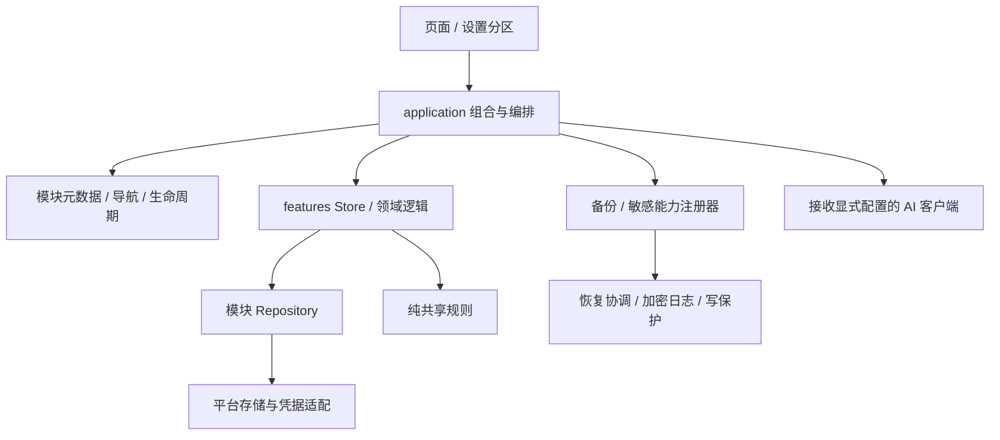

# ForMyself 架构接口与 Agent 开发规范

版本：v1.2（增加 Kanata P2 仓库、清理及备份契约；阶段验收以证据为准）。基础架构日期：2026-10-27（北京时间）。基础源码基线：`995a37e41f1835f75025fb3ca24bd9b745a94311`，架构 P1–P6 完成版本；Kanata 增量以第15–16节和对应阶段验收记录为准。

位置约定：用户指定本文件放在项目根目录，作为后续 Agent 的长期开发规范；其他正式交付物继续放 output。本文链接和示例路径均以根目录位置为准。

目的：让后续 Agent 在现有架构上开发，知道改动应放在哪里、接入哪些接口、保留哪些安全边界，以及用什么证据证明完成。本文是开发说明和规范，不是新的功能实现或新的产品验收。

“必须/禁止”表示开发要求；“当前实现”描述本版实际能力；示例只解释接口，不代表产品新增模块。后续 HEAD 变化时必须重新核对源码，不能凭本文的提交号或历史测试数判断当前状态。项目工作与交付总规则见 [AGENTS.md](./AGENTS.md)。

## 1. 接手前先完成这些检查

1. 阅读 AGENTS、本文及本次涉及的源码；再读 docs 中对应来源、分析、计划和验收。需要历史背景时读 [长期索引](./memory-bank/development-context.md)。[旧 HANDOFF](./HANDOFF.md) 仅作历史档案。
2. 执行 `git status --short --branch`、`git rev-parse HEAD`、`git diff --stat`，识别已有修改、删除和未跟踪文件。保留其他工作；不得用 reset/clean/强制检出来获得干净工作区，也不自动恢复用户删除项。
3. 明确当前授权范围、数据/格式/界面影响与验收方式。复杂任务在 docs 留下来源和计划；本地已有证据不等于本轮重新验证。
4. 仅按任务需要读取 raw，遵守只读、来源与敏感资料规则。测试默认使用合成记录，不把真实凭据或私人备份写入夹具。
5. 依赖准备使用 `npm ci`，版本以 package-lock 为准；postinstall 会应用受控原生补丁。不要绕过失败补丁继续交付，也不要在不需要时顺带升级依赖。

## 2. 架构地图与依赖方向

当前是 Vue 3 + Pinia + Vite + Capacitor 的模块化单体，业务数据以本机存储为主。Web 与 Android 具有不同平台能力。配置兼容的 AI 服务会接收用户选择的请求内容，不能宣称所有资料始终不离开设备。



图表达主要职责，未画出所有历史服务、兼容转发和必要聚合。不要把它当成所有旧代码已彻底解耦的证明。

| 目录 / 文件 | 职责 | 新改动规则 |
| --- | --- | --- |
| `src/application/` | 模块注册、导航、生命周期、备份/敏感组合、生活上下文、设置投影 | 在组合根表达跨业务协作；不能承载每个业务的全部领域规则 |
| `src/features/<feature>/` | 业务视图、Store、仓库、领域规则与局部适配 | 新业务优先在此形成边界；命名沿用相邻模块 |
| `src/platform/storage/` | Preferences、键清单、持久化状态、仓库与恢复日志 | 不在视图或普通 Store 直接调用持久化插件 |
| `src/platform/security/` | 原生安全凭据适配 | 凭据错误保持语义；不改为普通设置明文保存 |
| `src/platform/ai/` | 协议请求与流式处理 | 配置由参数提供；不导入全局 Store |
| `src/shared/` | 不依赖业务 Store 的公共规则 | 只放跨业务且职责稳定的纯规则 |
| `src/components/` | 公共控件、首页、设置分区 | 不将新增完整业务都堆入通用目录 |
| `src/composables/` | 应用壳和设置等交互编排 | 明确订阅、清理与请求所有者 |
| `src/services/` | 现有领域服务、通知、安全事务、兼容入口 | 随业务逐步整理，避免一次无关路径重排 |
| `src/stores/` | 认证、设置、受保护会话及旧入口转发 | 旧转发保持薄层，不继续添加业务 |
| `tests/` | 领域、组件、集成、故障、共享夹具与类型样例 | 新回归放进常规命令实际覆盖的范围 |
| `docs/` / `docs/qa/` | 过程、分析和验证证据 | 历史失败保留，结果和测试范围清楚区分 |
| `output/` | 正式交付 | 生成产物按既有忽略规则处理；本说明书按用户要求保存在项目根目录 |

已存在的 WeightView、DebtListView、PasswordVaultView 及对应旧 Store 路径是转发入口。新逻辑优先进入 `features/weight`、`features/savings`、`features/vault`。当前 lint 对 shared、AI 传输、部分 Core 与 feature Store 已限制导入；范围见 [eslint.config.js](./eslint.config.js)。规范适用于新增代码，不因某个历史文件尚未被 lint 匹配就允许引入耦合。

## 3. 模块、Store 与备份 ID 对照

这些命名不是同一个命名空间，不能相互猜测替换。

| 页面 ID | 业务位置 | Pinia Store ID | 备份参与者 ID |
| --- | --- | --- | --- |
| `home` | `components/HomeView.vue` | 由多个 Store 组合 | 无独立项 |
| `reports` | `components/MonthlyReportView.vue` | 由多个 Store 组合 | 无独立项 |
| `debts` | `features/savings/` | `debt` | `savings` |
| `weight` | `features/weight/` | `weight` | `weight` |
| `mood` | `features/mood/` | `mood` | `mood` |
| `todo` | `features/todo/` | `todo` | `todos` |
| `schedule` | `features/schedule/` | `schedule` | `schedules` |
| `chat` | `features/chat/` | `chat` | `chat` |
| `passwords` | `features/vault/` | `passwordVault` | `passwords` |
| `settings` | `components/SettingsView.vue` | `settings` | `settings`（非页面描述中的单项选项） |

认证和受保护会话分别见 [auth.js](./src/stores/auth.js)、[protectedAccess.js](./src/stores/protectedAccess.js)。不要将 Store ID 当作路由白名单或备份字段。

## 4. 页面注册与导航接口

定义：[contracts.d.ts](./src/application/contracts.d.ts)。实现：[moduleRegistry.js](./src/application/moduleRegistry.js)、[appNavigation.js](./src/application/appNavigation.js)。

### 4.1 ModuleDescriptor 与注册器

`createModuleRegistry(modules)` 返回 `list/get/has/settings/menu`。重复 ID、缺少标题/页面加载器、无效 access 等会抛出明确配置错误。

| 字段 | 类型 / 当前语义 |
| --- | --- |
| `id`、`title` | 必填字符串；ID 唯一且稳定 |
| `loadView()` | 必填；返回页面组件或 `{ default: component }` 的 Promise |
| `label`、`meta`、`icon` | 菜单显示名、副文案、图标名称；新图标还需接入 App 的图标映射 |
| `name`、`cache` | 组件名和缓存策略；普通模块默认缓存，敏感模块默认不缓存；敏感缓存必须提供可匹配的组件名以支持排除 |
| `access` | 可选，目前唯一非空值为 `'protected'`；必须同时接入敏感能力 |
| `settings` | 可选描述字符串；用于模块设置范围与入口，不会自动生成该模块的设置界面 |
| `backup` | 可选 `{ id, label, prefix }`；生成备份选择元数据，不自动实现备份参与者或文件协议 |
| `enabled(context)` | 当前影响菜单生成；不能作为鉴权、生命周期、导航或存储安全门禁 |
| `bindings(context)` | 页面 props/事件映射；仅暴露所需字段，不传递全部全局状态 |

下例使用现有体重页面演示真实字段，创建独立注册器；新增模块时替换为自己的实现，不能用它覆盖生产清单。

```js
import { createModuleRegistry } from './src/application/moduleRegistry.js'

const registry = createModuleRegistry([{
  id: 'weight',
  title: '体重记录',
  name: 'WeightView',
  loadView: () => import('./src/features/weight/WeightView.vue'),
  backup: { id: 'weight', label: '体重数据', prefix: 'Weight' }
}])
registry.has('weight') // true
```

### 4.2 导航与返回

`createAppNavigation({ registry, filterRoute })` 维护当前路由、最多 30 层历史、滚动恢复及模块设置。主要方法：`navigate(value, options)`、`replaceRoute(value)`、`switchView(view)`、`goBack()`、`openModuleSettings(scope)`、`openGeneralSettingsSection(section)`。现有 settings Store 仍代理相关接口，兼容旧调用。

必须通过导航方法修改页面；不要直接改 currentView 来绕过历史、过滤和设置范围处理。保留通知目标中的 Todo item/date、Schedule item/occurrence、Chat proactive 等业务语义。

深链入口见 [appDeepLink.js](./src/services/appDeepLink.js)：先验证 `formyself://open/...` 协议与主机，再解析目标；当前密码库和设置不进入通用别名清单。保留 WebView 113 的自定义 URL 兼容回归，不将深链参数视为可信执行指令。

弹层通过 [backNavigation.js](./src/services/backNavigation.js) 的 `registerBackHandler(handler, { priority, isActive })` 注册，并在卸载时注销。handler 返回 `false` 表示未处理，其余返回值会消费该次返回；不要漏写返回值导致错误拦截。

## 5. 生命周期与普通模块接入

实现：[moduleLifecycle.js](./src/application/moduleLifecycle.js)、[ordinaryModules.js](./src/application/ordinaryModules.js)、[useAppController.js](./src/composables/useAppController.js)。

`LifecycleParticipant` 必填 `id`；`initialize/resume/flush/subscribe/dispose` 均为可选钩子，按实际能力实现。`subscribe()` 返回取消订阅函数；`dispose()` 释放模块资源。

- `createModuleLifecycle(participants).initialize()` 对同一实例去重；处置后不能再次初始化。
- `resume()`、`flush()` 和初始化内部调用使用 `Promise.allSettled`；Promise resolve 不表示所有模块成功，调用者必须检查 rejected 结果并结合 Store 状态反馈。
- 初始化结束才注册订阅；卸载期间的迟到初始化不会再注册。dispose 幂等，先取消订阅再执行模块清理。
- `createListenerScope().listenMany(plugin, bindings)` 独立注册原生事件，单个失败/迟到不应阻断其他事件；处置后的迟到 handle 仍需移除。

新增普通模块的完整步骤：

1. 建立 feature 的规则、可注入仓库、Store 和视图，先定义数据和失败语义。
2. 在模块清单注册页面；需要新图标或模块设置时补齐图标映射、设置组件/composable 与字段投影。
3. 在 ordinaryModules 的组合根提供 Store、initialize、flush 及必要订阅/前台恢复。控制器可调整构造依赖；不要新增逐模块启动/后台保存条件分支。
4. 接入 Store 的加载/保存状态、页面错误与重试。新的聚合首页/报表/提醒必须明确数据就绪条件，不能把失败模块当空数据。
5. 按需要独立接入备份、深链参数、首页卡片、通知和 Android 能力。检查备份设置页仍存在的 readiness/解析映射，不假定注册器覆盖一切。
6. 增加导航、返回、滚动、重复初始化/订阅清理、存储故障与数据往返测试。参考 [ModuleRegistry.spec.js](./tests/ModuleRegistry.spec.js)。

## 6. 普通存储接口与失败语义

实现：[preferences.js](./src/platform/storage/preferences.js)、[preferenceRepository.js](./src/platform/storage/preferenceRepository.js)、[storePersistence.js](./src/platform/storage/storePersistence.js)。现有最小样例：[weightRepository.js](./src/features/weight/weightRepository.js)、[weightStore.js](./src/features/weight/weightStore.js)。

### 6.1 Driver 与 Repository

`PreferenceDriver.get({ key })` 返回 `Promise<{ value: string | null }>`；`set({ key, value })` 返回可失败的 Promise；remove/flush 在驱动上可选。`createPreferenceRepository(keys, driver)` 限制可访问键，未知键抛错；仓库暴露 get/set/remove/flush，并可增加业务 read/validate 等方法。

新增 Preferences 键集中登记 [keys.js](./src/platform/storage/keys.js)，保持已发布键、记录 ID、日期和版本兼容。Todo 现有键由专用仓库导出，不能为追求形式统一而无迁移地移动或改名。大集合当前仍全量 JSON 保存；仓库边界便于替换，不代表已实现数据库事务、索引或增量写入。

底层 createPreferenceStorage 串行写、读前等待既有写入；它的内部链会收敛异常以允许后续任务继续，`flush()` 只等待结算。不得据此宣称业务数据保存成功。必须使用保留待写状态并会报告失败的 Store flush/业务结果。

### 6.2 createStorePersistence

接口：`createStorePersistence(isDataLoadedRef, driver)`。

| 方法 / 状态 | 语义与使用要求 |
| --- | --- |
| `load(read, commit, afterLoad?)` | 读与校验成功后才 commit 并设 ready；读取异常返回 false；成功返回 true；待写 flush 失败可 reject，不能只观察是否抛错 |
| `assertReady()` | 普通修改前检查已加载及恢复写保护；Store 动作本身调用 |
| `assertLoaded()` | 仅检查加载；受控恢复等内部路径使用，普通 UI 不可借此绕过恢复门禁 |
| `canAutosave()` | 已成功加载且恢复未阻断时才允许自动保存 |
| `storage.set(options)` / `write(options)` | 串行写入、按键保留最新待写值；失败设置可见状态并 reject |
| `expose.flush()` / `retrySave()` | 等待写入、重试待写值；失败继续报错；未加载时拒绝 |
| `loadStatus` | `idle/loading/ready/error` |
| `saveStatus` | `saved/saving/error`；初始 saved 不代表历史数据已经加载 |
| `loadError/saveError` | 用户可见的读取/保存失败；不能只清空错误而不重试真实动作 |

普通 Store 可以参照以下骨架；实际模块还需导出状态、动作、仓库校验与组件反馈。

```js
import { ref, watch } from 'vue'
import { weightRepository } from './src/features/weight/weightRepository.js'
import { STORAGE_KEYS } from './src/platform/storage/keys.js'
import { createStorePersistence } from './src/platform/storage/storePersistence.js'

const records = ref([])
const loaded = ref(false)
const persistence = createStorePersistence(loaded, weightRepository)
const load = () => persistence.load(
  () => weightRepository.read(),
  value => { records.value = value }
)
watch(records, value => {
  if (persistence.canAutosave()) {
    void persistence.storage.set({
      key: STORAGE_KEYS.weightRecords,
      value: JSON.stringify(value)
    }).catch(() => {}) // helper 已保留错误和待写值，页面仍须呈现 expose
  }
}, { deep: true, flush: 'sync' })
const add = record => { persistence.assertReady(); records.value.push(record) }
void load
void add
```

强制规则：

- 只有明确不存在才初始化空数据。解析失败、读取失败、未知版本不等于不存在；禁止在 finally 中无条件设已加载。
- 多键模块全部读取并验证成功再提交内存，不提交半套默认值；迁移与自动补齐也要经过门禁。
- `parseStoredJson` 只做其定义的基本形状检查；新增字段约束、金额、版本等仍需领域校验，不能假定其会自动验证全部 DTO。
- 重新加载前先结算待写，避免旧磁盘值丢弃最新编辑；写失败保持当前草稿和最新待写值，不能伪造“已保存”。
- 状态展示可复用 [DataStatusBanner.vue](./src/components/DataStatusBanner.vue)；重试必须调用实际 Store，而非仅隐藏提示。
- 多键持久化和并发写不是原子事务。对部分提交、迟到写入、失败重试和重新实例化重载增加真实行为回归。

## 7. 备份参与者与文件协议

定义与实现：[contracts.d.ts](./src/application/contracts.d.ts)、[backupRegistry.js](./src/application/backupRegistry.js)、[backupParticipants.js](./src/application/backupParticipants.js)、[fullBackup.js](./src/services/fullBackup.js)。

`BackupPart` 是 `{ data, metadata? }`。参与者必需方法为 `ready/export/restore/flush`，必填唯一 id；可选 `initialize/validate/singleExport/import/synchronize` 和 optional 标志。

| 参与者方法 | 约定 |
| --- | --- |
| `ready()` | 已加载且没有加载错误；导出前仍需 flush 结算保存 |
| `export()` | 同步返回 BackupPart；不得用空集合替代未加载数据 |
| `validate(part)` | 业务校验；当前接口可选，新增格式必须提供相应校验路径 |
| `restore(part)` | 恢复该模块并正确报告写入失败；内部使用，不能替代全量恢复协调 |
| `flush()` | 报告模块持久化完成与失败 |
| `singleExport()` / `import(value, { overwrite })` | 单项文件格式和覆盖/合并语义，必须分别测试 |
| `synchronize()` | 提交后的通知/组件等派生同步，不重复导入业务记录 |

注册器的 `initialize()` 检查就绪；`exportAll()` 检查就绪并生成 JSON 克隆；`restoreAll(parts)` 拒绝未知/缺失必需参与者，先校验，再等待全部恢复和 flush 结算后报告失败；`singleExport/singleImport` 处理单项路径。

注意：`exportAll()` 本身不替调用者 flush；`restoreAll()` 本身不提供跨重启事务。产品完整路径由 [fullBackupRuntime.js](./src/application/fullBackupRuntime.js) 组合并使用协调器。

基础完整文件类型是 `formyself-full-backup`、版本 12，兼容 v1–v12；Kanata P2 产品组合根采用 v13，旧适配器和 `FullBackupDTO` 保留 v1–v12，见第16节。`buildFullBackupFromParts/fullBackupParts` 显式映射既有参与者；未知字段类型不能静默忽略，也不能因注册一个新参与者便宣称旧 v12 自动支持新业务。

新增备份类型必须同步检查：页面 backup 元数据、备份参与者、FullBackupDTO、格式映射和版本兼容、[useBackupSettings.js](./src/composables/settings/useBackupSettings.js) 的单项解析/认证/readiness 映射、文件前缀和 UI 选项。保留旧备份缺少 Todo 等字段的既有语义。

主密码、设备生物凭据不作为备份项导出；AI 配置等内容随备份文件加密。文件备份既有加密流程与恢复日志 AES-GCM 是不同封装，不能擅自统一而破坏历史兼容。

## 8. 完整恢复、中断与回滚

实现：[restoreCoordinator.js](./src/application/restoreCoordinator.js)、[restoreJournal.js](./src/platform/storage/restoreJournal.js)、[restoreState.js](./src/platform/storage/restoreState.js)、[main.js](./src/main.js)。

`createRestoreCoordinator({ journal, state, prepare, capture, apply, validate, validateRecovery?, synchronize? })` 接收产品实际适配器。主要接口为 `probe()`、`restore(input, password)`、`recover(password)`、`retrySynchronization()`。

正常顺序：校验输入 → 阻断普通写入 → 准备/flush → 捕获旧快照 → 持久化并读回验证加密恢复记录 → 应用目标 → 写提交标记 → 清理日志 → 开放写入 → 同步派生状态。

- 提交标记前中断：重启后恢复 previous；标记已完成：恢复 target。
- 应用失败时补偿旧快照；回滚失败保留材料与 blocked 状态，不允许混合状态进入普通编辑。
- 日志采用带认证的 AES-GCM 封装，版本和文件路径独立管理；commit 标记用密文摘要关联。修改时必须测试错密、损坏、提交错配和清理顺序。
- 启动在业务可写前探测日志。普通模块、受保护操作和原生 Todo 写入都要服从门禁；关闭全屏入口验证也不能绕过恢复。
- `state` 包含 blocked/busy/message/syncError。同步失败属于派生状态问题，应重试同步；不要再次导入全部业务数据。
- `applyFullBackupSnapshot` 是受控内部能力，产品 UI 完整恢复调用协调器 restore；禁止手写另一套 Promise.all 恢复替代它。
- 不得直接删除日志、重置 blocked 或卸载/降级来“修复”失败。存在日志时先用支持它的版本完成恢复并确认一致，再回退旧代码。

这是多存储应用级协调与恢复协议，没有把 Preferences、文件、原生仓库变成同一个数据库 ACID 事务。参考 [RestoreCoordinator.spec.js](./tests/RestoreCoordinator.spec.js) 的中断点、失败和重启测试。

## 9. 认证与新增敏感模块

实现：[protectedModules.js](./src/application/protectedModules.js)、[protectedAccess.js](./src/stores/protectedAccess.js)、[masterPasswordChange.js](./src/services/masterPasswordChange.js)、[secureCredentials.js](./src/platform/security/secureCredentials.js)。

### 9.1 能力与会话接口

`createProtectedModuleRegistry([{ id, resolve, load }])`：resolve 异步取得真实 Store；load 的签名为 `(store, password)`。解析后检查 Store 的 release、reencrypt、suspendPersistence、flush，并读取 isDataLoaded/loadError/saveError。

| Store 能力 | 必须保持的行为 |
| --- | --- |
| `release()` | 结算需保护的写入并释放明文、临时凭据、页面资源；失败不能伪装已保存 |
| `reencrypt(password)` | 用目标密码重加密；部分写入失败时仍可参与旧密码补偿 |
| `suspendPersistence()` | 恢复异常等状态暂停普通自动保存 |
| `flush()` | 明确报告待写完成及失败 |
| `isDataLoaded/loadError/saveError` | 成功加载与不同失败语义可观察，不将解密失败当空数据 |

受保护 Store 提供 `authenticate({ force? })`、`ensureModule(id)`、`ensureModules(ids?)`、`runOperation(ids, action, options?)`、`reencryptors()` 等。加载方法返回布尔结果；取消/失败不等同异常抛出。runOperation 串行获取操作租约，action 接收 `(password, sessionRevision)`，返回业务结果；权限未就绪可返回 false。

普通操作不得传入内部 recovering 选项绕过恢复门禁。对异步结果核对会话版本，禁止旧会话回写。视图隐藏不等于明文已释放；缓存排除、订阅、定时器和请求都要覆盖。

### 9.2 两种入口模式

`requireAppUnlock=true`：统一入口认证后沿现有路径加载敏感模块；`false`：先进入普通页面，首次访问敏感模块时认证并按需加载。普通页面和普通设置不得附带解密全部敏感数据。

后台会话过期时撤销界面访问；已有写操作受租约保护至结算，再释放敏感状态。主密码变更使用实际 changeMasterPasswordTransaction，失败参与者也纳入反向回滚；回滚失败传播 rollbackFailed，并触发保护。

密码库查看/复制的独立验证见 [vaultAccessGuard.js](./src/services/vaultAccessGuard.js)，不被入口认证替代。Android 凭据沿安全适配器和写后读回；读取异常不视为未配置，迁移验证前保留旧副本。

### 9.3 接入敏感模块清单

1. 实现仓库、加密格式、Store 加载/保存/释放/重加密及错误语义。
2. 页面声明 protected，组件名与缓存策略配合；通过 protectedModules 懒解析，不在壳层提前导入和解密。
3. 按需注册备份及历史格式适配，明确完整/单项备份分别需要哪些权限。
4. 验证正确/错误凭据、取消、模块独立加载、并发去重、会话复用、加载中失效及缓存清除。
5. 在每个改密参与者处注入部分写入、迟到写入、回滚失败；验证租约、冷启动重载及数据往返。参考 [CapabilityRegistry.spec.js](./tests/CapabilityRegistry.spec.js)、[ProtectedDataRecovery.spec.js](./tests/ProtectedDataRecovery.spec.js)。

聊天另有 [chatPersistence.js](./src/features/chat/chatPersistence.js) 的密文队列与恢复副本，按主文件指纹避免旧恢复覆盖新数据。不要改为在锁定后的队列里保留明文或主密码。所有持久化介质同时失败时，不能承诺强杀后恢复进程内草稿。

## 10. AI、公共日期、设置和界面约束

### 10.1 AI 请求

[createAIClient(configuration)](./src/platform/ai/client.js) 接收配置 getter，返回 `askAI(prompt)` 与 `streamAIChat({ messages, systemPrompt, signal, onDelta, temperature, maxTokens })`。应用侧由 [aiClient.js](./src/application/aiClient.js) 读取 Settings 注入；旧 services/aiEngine 是兼容出口。

- configuration 提供 aiProviderUrl/aiApiKey/aiModel；请求层不实例化 Pinia。
- stream 返回完整文本；onDelta 接收 `(delta, full)`，保留 SSE、非流式回退、模型角色兼容、取消和错误分类。
- askAI 当前仅收 prompt，不支持传入 signal；新增可取消调用时使用合适接口或显式演进契约与测试，不能传一个被忽略的参数便宣称支持取消。
- 请求所有者负责 AbortController、页面卸载与会话失效；旧结果不得更新新会话。测试用受控 fetch/回复，真实服务请求按用户授权。
- API Key 保存逻辑沿 Settings 的独立串行队列、状态、重试和读回验证；连接测试等待保存。禁止在日志打印 Authorization、主密码、API Key 或私人提示词。

### 10.2 日期与跨业务上下文

[shared/date.js](./src/shared/date.js) 提供 `formatLocalDate(date?)`、`parseLocalDate(value)`、`addDays(value, amount)`。业务本地日期用本地年月日，不能用 UTC ISO 截断代替；校验闰日、跨月、时区和重复锚点。时间戳与本地日期字段分别定义。

跨模块生活上下文通过 [companionContext.js](./src/application/companionContext.js) 组合；不要让 Todo 依赖日程业务文件作为公共日期库，或让一个 feature 的全局 Store 成为另一个的工具函数。

### 10.3 设置和界面

[projectSettingsModel(providers, keys)](./src/application/settingsModels.js) 对每个设置分区投影字段；字段缺失或同名不同引用会报错。新增分区同步维护 SETTINGS_SECTION_FIELDS、composable、组件与必要回归，不恢复为展开所有 providers 的大 context。

复用 app/styles、主题与组件透明度等现有规则；组件保持明确 props/事件边界。修改布局须覆盖窄屏、较宽屏、滚动/键盘、焦点与返回、减少动效及敏感模块卸载；修改壁纸与裁剪还需覆盖取消、保存失败和首帧准备。减少动效只能停用动画，不能改变正常布局或点击能力。

## 11. Android、Todo 与插件补丁

[todoRepository.js](./src/features/todo/todoRepository.js) 使用 `createTodoRepository(storage, nativeDriver)`，暴露 read/apply/flush。Android 通过 Java 仓库和 expectedRevision 进行 CAS，冲突重读并重放命令，最多 8 次；Web 使用同一业务命令语义。

- 禁止另建桌面组件私有业务数据源，或从 JS 直接整体覆盖 canonical Todo 键绕过原生 revision。
- Todo 重复规则变化同步更新 [共享夹具](./tests/fixtures/todo-contract.json)，分别执行 JS 与 Java 实现。不能把双方相同错误产生的结果互相比对当成独立预期。
- 首页/日程 widget 沿版本化展示快照；修改快照协议需兼容原生消费者并检查恢复门禁。
- 持久化、通知与生物凭据依赖补丁由 scripts/patch-capacitor-*.mjs 与 postinstall 管理，必须幂等，不支持的源码明确失败；不要把 node_modules 的手改当成实现。
- 当前 Android 配置见 [variables.gradle](./android/variables.gradle)：minSdk 24、compile/target 36；构建使用 JDK 21。设备与 WebView 能力不同，版本声明不能代替实际运行。

## 12. 验证命令与变更矩阵

常规命令来自 [package.json](./package.json)，CI 配置见 [quality.yml](./.github/workflows/quality.yml)。

```bash
npm ci
npm run check
```

`check` 顺序执行 lint、Node 测试、Vitest、Vue 类型、strict 契约类型和生产构建。Node 范围为 tests/*.test.js，Vitest 为 tests/*.spec.js；放在 docs/qa 的历史探针不会自动成为常规门禁。故障探针复现成功与修复后的安全测试通过要分别记录。

除纯说明修改外，业务或接口变更均必须运行 npm run check；下表列出相应补充要求。只读审查不改变实现时，按任务范围选择检查并报告实际执行范围。

| 变更 | 必需补充验证 |
| --- | --- |
| 纯说明/入口/忽略规则 | 源码接口、链接、示例语法、Git 忽略与差异；不重复无关业务测试 |
| 领域规则 / 普通 Store / 仓库 | 行为和故障回归；读取失败原字节不变；写失败最新值重试；新建实例重载；npm run check |
| 模块 / 生命周期 / 导航 | 导航/设置/返回/滚动；重复初始化、订阅清理与迟到监听；npm run check |
| 备份 / 恢复 | 产品实际协调器；旧格式、非法输入零写入、部分失败/回滚失败；中断点新运行时恢复；涉及持久化/原生路径时实际强停冷启动 |
| 敏感会话 / 改密 / 凭据 | 两种模式、取消/错密、租约、释放缓存、每个参与者失败、读回与冷启动；相关 Android 行为验证 |
| Todo / widget / 原生桥 / 插件补丁 | JS/Java 同夹具、原生 instrumentation、实际接收器与通知、需要的 WebView E2E；补丁幂等和不匹配失败 |
| UI / AI 异步 | 用户可观察行为与取消/竞态；布局可点击、减少动效、会话失效；按影响补充浏览器/设备验证 |
| 存储引擎或规模策略 | 单独迁移设计、历史数据校验与回滚、容量/查询/性能样本；不得夹带进普通界面改动 |

接口变更同步修改 [contracts.d.ts](./src/application/contracts.d.ts)、实际导入该接口的 [类型样例](./tests/types/contracts.ts) 和 [tsconfig.contracts.json](./tsconfig.contracts.json)。目前 strict 是局部增量，checkJs 仍关闭；新契约必须实际参与类型检查，不能仅写被忽略的注释。不得删除 @ts-expect-error 负向样例或关闭检查来消除接口错误。

Android 构建示例（在仓库根开始）：

```bash
npm run build
npx cap sync android
cd android
./gradlew :app:testDebugUnitTest :app:assembleDebug :app:assembleDebugAndroidTest
./gradlew :app:connectedDebugAndroidTest
```

Windows 使用 `npm.cmd`、`npx.cmd` 和 `android/gradlew.bat` 的对应命令。instrumentation 仅连接任务专用隔离模拟器；执行前检查目标设备，不指向用户真实数据环境。

原生 E2E 命令是 `npm run test:e2e:android`，驱动位于 [native/verify.mjs](./docs/qa/architecture-20261026/native/verify.mjs)，可通过 FORMYSELF_DEVICE_SERIAL 指定已核对的任务模拟器。先安装匹配 dist 的主/测试 APK，准备 playwright-core 与 Android 支持。驱动会清空测试 App 数据并做强停、改密和恢复，仅能使用可清理的合成环境；不能因为设备名以 emulator 开头便认为里面没有用户资料。不要在未确认隔离的设备上直接照抄执行。

当前 JVM 模板测试只有算术样例，领域/存储证据主要来自 instrumentation；CI 目前没有 lintDebug。构建成功不能代替原生业务通过；源码正则不能替代真实故障与生命周期行为。P6 历史结果是 Node 285、组件 156、lint 0 错误/47 警告，不是未来固定目标或本轮自动通过的凭据。

性能比较必须记录设备/内核、数据组成、测量路径、样本和基线。历史性能基线 ff4e0bc 衡量模块拆分前后，不能宣称涵盖计划从 ceda70f 开始的全部变化；20% 是调查线，不能当通用体验保证。

## 13. 完成定义、交付与后续维护

一次业务开发满足以下条件后才能报告完成：

- 行为和边界在授权范围内实现；没有把未加载、取消、保存失败或回滚失败当成功。
- 按变更矩阵执行实际检查，记录命令、退出状态、范围和失败/修复/复测过程。跳过、未运行、环境受阻和实体手机复核明确列出。
- 原始资料、既有工作区改动及用户设备数据受到保护；不输出或持久化真实凭据。
- 新接口、模块能力、存储键、格式、兼容和依赖补丁有对应源码、类型/行为回归和文档更新。
- docs 留过程，output 只放符合命名与验收要求的正式交付；新版本不覆盖历史包。记录安装包摘要、来源和签名兼容边界，不能通过卸载用户应用解决签名不匹配。
- 报告实际修改文件、原始依据、验证结果、剩余复核和未完成项；提交/推送/发布按当前用户授权，不把旧任务授权无限延续。

后续交接至少说明：当前 HEAD 与工作区状态、目标及已确认范围、实际改动和注册点、关键存储/安全兼容边界、执行过的检查及证据、下一步和阻塞条件。长期稳定的背景可写 memory-bank；一次性分析、凭据和私人内容不得写入。

本文或规范演进时，先更新真实接口/行为与测试，再更新说明，并维护版本号和可追溯历史。文件名或位置变化后同步修改 AGENTS、README、HANDOFF、长期索引和文档校验脚本；根目录说明书无需 output 忽略白名单。代码中的契约是签名依据，本文承担解释与约束，避免维护另一套不受检查的“平行接口”。

## 14. 来源与本版边界

来源均为本仓库：上述链接对应的实际源码、类型、测试和配置；[P1–P6 计划](./docs/20261026-architecture-remediation-plan-v1.md)、[最终阶段验收](./docs/20261026-architecture-stage-6-verification-v1.md)、[前后对比](./docs/20261027-architecture-before-after-v1.md)。引用日期为 2026-10-27，未引入外部研究资料，未读取私人备份。

当前仍使用 Preferences 集合、原生 Todo 与聊天文件等不同存储，没有数据库迁移、多端同步或任意插件自动备份能力；严格类型为局部覆盖。后续新业务、规模、数据库/同步及正式发布签名须在对应任务中明确需求，不把它们当作本版已实现功能。

本版新增的是规范、说明书和入口，不重新实施或验收业务功能；根目录位置及链接校验见 [本版检查](./docs/qa/agent-manual-20261027/verification-v2.json)，原 output 版本检查记录保留为历史证据。

## 15. Kanata P1 纯领域契约（增量）

当前 Kanata 执行依据为 [连续计划 v3](docs/20261028-kanata-continuous-execution-plan-v3.md) 和 [五人预设规格](docs/20261028-kanata-abydos-preset-spec-v1.md)。它们覆盖历史“旧小暖数据迁移”条款：旧温馨小家不导入新领域，真实清理必须由运行时受保护流程经用户明确确认，不能据此删除真实设备数据。

新增纯领域入口：[kanataCore.js](src/features/chat/domain/kanataCore.js)、[kanataValidation.js](src/features/chat/domain/kanataValidation.js)、[presetCore.js](src/features/chat/domain/presetCore.js)。类型源为 [kanataTypes.d.ts](src/features/chat/domain/kanataTypes.d.ts)，由 application/contracts.d.ts 重导出，并通过 [strict 样例](tests/types/kanata.ts) 实际进入类型检查。

- `createEmptyKanataData(userId)` 创建 `{type:'kanata-data',version:1,...}` 空集合。这里的版本属于新领域命名空间，不改变旧 chat 数据v4、单项备份v4或完整备份v12。
- `validateKanataData(unknown)` 验证完整引用图，返回独立JSON副本；无效数据抛 `KanataValidationError`，含结构路径和稳定code，不回显输入正文。拒绝重复ID、跨世界/孤儿引用、非法身份、未来版本、循环事件与非JSON运行时对象。
- `validateWorldPreset(unknown)` 验证预设定义；`instantiateWorldPreset(data,preset,{initializationKey,now,timeZone,idFactory})` 是无I/O的纯变换。时间/ID显式注入，相同初始化键只返回既有结果，不重新建卡/世界；主动新建第二世界需不同初始化键。用户修改实例不会改基础卡，旧实例锁定卡版本。
- [阿拜多斯预设数据](src/features/chat/presets/abydos.v1.json) 独立于Store，含5角色、10组队内关系、8条基础+5条角色私有指导世界书。实例化产生5私聊和1群聊，无消息/记忆/事件/任务/生活授权，自治/主动/通知初始关闭（保守工程默认）。关系数值是相对描述性baseline的零增量，`dimensionRuleVersion=1`，不是捏造好感分数。
- P1尚未接入运行时Store、页面、备份、磁盘或AI，不得将纯函数通过描述成预设已能在应用聊天。预设正文与公开分发授权仍须P3审查，不含官方图像或完整台词。
- P1行为/负向测试见 [kanataDomain.test.js](tests/kanataDomain.test.js)。新增类型或引用时同步运行 `npm run check`；P2起另需实际加密/恢复/改密/Android证据，不能仅复用这些纯函数测试作为放行。

## 16. Kanata P2 运行时增量与验证门禁

本节描述当前代码，**不代表 P2 已经完成 Android 验收**；当次证据及放行状态见 [P2检查点](docs/20261028-kanata-stage-p2-verification-v1.md)。第15节“尚未接入运行时”是 P1 时点的边界，此节覆盖当前接入情况。

- 持久化：[kanataRepository.js](src/features/chat/storage/kanataRepository.js)，注入 filesystem / journal / directory，独立 `formyself/kanata-v1.enc`、`.tmp`、`.bak` 与 `my_kanata_recovery_encrypted_v1`；沿用 CryptoJS passphrase AES 协议，没有修改平台加密或引入数据库。`read(password)` 区分 missing/ready/recovered，缺失只返回 null；解析、版本、权限和解密失败拒绝，读取不改文件。`write/flush/retry/reencrypt/release/getState` 保留失败待写密文和可观察错误。改密同时重写旧备份副本，避免残留旧密码可读副本。Web mkdir 的已存在异常按实际插件处理，带明确权限错误码时优先拒绝。
- Store：[kanataStore.js](src/features/chat/kanataStore.js)，是产品 protectedModules 的 chat 实现，旧 chatStore 不再自动加载。snapshot 为只读；update 仅允许同步、分离、完整校验的草稿。首次 initializePreset 需要应用内部清理能力，未加载/恢复阻塞/改密未补偿时拒绝普通写；失败草稿不能标为成功。release 清除明文/临时密码，保存失败仍报告；内部 restoreSnapshot 由备份适配器调用，不从页面直接恢复。
- 首启：[kanataRuntime.js](src/application/kanataRuntime.js) 使用受保护操作租约与 [legacyChatCleanup.js](src/features/chat/legacy/legacyChatCleanup.js)。每次执行/中断恢复都重新请求 literal true 确认；确认前零删除。停止旧 Store 写入后，仅清理旧主/tmp/bak、旧恢复键、旧通知范围和旧频道。检查恢复日志与会话 revision，分步读回验证；`my_kanata_legacy_cleanup_v1` 只记录非秘密进度，不存确认令牌或私人数据。新 seed 在旧流程完成后单独取得受保护租约并等待 flush，无历史聊天。Agent 测试只操作合成资料。
- 界面：chat 路由保持，页面改为懒加载 KanataSetupView、cache=false；旧通知不再 materialize 历史 outbox。设置分区只导航到受保护入口，不挂载旧编辑/清理按钮。备份设置通过新的 chat 适配器；读前预览与取消不 flush 其他模块，不把取消当合并。
- 备份：[kanataBackup.js](src/features/chat/backup/kanataBackup.js) 提供新单项 `kanata-chat-backup` v1 和完整 `formyself-full-backup` v13。外部备份 `taskPolicy=pause-sending-v1` 将待发/执行中/失败的 reply/proactive/followup 保留为 cancelled 并清租约，避免导入后自动重发；没有 policy 的外来文件也不能绕过该规则。单项仅明确覆盖，碰撞重映射未设计前拒绝 merge；旧单项明确拒绝。
- 旧完整备份 v1–v12：预览说明旧 chat 丢弃、现有 Kanata 保留；导入必须提供 `legacyChat:'discard'`。旧 chat 在进入旧 normalizer 前清空；旧适配器只处理非 chat 数据，永不接触新的 Kanata 图。旧恢复日志来自已经确认过的事务，恢复时可由 validateRecovery 过滤为非 chat，而外部新导入仍必须确认。
- 恢复：[kanataBackupRuntime.js](src/application/kanataBackupRuntime.js) 与 [fullBackupRuntime.js](src/application/fullBackupRuntime.js) 复用 createBackupRegistry / 实际 createRestoreCoordinator / AES-GCM restoreJournal。内部 canonical `kanata-restore-snapshot` v1 区分 preserve/replace，回滚捕获保留精确任务状态，不能用暂停任务的外部备份当回滚快照。协调器新增可选 validateRecovery，默认沿用 validate，不变更日志加密。主密码和设备生物凭据不导出；旧全备保留其他模块的既有版本语义（如缺失 Todo 时保持现有 Todo）。
- 类型：contracts.d.ts 重导出真实备份、仓库 DTO 和 ReturnType；[strict样例](tests/types/kanata.ts) 覆盖密码类型、旧图拒绝、显式旧备份选择、wire/canonical 版本区分。FullBackupDTO 是历史 shell，不能给它简单加上13而让旧 normalizer处理新图。
- 验证：`npm run check`；新增 Node 仓库/清理/备份故障测试和实际 Pinia、产品 fullBackupRuntime、加密恢复日志、设置 FileReader 组件路径测试。Web 实测驱动为 [verify-web.mjs](docs/qa/kanata-continuous/p2/verify-web.mjs)，只启动全新隔离 Chromium context，需本机 Vite dev server（默认4173）和系统 Chromium，不读取用户浏览器。Android 仍须按第12节构建与独立设备验证，旧 P6 驱动中的旧聊天断言不作为新产品验收。
- 规模：当前仍是全量 JSON 加密/重载，没有真实磁盘分页/索引查询。P2 样本只记录数据增长；1万条已有明显整包耗时，P7 必须先独立设计必要分片/索引、兼容与回滚，并在目标设备确定阈值，不能声称容量和真分页已完成。
