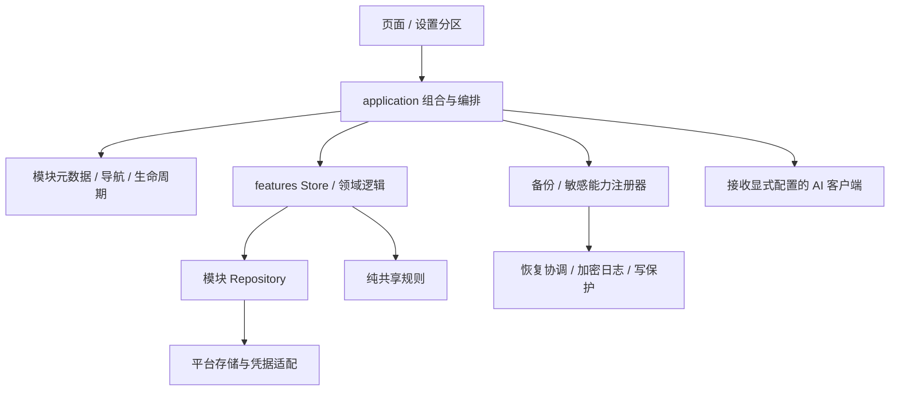

# ForMyself 架构接口与 Agent 开发规范

2026-11-02后续P7切片（仍待容量复测）：原生页读写保持每批<=4；只有纯退休键批次允许<=64，整批预检/结算、失败不启动后批，无正文进入大批次。`ArchiveFilesystemDriver.deleteArchiveKeys?`由平台适配器显式own capability提供，原Capacitor Proxy的未知方法不可当能力；无能力仍用原4页路径。退休排除新主/备仍引用的内容键。恢复JSON采用碎片缓冲合并再8Ki字符切片，保持相同字节/严格属性与256MiB预算；验证复用只限`ownImmutableKanataData`执行完整校验→递归冻结→完整校验后登记的私有WeakSet身份，未知输入/浅冻结/自报标记不走捷径，普通clone仍完整复制，WeakSet不强留明文。预备实测和异常/自查记录见[P7最终收口](docs/20261102-kanata-p7-final-closure-v1.md)，不把本节当放行。

2026-11-02有界原生归档I/O：`platform/storage/archiveFileBatch`仅为生产Native/Data原Filesystem代理固定hash命名空间，每批<=4个密文读写删、最多一批在途，完整结算/错误无降级；超256KiB页预先选择原单文件路径。`MainActivity`注册`ArchiveFileBatchPlugin`，固定内部目录、整批预检canonical路径/非目录/无symlink/有效加密文本和写入hash，写后fsync；JS仍逐项hash/解密/索引与精确读回。主头/日志/备份格式/其他模块I/O与权限/恢复写门禁不变。契约为`ArchiveFileCommand/Result/BatchDriver`，strict正负例实际导入；新`ArchiveFileBatchTest`只在目标App cache的新随机合成子目录做文件行为，不使用其files目录。已有合成资料的本地驱动采用`adb install -r -t`及`am instrument -w -r`；不得以Gradle connected任务默认保留已安装数据（本轮发现其自动卸载，失败/恢复/CAS新世代证据见[执行记录](docs/20261102-kanata-p7-final-closure-v1.md)）。未经实测不得宣称P7通过。

2026-11-02 P7 最终收口计算切片：归档页密文散列使用 `sha256TextAsync(string):Promise<string>` 的平台SHA256；缺subtle或输入超过256Ki字符时预先选择原分块同步散列，避免超长页整串bytes分配。已选择平台后失败传播固定错误码，不降级重试。严格UTF8校验抽为 `utf8Bytes(string):Uint8Array`，异步AES直接使用字节，避免WordArray往返。所有新await之后保留owner复核，密文/盐/派生/散列/读回、主头与GCM恢复协议不变；实际结果见[执行记录](docs/20261102-kanata-p7-final-closure-v1.md)，不得提前当性能放行。

2026-11-02 P7 内部规划增量：`messageArchiveCore.planMessageArchive`改用索引并查集和定长链接/保留数组，减少每消息邻接数组与逐组件集合分配；同会话回复连通分量、外部来源（含未知扩展）、最近消息、50条页上限和确定性顺序保持。无接口/格式/加密或恢复门禁变更。验证以[本轮记录](docs/20261102-kanata-p7-archive-planner-v1.md)为准，不能据此认为P7容量通过。

同轮字节转换增量：归档AES、恢复载荷和原GCM日志的Base64转换采用有界apply直接读取typed-array索引，解密采用定长byte数组逐索引复制，避免spread/from的逐字节迭代临时分配。参数上限仍8190/8192，原密码派生/盐/填充/UTF8/BOM/密文字节、摘要绑定、读回和补偿语义均保留；新增长正文固定盐旧CryptoJS双向互读回归。没有凭据缓存或协议迁移。

同轮 Web 平台增量：`scripts/patch-capacitor-filesystem.mjs`由postinstall验证`@capacitor/filesystem@8.1.2`的ESM/CJS/browser源码并幂等修补readdir。原实现Promise.all读取目录所有包含完整密文content的IndexedDB条目；现最多4条一批allSettled，保留全部元数据/顺序/斜杠回退，失败先settle本批再拒绝，不启动后批或以空结果代替。未知版本/源码/残缺补丁拒绝，移除不再适用的上游sourceMappingURL注释，不删除map文件。没有变更DB/键/原生Java/文件或加密格式。`node --test tests/filesystemWebPatch.test.js`测试真实安装包Web类的行为；生产验收仍见本轮记录。

同轮冷启动恢复修复：Store.load在原图/版本及归档metadata校验通过后，仅对仓库确实存在的pending加密工作完成flush，确认无待写/保存错误后再发布ready；不存在的仓库不因此创建种子或写入。失败保持旧主/恢复材料与未加载，可再次认证重试；blocked/busy的完整恢复期间跳过自动flush，由实际协调器按原流程处理。恢复后待回复任务仍由原前台运行时按源/时限/权限重查，不在load中调用AI。`KanataPendingRecovery.spec.js`覆盖真实仓库成功/失败重试/缺页/未来版本/恢复门禁/会话释放，无存储格式或接口变更。

版本：v1.4（包含 Kanata P7 加密历史页、异步原生AES计算及经摘要绑定的日志回滚能力；阶段验收以证据为准）。基础架构日期：2026-10-27（北京时间）。基础源码基线：`995a37e41f1835f75025fb3ca24bd9b745a94311`，架构 P1–P6 完成版本；Kanata 增量以第15–21节和对应阶段验收记录为准。

位置约定：用户指定本文件放在项目根目录，作为后续 Agent 的长期开发规范；其他正式交付物继续放 output。本文链接和示例路径均以根目录位置为准。

目的：让后续 Agent 在现有架构上开发，知道改动应放在哪里、接入哪些接口、保留哪些安全边界，以及用什么证据证明完成。本文是开发说明和规范，不是新的功能实现或新的产品验收。

“必须/禁止”表示开发要求；“当前实现”描述本版实际能力；示例只解释接口，不代表产品新增模块。后续 HEAD 变化时必须重新核对源码，不能凭本文的提交号或历史测试数判断当前状态。项目工作与交付总规则见 [AGENTS.md](./AGENTS.md)。

## 1. 接手前先完成这些检查

1. 阅读 AGENTS、本文及本次涉及的源码；再读 docs 中对应来源、分析、计划和验收。需要历史背景时读 [长期索引](./memory-bank/development-context.md)。[旧 HANDOFF](./HANDOFF.md) 仅作历史档案。
2. 执行 `git status --short --branch`、`git rev-parse HEAD`、`git diff --stat`，识别已有修改、删除和未跟踪文件。保留其他工作；不得用 reset/clean/强制检出来获得干净工作区，也不自动恢复用户删除项。
3. 明确当前授权范围、数据/格式/界面影响与验收方式。复杂任务在 docs 留下来源和计划；本地已有证据不等于本轮重新验证。
4. 仅按任务需要读取 raw，遵守只读、来源与敏感资料规则。测试默认使用合成记录，不把真实凭据或私人备份写入夹具。
5. 依赖准备使用 `npm ci`，版本以 package-lock 为准；postinstall 会应用受控原生及Web补丁。不要绕过失败补丁继续交付，也不要在不需要时顺带升级依赖。

## 2. 架构地图与依赖方向

当前是 Vue 3 + Pinia + Vite + Capacitor 的模块化单体，业务数据以本机存储为主。Web 与 Android 具有不同平台能力。配置兼容的 AI 服务会接收用户选择的请求内容，不能宣称所有资料始终不离开设备。



图表达主要职责，未画出所有历史服务、兼容转发和必要聚合。不要把它当成所有旧代码已彻底解耦的证明。

| 目录 / 文件 | 职责 | 新改动规则 |
| --- | --- | --- |
| `src/application/` | 模块注册、导航、生命周期、备份/敏感组合、生活上下文、设置投影 | 在组合根表达跨业务协作；不能承载每个业务的全部领域规则 |
| `src/features/<feature>/` | 业务视图、Store、仓库、领域规则与局部适配 | 新业务优先在此形成边界；命名沿用相邻模块 |
| `src/platform/storage/` | Preferences、键清单、持久化状态、仓库与恢复日志 | 不在视图或普通 Store 直接调用持久化插件 |
| `src/platform/security/` | 原生安全凭据适配 | 凭据错误保持语义；不改为普通设置明文保存 |
| `src/platform/ai/` | 协议请求与流式处理 | 配置由参数提供；不导入全局 Store |
| `src/shared/` | 不依赖业务 Store 的公共规则 | 只放跨业务且职责稳定的纯规则 |
| `src/components/` | 公共控件、首页、设置分区 | 不将新增完整业务都堆入通用目录 |
| `src/composables/` | 应用壳和设置等交互编排 | 明确订阅、清理与请求所有者 |
| `src/services/` | 现有领域服务、通知、安全事务、兼容入口 | 随业务逐步整理，避免一次无关路径重排 |
| `src/stores/` | 认证、设置、受保护会话及旧入口转发 | 旧转发保持薄层，不继续添加业务 |
| `tests/` | 领域、组件、集成、故障、共享夹具与类型样例 | 新回归放进常规命令实际覆盖的范围 |
| `docs/` / `docs/qa/` | 过程、分析和验证证据 | 历史失败保留，结果和测试范围清楚区分 |
| `output/` | 正式交付 | 生成产物按既有忽略规则处理；本说明书按用户要求保存在项目根目录 |

已存在的 WeightView、DebtListView、PasswordVaultView 及对应旧 Store 路径是转发入口。新逻辑优先进入 `features/weight`、`features/savings`、`features/vault`。当前 lint 对 shared、AI 传输、部分 Core 与 feature Store 已限制导入；范围见 [eslint.config.js](./eslint.config.js)。规范适用于新增代码，不因某个历史文件尚未被 lint 匹配就允许引入耦合。

## 3. 模块、Store 与备份 ID 对照

这些命名不是同一个命名空间，不能相互猜测替换。

| 页面 ID | 业务位置 | Pinia Store ID | 备份参与者 ID |
| --- | --- | --- | --- |
| `home` | `components/HomeView.vue` | 由多个 Store 组合 | 无独立项 |
| `reports` | `components/MonthlyReportView.vue` | 由多个 Store 组合 | 无独立项 |
| `debts` | `features/savings/` | `debt` | `savings` |
| `weight` | `features/weight/` | `weight` | `weight` |
| `mood` | `features/mood/` | `mood` | `mood` |
| `todo` | `features/todo/` | `todo` | `todos` |
| `schedule` | `features/schedule/` | `schedule` | `schedules` |
| `chat` | `features/chat/` | `chat` | `chat` |
| `passwords` | `features/vault/` | `passwordVault` | `passwords` |
| `settings` | `components/SettingsView.vue` | `settings` | `settings`（非页面描述中的单项选项） |

认证和受保护会话分别见 [auth.js](./src/stores/auth.js)、[protectedAccess.js](./src/stores/protectedAccess.js)。不要将 Store ID 当作路由白名单或备份字段。

## 4. 页面注册与导航接口

定义：[contracts.d.ts](./src/application/contracts.d.ts)。实现：[moduleRegistry.js](./src/application/moduleRegistry.js)、[appNavigation.js](./src/application/appNavigation.js)。

### 4.1 ModuleDescriptor 与注册器

`createModuleRegistry(modules)` 返回 `list/get/has/settings/menu`。重复 ID、缺少标题/页面加载器、无效 access 等会抛出明确配置错误。

| 字段 | 类型 / 当前语义 |
| --- | --- |
| `id`、`title` | 必填字符串；ID 唯一且稳定 |
| `loadView()` | 必填；返回页面组件或 `{ default: component }` 的 Promise |
| `label`、`meta`、`icon` | 菜单显示名、副文案、图标名称；新图标还需接入 App 的图标映射 |
| `name`、`cache` | 组件名和缓存策略；普通模块默认缓存，敏感模块默认不缓存；敏感缓存必须提供可匹配的组件名以支持排除 |
| `access` | 可选，目前唯一非空值为 `'protected'`；必须同时接入敏感能力 |
| `settings` | 可选描述字符串；用于模块设置范围与入口，不会自动生成该模块的设置界面 |
| `backup` | 可选 `{ id, label, prefix }`；生成备份选择元数据，不自动实现备份参与者或文件协议 |
| `enabled(context)` | 当前影响菜单生成；不能作为鉴权、生命周期、导航或存储安全门禁 |
| `bindings(context)` | 页面 props/事件映射；仅暴露所需字段，不传递全部全局状态 |

下例使用现有体重页面演示真实字段，创建独立注册器；新增模块时替换为自己的实现，不能用它覆盖生产清单。

```js
import { createModuleRegistry } from './src/application/moduleRegistry.js'

const registry = createModuleRegistry([{
  id: 'weight',
  title: '体重记录',
  name: 'WeightView',
  loadView: () => import('./src/features/weight/WeightView.vue'),
  backup: { id: 'weight', label: '体重数据', prefix: 'Weight' }
}])
registry.has('weight') // true
```

### 4.2 导航与返回

`createAppNavigation({ registry, filterRoute })` 维护当前路由、最多 30 层历史、滚动恢复及模块设置。主要方法：`navigate(value, options)`、`replaceRoute(value)`、`switchView(view)`、`goBack()`、`openModuleSettings(scope)`、`openGeneralSettingsSection(section)`。现有 settings Store 仍代理相关接口，兼容旧调用。

必须通过导航方法修改页面；不要直接改 currentView 来绕过历史、过滤和设置范围处理。保留通知目标中的 Todo item/date、Schedule item/occurrence、Chat proactive 等业务语义。

深链入口见 [appDeepLink.js](./src/services/appDeepLink.js)：先验证 `formyself://open/...` 协议与主机，再解析目标；当前密码库和设置不进入通用别名清单。保留 WebView 113 的自定义 URL 兼容回归，不将深链参数视为可信执行指令。

弹层通过 [backNavigation.js](./src/services/backNavigation.js) 的 `registerBackHandler(handler, { priority, isActive })` 注册，并在卸载时注销。handler 返回 `false` 表示未处理，其余返回值会消费该次返回；不要漏写返回值导致错误拦截。

## 5. 生命周期与普通模块接入

实现：[moduleLifecycle.js](./src/application/moduleLifecycle.js)、[ordinaryModules.js](./src/application/ordinaryModules.js)、[useAppController.js](./src/composables/useAppController.js)。

`LifecycleParticipant` 必填 `id`；`initialize/resume/flush/subscribe/dispose` 均为可选钩子，按实际能力实现。`subscribe()` 返回取消订阅函数；`dispose()` 释放模块资源。

- `createModuleLifecycle(participants).initialize()` 对同一实例去重；处置后不能再次初始化。
- `resume()`、`flush()` 和初始化内部调用使用 `Promise.allSettled`；Promise resolve 不表示所有模块成功，调用者必须检查 rejected 结果并结合 Store 状态反馈。
- 初始化结束才注册订阅；卸载期间的迟到初始化不会再注册。dispose 幂等，先取消订阅再执行模块清理。
- `createListenerScope().listenMany(plugin, bindings)` 独立注册原生事件，单个失败/迟到不应阻断其他事件；处置后的迟到 handle 仍需移除。

新增普通模块的完整步骤：

1. 建立 feature 的规则、可注入仓库、Store 和视图，先定义数据和失败语义。
2. 在模块清单注册页面；需要新图标或模块设置时补齐图标映射、设置组件/composable 与字段投影。
3. 在 ordinaryModules 的组合根提供 Store、initialize、flush 及必要订阅/前台恢复。控制器可调整构造依赖；不要新增逐模块启动/后台保存条件分支。
4. 接入 Store 的加载/保存状态、页面错误与重试。新的聚合首页/报表/提醒必须明确数据就绪条件，不能把失败模块当空数据。
5. 按需要独立接入备份、深链参数、首页卡片、通知和 Android 能力。检查备份设置页仍存在的 readiness/解析映射，不假定注册器覆盖一切。
6. 增加导航、返回、滚动、重复初始化/订阅清理、存储故障与数据往返测试。参考 [ModuleRegistry.spec.js](./tests/ModuleRegistry.spec.js)。

## 6. 普通存储接口与失败语义

实现：[preferences.js](./src/platform/storage/preferences.js)、[preferenceRepository.js](./src/platform/storage/preferenceRepository.js)、[storePersistence.js](./src/platform/storage/storePersistence.js)。现有最小样例：[weightRepository.js](./src/features/weight/weightRepository.js)、[weightStore.js](./src/features/weight/weightStore.js)。

### 6.1 Driver 与 Repository

`PreferenceDriver.get({ key })` 返回 `Promise<{ value: string | null }>`；`set({ key, value })` 返回可失败的 Promise；remove/flush 在驱动上可选。`createPreferenceRepository(keys, driver)` 限制可访问键，未知键抛错；仓库暴露 get/set/remove/flush，并可增加业务 read/validate 等方法。

新增 Preferences 键集中登记 [keys.js](./src/platform/storage/keys.js)，保持已发布键、记录 ID、日期和版本兼容。Todo 现有键由专用仓库导出，不能为追求形式统一而无迁移地移动或改名。大集合当前仍全量 JSON 保存；仓库边界便于替换，不代表已实现数据库事务、索引或增量写入。

底层 createPreferenceStorage 串行写、读前等待既有写入；它的内部链会收敛异常以允许后续任务继续，`flush()` 只等待结算。不得据此宣称业务数据保存成功。必须使用保留待写状态并会报告失败的 Store flush/业务结果。

### 6.2 createStorePersistence

接口：`createStorePersistence(isDataLoadedRef, driver)`。

| 方法 / 状态 | 语义与使用要求 |
| --- | --- |
| `load(read, commit, afterLoad?)` | 读与校验成功后才 commit 并设 ready；读取异常返回 false；成功返回 true；待写 flush 失败可 reject，不能只观察是否抛错 |
| `assertReady()` | 普通修改前检查已加载及恢复写保护；Store 动作本身调用 |
| `assertLoaded()` | 仅检查加载；受控恢复等内部路径使用，普通 UI 不可借此绕过恢复门禁 |
| `canAutosave()` | 已成功加载且恢复未阻断时才允许自动保存 |
| `storage.set(options)` / `write(options)` | 串行写入、按键保留最新待写值；失败设置可见状态并 reject |
| `expose.flush()` / `retrySave()` | 等待写入、重试待写值；失败继续报错；未加载时拒绝 |
| `loadStatus` | `idle/loading/ready/error` |
| `saveStatus` | `saved/saving/error`；初始 saved 不代表历史数据已经加载 |
| `loadError/saveError` | 用户可见的读取/保存失败；不能只清空错误而不重试真实动作 |

普通 Store 可以参照以下骨架；实际模块还需导出状态、动作、仓库校验与组件反馈。

```js
import { ref, watch } from 'vue'
import { weightRepository } from './src/features/weight/weightRepository.js'
import { STORAGE_KEYS } from './src/platform/storage/keys.js'
import { createStorePersistence } from './src/platform/storage/storePersistence.js'

const records = ref([])
const loaded = ref(false)
const persistence = createStorePersistence(loaded, weightRepository)
const load = () => persistence.load(
  () => weightRepository.read(),
  value => { records.value = value }
)
watch(records, value => {
  if (persistence.canAutosave()) {
    void persistence.storage.set({
      key: STORAGE_KEYS.weightRecords,
      value: JSON.stringify(value)
    }).catch(() => {}) // helper 已保留错误和待写值，页面仍须呈现 expose
  }
}, { deep: true, flush: 'sync' })
const add = record => { persistence.assertReady(); records.value.push(record) }
void load
void add
```

强制规则：

- 只有明确不存在才初始化空数据。解析失败、读取失败、未知版本不等于不存在；禁止在 finally 中无条件设已加载。
- 多键模块全部读取并验证成功再提交内存，不提交半套默认值；迁移与自动补齐也要经过门禁。
- `parseStoredJson` 只做其定义的基本形状检查；新增字段约束、金额、版本等仍需领域校验，不能假定其会自动验证全部 DTO。
- 重新加载前先结算待写，避免旧磁盘值丢弃最新编辑；写失败保持当前草稿和最新待写值，不能伪造“已保存”。
- 状态展示可复用 [DataStatusBanner.vue](./src/components/DataStatusBanner.vue)；重试必须调用实际 Store，而非仅隐藏提示。
- 多键持久化和并发写不是原子事务。对部分提交、迟到写入、失败重试和重新实例化重载增加真实行为回归。

## 7. 备份参与者与文件协议

定义与实现：[contracts.d.ts](./src/application/contracts.d.ts)、[backupRegistry.js](./src/application/backupRegistry.js)、[backupParticipants.js](./src/application/backupParticipants.js)、[fullBackup.js](./src/services/fullBackup.js)。

`BackupPart` 是 `{ data, metadata? }`。参与者必需方法为 `ready/export/restore/flush`，必填唯一 id；可选 `initialize/validate/singleExport/import/synchronize` 和 optional 标志。

| 参与者方法 | 约定 |
| --- | --- |
| `ready()` | 已加载且没有加载错误；导出前仍需 flush 结算保存 |
| `export()` | 同步返回 BackupPart；不得用空集合替代未加载数据 |
| `validate(part)` | 业务校验；当前接口可选，新增格式必须提供相应校验路径 |
| `restore(part)` | 恢复该模块并正确报告写入失败；内部使用，不能替代全量恢复协调 |
| `flush()` | 报告模块持久化完成与失败 |
| `singleExport()` / `import(value, { overwrite })` | 单项文件格式和覆盖/合并语义，必须分别测试 |
| `synchronize()` | 提交后的通知/组件等派生同步，不重复导入业务记录 |

注册器的 `initialize()` 检查就绪；`exportAll()` 检查就绪并生成 JSON 克隆；`restoreAll(parts)` 拒绝未知/缺失必需参与者，先校验，再等待全部恢复和 flush 结算后报告失败；`singleExport/singleImport` 处理单项路径。

注意：`exportAll()` 本身不替调用者 flush；`restoreAll()` 本身不提供跨重启事务。产品完整路径由 [fullBackupRuntime.js](./src/application/fullBackupRuntime.js) 组合并使用协调器。

基础完整文件类型是 `formyself-full-backup`、版本 12，兼容 v1–v12；Kanata P2 产品组合根采用 v13，旧适配器和 `FullBackupDTO` 保留 v1–v12，见第16节。`buildFullBackupFromParts/fullBackupParts` 显式映射既有参与者；未知字段类型不能静默忽略，也不能因注册一个新参与者便宣称旧 v12 自动支持新业务。

新增备份类型必须同步检查：页面 backup 元数据、备份参与者、FullBackupDTO、格式映射和版本兼容、[useBackupSettings.js](./src/composables/settings/useBackupSettings.js) 的单项解析/认证/readiness 映射、文件前缀和 UI 选项。保留旧备份缺少 Todo 等字段的既有语义。

主密码、设备生物凭据不作为备份项导出；AI 配置等内容随备份文件加密。文件备份既有加密流程与恢复日志 AES-GCM 是不同封装，不能擅自统一而破坏历史兼容。

## 8. 完整恢复、中断与回滚

实现：[restoreCoordinator.js](./src/application/restoreCoordinator.js)、[restoreJournal.js](./src/platform/storage/restoreJournal.js)、[restoreState.js](./src/platform/storage/restoreState.js)、[main.js](./src/main.js)。

`createRestoreCoordinator({ journal, state, prepare, capture, apply, validate, validateRecovery?, synchronize? })` 接收产品实际适配器。主要接口为 `probe()`、`restore(input, password)`、`recover(password)`、`retrySynchronization()`。

正常顺序：校验输入 → 阻断普通写入 → 准备/flush → 捕获旧快照 → 持久化并读回验证加密恢复记录 → 应用目标 → 写提交标记 → 清理日志 → 开放写入 → 同步派生状态。

- 提交标记前中断：重启后恢复 previous；标记已完成：恢复 target。
- 应用失败时补偿旧快照；回滚失败保留材料与 blocked 状态，不允许混合状态进入普通编辑。
- 日志采用带认证的 AES-GCM 封装，版本和文件路径独立管理；commit 标记用密文摘要关联。修改时必须测试错密、损坏、提交错配和清理顺序。
- 启动在业务可写前探测日志。普通模块、受保护操作和原生 Todo 写入都要服从门禁；关闭全屏入口验证也不能绕过恢复。
- `state` 包含 blocked/busy/message/syncError。同步失败属于派生状态问题，应重试同步；不要再次导入全部业务数据。
- `applyFullBackupSnapshot` 是受控内部能力，产品 UI 完整恢复调用协调器 restore；禁止手写另一套 Promise.all 恢复替代它。
- 不得直接删除日志、重置 blocked 或卸载/降级来“修复”失败。存在日志时先用支持它的版本完成恢复并确认一致，再回退旧代码。

这是多存储应用级协调与恢复协议，没有把 Preferences、文件、原生仓库变成同一个数据库 ACID 事务。参考 [RestoreCoordinator.spec.js](./tests/RestoreCoordinator.spec.js) 的中断点、失败和重启测试。

## 9. 认证与新增敏感模块

实现：[protectedModules.js](./src/application/protectedModules.js)、[protectedAccess.js](./src/stores/protectedAccess.js)、[masterPasswordChange.js](./src/services/masterPasswordChange.js)、[secureCredentials.js](./src/platform/security/secureCredentials.js)。

### 9.1 能力与会话接口

`createProtectedModuleRegistry([{ id, resolve, load }])`：resolve 异步取得真实 Store；load 的签名为 `(store, password)`。解析后检查 Store 的 release、reencrypt、suspendPersistence、flush，并读取 isDataLoaded/loadError/saveError。

| Store 能力 | 必须保持的行为 |
| --- | --- |
| `release()` | 结算需保护的写入并释放明文、临时凭据、页面资源；失败不能伪装已保存 |
| `reencrypt(password)` | 用目标密码重加密；部分写入失败时仍可参与旧密码补偿 |
| `suspendPersistence()` | 恢复异常等状态暂停普通自动保存 |
| `flush()` | 明确报告待写完成及失败 |
| `isDataLoaded/loadError/saveError` | 成功加载与不同失败语义可观察，不将解密失败当空数据 |

受保护 Store 提供 `authenticate({ force? })`、`ensureModule(id)`、`ensureModules(ids?)`、`runOperation(ids, action, options?)`、`reencryptors()` 等。加载方法返回布尔结果；取消/失败不等同异常抛出。runOperation 串行获取操作租约，action 接收 `(password, sessionRevision)`，返回业务结果；权限未就绪可返回 false。

普通操作不得传入内部 recovering 选项绕过恢复门禁。对异步结果核对会话版本，禁止旧会话回写。视图隐藏不等于明文已释放；缓存排除、订阅、定时器和请求都要覆盖。

### 9.2 两种入口模式

`requireAppUnlock=true`：统一入口认证后沿现有路径加载敏感模块；`false`：先进入普通页面，首次访问敏感模块时认证并按需加载。普通页面和普通设置不得附带解密全部敏感数据。

后台会话过期时撤销界面访问；已有写操作受租约保护至结算，再释放敏感状态。主密码变更使用实际 changeMasterPasswordTransaction，失败参与者也纳入反向回滚；回滚失败传播 rollbackFailed，并触发保护。

密码库查看/复制的独立验证见 [vaultAccessGuard.js](./src/services/vaultAccessGuard.js)，不被入口认证替代。Android 凭据沿安全适配器和写后读回；读取异常不视为未配置，迁移验证前保留旧副本。

### 9.3 接入敏感模块清单

1. 实现仓库、加密格式、Store 加载/保存/释放/重加密及错误语义。
2. 页面声明 protected，组件名与缓存策略配合；通过 protectedModules 懒解析，不在壳层提前导入和解密。
3. 按需注册备份及历史格式适配，明确完整/单项备份分别需要哪些权限。
4. 验证正确/错误凭据、取消、模块独立加载、并发去重、会话复用、加载中失效及缓存清除。
5. 在每个改密参与者处注入部分写入、迟到写入、回滚失败；验证租约、冷启动重载及数据往返。参考 [CapabilityRegistry.spec.js](./tests/CapabilityRegistry.spec.js)、[ProtectedDataRecovery.spec.js](./tests/ProtectedDataRecovery.spec.js)。

聊天另有 [chatPersistence.js](./src/features/chat/chatPersistence.js) 的密文队列与恢复副本，按主文件指纹避免旧恢复覆盖新数据。不要改为在锁定后的队列里保留明文或主密码。所有持久化介质同时失败时，不能承诺强杀后恢复进程内草稿。

## 10. AI、公共日期、设置和界面约束

### 10.1 AI 请求

[createAIClient(configuration)](./src/platform/ai/client.js) 接收配置 getter，返回 `askAI(prompt)` 与 `streamAIChat({ messages, systemPrompt, signal, onDelta, temperature, maxTokens })`。应用侧由 [aiClient.js](./src/application/aiClient.js) 读取 Settings 注入；旧 services/aiEngine 是兼容出口。

- configuration 提供 aiProviderUrl/aiApiKey/aiModel；请求层不实例化 Pinia。
- stream 返回完整文本；onDelta 接收 `(delta, full)`，保留 SSE、非流式回退、模型角色兼容、取消和错误分类。
- askAI 当前仅收 prompt，不支持传入 signal；新增可取消调用时使用合适接口或显式演进契约与测试，不能传一个被忽略的参数便宣称支持取消。
- 请求所有者负责 AbortController、页面卸载与会话失效；旧结果不得更新新会话。测试用受控 fetch/回复，真实服务请求按用户授权。
- API Key 保存逻辑沿 Settings 的独立串行队列、状态、重试和读回验证；连接测试等待保存。禁止在日志打印 Authorization、主密码、API Key 或私人提示词。

### 10.2 日期与跨业务上下文

[shared/date.js](./src/shared/date.js) 提供 `formatLocalDate(date?)`、`parseLocalDate(value)`、`addDays(value, amount)`。业务本地日期用本地年月日，不能用 UTC ISO 截断代替；校验闰日、跨月、时区和重复锚点。时间戳与本地日期字段分别定义。

跨模块生活上下文通过 [companionContext.js](./src/application/companionContext.js) 组合；不要让 Todo 依赖日程业务文件作为公共日期库，或让一个 feature 的全局 Store 成为另一个的工具函数。

### 10.3 设置和界面

[projectSettingsModel(providers, keys)](./src/application/settingsModels.js) 对每个设置分区投影字段；字段缺失或同名不同引用会报错。新增分区同步维护 SETTINGS_SECTION_FIELDS、composable、组件与必要回归，不恢复为展开所有 providers 的大 context。

复用 app/styles、主题与组件透明度等现有规则；组件保持明确 props/事件边界。修改布局须覆盖窄屏、较宽屏、滚动/键盘、焦点与返回、减少动效及敏感模块卸载；修改壁纸与裁剪还需覆盖取消、保存失败和首帧准备。减少动效只能停用动画，不能改变正常布局或点击能力。

## 11. Android、Todo 与插件补丁

[todoRepository.js](./src/features/todo/todoRepository.js) 使用 `createTodoRepository(storage, nativeDriver)`，暴露 read/apply/flush。Android 通过 Java 仓库和 expectedRevision 进行 CAS，冲突重读并重放命令，最多 8 次；Web 使用同一业务命令语义。

- 禁止另建桌面组件私有业务数据源，或从 JS 直接整体覆盖 canonical Todo 键绕过原生 revision。
- Todo 重复规则变化同步更新 [共享夹具](./tests/fixtures/todo-contract.json)，分别执行 JS 与 Java 实现。不能把双方相同错误产生的结果互相比对当成独立预期。
- 首页/日程 widget 沿版本化展示快照；修改快照协议需兼容原生消费者并检查恢复门禁。
- 持久化、通知、生物凭据与Filesystem Web有界目录读取的依赖补丁由 scripts/patch-capacitor-*.mjs 与 postinstall 管理，必须幂等，不支持的源码/版本明确失败；不要把 node_modules 的手改当成实现。
- 当前 Android 配置见 [variables.gradle](./android/variables.gradle)：minSdk 24、compile/target 36；构建使用 JDK 21。设备与 WebView 能力不同，版本声明不能代替实际运行。

## 12. 验证命令与变更矩阵

常规命令来自 [package.json](./package.json)，CI 配置见 [quality.yml](./.github/workflows/quality.yml)。

```bash
npm ci
npm run check
```

`check` 顺序执行 lint、Node 测试、Vitest、Vue 类型、strict 契约类型和生产构建。Node 范围为 tests/*.test.js，Vitest 为 tests/*.spec.js；放在 docs/qa 的历史探针不会自动成为常规门禁。故障探针复现成功与修复后的安全测试通过要分别记录。

除纯说明修改外，业务或接口变更均必须运行 npm run check；下表列出相应补充要求。只读审查不改变实现时，按任务范围选择检查并报告实际执行范围。

| 变更 | 必需补充验证 |
| --- | --- |
| 纯说明/入口/忽略规则 | 源码接口、链接、示例语法、Git 忽略与差异；不重复无关业务测试 |
| 领域规则 / 普通 Store / 仓库 | 行为和故障回归；读取失败原字节不变；写失败最新值重试；新建实例重载；npm run check |
| 模块 / 生命周期 / 导航 | 导航/设置/返回/滚动；重复初始化、订阅清理与迟到监听；npm run check |
| 备份 / 恢复 | 产品实际协调器；旧格式、非法输入零写入、部分失败/回滚失败；中断点新运行时恢复；涉及持久化/原生路径时实际强停冷启动 |
| 敏感会话 / 改密 / 凭据 | 两种模式、取消/错密、租约、释放缓存、每个参与者失败、读回与冷启动；相关 Android 行为验证 |
| Todo / widget / 原生桥 / 插件补丁 | JS/Java 同夹具、原生 instrumentation、实际接收器与通知、需要的 WebView E2E；补丁幂等和不匹配失败 |
| UI / AI 异步 | 用户可观察行为与取消/竞态；布局可点击、减少动效、会话失效；按影响补充浏览器/设备验证 |
| 存储引擎或规模策略 | 单独迁移设计、历史数据校验与回滚、容量/查询/性能样本；不得夹带进普通界面改动 |

接口变更同步修改 [contracts.d.ts](./src/application/contracts.d.ts)、实际导入该接口的 [类型样例](./tests/types/contracts.ts) 和 [tsconfig.contracts.json](./tsconfig.contracts.json)。目前 strict 是局部增量，checkJs 仍关闭；新契约必须实际参与类型检查，不能仅写被忽略的注释。不得删除 @ts-expect-error 负向样例或关闭检查来消除接口错误。

Android 构建示例（在仓库根开始）：

```bash
npm run build
npx cap sync android
cd android
./gradlew :app:testDebugUnitTest :app:assembleDebug :app:assembleDebugAndroidTest
./gradlew :app:connectedDebugAndroidTest
```

Windows 使用 `npm.cmd`、`npx.cmd` 和 `android/gradlew.bat` 的对应命令。instrumentation 仅连接任务专用隔离模拟器；执行前检查目标设备，不指向用户真实数据环境。

原生 E2E 命令是 `npm run test:e2e:android`，驱动位于 [native/verify.mjs](./docs/qa/architecture-20261026/native/verify.mjs)，可通过 FORMYSELF_DEVICE_SERIAL 指定已核对的任务模拟器。先安装匹配 dist 的主/测试 APK，准备 playwright-core 与 Android 支持。驱动会清空测试 App 数据并做强停、改密和恢复，仅能使用可清理的合成环境；不能因为设备名以 emulator 开头便认为里面没有用户资料。不要在未确认隔离的设备上直接照抄执行。

当前 JVM 模板测试只有算术样例，领域/存储证据主要来自 instrumentation；CI 目前没有 lintDebug。构建成功不能代替原生业务通过；源码正则不能替代真实故障与生命周期行为。P6 历史结果是 Node 285、组件 156、lint 0 错误/47 警告，不是未来固定目标或本轮自动通过的凭据。

性能比较必须记录设备/内核、数据组成、测量路径、样本和基线。历史性能基线 ff4e0bc 衡量模块拆分前后，不能宣称涵盖计划从 ceda70f 开始的全部变化；20% 是调查线，不能当通用体验保证。

## 13. 完成定义、交付与后续维护

一次业务开发满足以下条件后才能报告完成：

- 行为和边界在授权范围内实现；没有把未加载、取消、保存失败或回滚失败当成功。
- 按变更矩阵执行实际检查，记录命令、退出状态、范围和失败/修复/复测过程。跳过、未运行、环境受阻和实体手机复核明确列出。
- 原始资料、既有工作区改动及用户设备数据受到保护；不输出或持久化真实凭据。
- 新接口、模块能力、存储键、格式、兼容和依赖补丁有对应源码、类型/行为回归和文档更新。
- docs 留过程，output 只放符合命名与验收要求的正式交付；新版本不覆盖历史包。记录安装包摘要、来源和签名兼容边界，不能通过卸载用户应用解决签名不匹配。
- 报告实际修改文件、原始依据、验证结果、剩余复核和未完成项；提交/推送/发布按当前用户授权，不把旧任务授权无限延续。

后续交接至少说明：当前 HEAD 与工作区状态、目标及已确认范围、实际改动和注册点、关键存储/安全兼容边界、执行过的检查及证据、下一步和阻塞条件。长期稳定的背景可写 memory-bank；一次性分析、凭据和私人内容不得写入。

本文或规范演进时，先更新真实接口/行为与测试，再更新说明，并维护版本号和可追溯历史。文件名或位置变化后同步修改 AGENTS、README、HANDOFF、长期索引和文档校验脚本；根目录说明书无需 output 忽略白名单。代码中的契约是签名依据，本文承担解释与约束，避免维护另一套不受检查的“平行接口”。

## 14. 来源与本版边界

来源均为本仓库：上述链接对应的实际源码、类型、测试和配置；[P1–P6 计划](./docs/20261026-architecture-remediation-plan-v1.md)、[最终阶段验收](./docs/20261026-architecture-stage-6-verification-v1.md)、[前后对比](./docs/20261027-architecture-before-after-v1.md)。引用日期为 2026-10-27，未引入外部研究资料，未读取私人备份。

当前仍使用 Preferences 集合、原生 Todo 与聊天文件等不同存储，没有数据库迁移、多端同步或任意插件自动备份能力；严格类型为局部覆盖。后续新业务、规模、数据库/同步及正式发布签名须在对应任务中明确需求，不把它们当作本版已实现功能。

本版新增的是规范、说明书和入口，不重新实施或验收业务功能；根目录位置及链接校验见 [本版检查](./docs/qa/agent-manual-20261027/verification-v2.json)，原 output 版本检查记录保留为历史证据。

## 15. Kanata P1 纯领域契约（增量）

当前 Kanata 执行依据为 [连续计划 v3](docs/20261028-kanata-continuous-execution-plan-v3.md) 和 [五人预设规格](docs/20261028-kanata-abydos-preset-spec-v1.md)。它们覆盖历史“旧小暖数据迁移”条款：旧温馨小家不导入新领域，真实清理必须由运行时受保护流程经用户明确确认，不能据此删除真实设备数据。

新增纯领域入口：[kanataCore.js](src/features/chat/domain/kanataCore.js)、[kanataValidation.js](src/features/chat/domain/kanataValidation.js)、[presetCore.js](src/features/chat/domain/presetCore.js)。类型源为 [kanataTypes.d.ts](src/features/chat/domain/kanataTypes.d.ts)，由 application/contracts.d.ts 重导出，并通过 [strict 样例](tests/types/kanata.ts) 实际进入类型检查。

- `createEmptyKanataData(userId)` 创建 `{type:'kanata-data',version:1,...}` 空集合。这里的版本属于新领域命名空间，不改变旧 chat 数据v4、单项备份v4或完整备份v12。
- `validateKanataData(unknown)` 验证完整引用图，返回独立JSON副本；无效数据抛 `KanataValidationError`，含结构路径和稳定code，不回显输入正文。拒绝重复ID、跨世界/孤儿引用、非法身份、未来版本、循环事件与非JSON运行时对象。
- `validateWorldPreset(unknown)` 验证预设定义；`instantiateWorldPreset(data,preset,{initializationKey,now,timeZone,idFactory})` 是无I/O的纯变换。时间/ID显式注入，相同初始化键只返回既有结果，不重新建卡/世界；主动新建第二世界需不同初始化键。用户修改实例不会改基础卡，旧实例锁定卡版本。
- [阿拜多斯预设数据](src/features/chat/presets/abydos.v1.json) 独立于Store，含5角色、10组队内关系、8条基础+5条角色私有指导世界书。实例化产生5私聊和1群聊，无消息/记忆/事件/任务/生活授权，自治/主动/通知初始关闭（保守工程默认）。关系数值是相对描述性baseline的零增量，`dimensionRuleVersion=1`，不是捏造好感分数。
- P1尚未接入运行时Store、页面、备份、磁盘或AI，不得将纯函数通过描述成预设已能在应用聊天。预设正文与公开分发授权仍须P3审查，不含官方图像或完整台词。
- P1行为/负向测试见 [kanataDomain.test.js](tests/kanataDomain.test.js)。新增类型或引用时同步运行 `npm run check`；P2起另需实际加密/恢复/改密/Android证据，不能仅复用这些纯函数测试作为放行。

## 16. Kanata P2 运行时增量与验证门禁

本节描述当前代码，**不代表 P2 已经完成 Android 验收**；当次证据及放行状态见 [P2检查点](docs/20261028-kanata-stage-p2-verification-v1.md)。第15节“尚未接入运行时”是 P1 时点的边界，此节覆盖当前接入情况。

- 持久化：[kanataRepository.js](src/features/chat/storage/kanataRepository.js)，注入 filesystem / journal / directory，独立 `formyself/kanata-v1.enc`、`.tmp`、`.bak` 与 `my_kanata_recovery_encrypted_v1`；沿用 CryptoJS passphrase AES 协议，没有修改平台加密或引入数据库。`read(password)` 区分 missing/ready/recovered，缺失只返回 null；解析、版本、权限和解密失败拒绝，读取不改文件。`write/flush/retry/reencrypt/release/getState` 保留失败待写密文和可观察错误。改密同时重写旧备份副本，避免残留旧密码可读副本。Web mkdir 的已存在异常按实际插件处理，带明确权限错误码时优先拒绝。
- Store：[kanataStore.js](src/features/chat/kanataStore.js)，是产品 protectedModules 的 chat 实现，旧 chatStore 不再自动加载。snapshot 为只读；update 仅允许同步、分离、完整校验的草稿。首次 initializePreset 需要应用内部清理能力，未加载/恢复阻塞/改密未补偿时拒绝普通写；失败草稿不能标为成功。release 清除明文/临时密码，保存失败仍报告；内部 restoreSnapshot 由备份适配器调用，不从页面直接恢复。
- 首启：[kanataRuntime.js](src/application/kanataRuntime.js) 使用受保护操作租约与 [legacyChatCleanup.js](src/features/chat/legacy/legacyChatCleanup.js)。每次执行/中断恢复都重新请求 literal true 确认；确认前零删除。停止旧 Store 写入后，仅清理旧主/tmp/bak、旧恢复键、旧通知范围和旧频道。检查恢复日志与会话 revision，分步读回验证；`my_kanata_legacy_cleanup_v1` 只记录非秘密进度，不存确认令牌或私人数据。新 seed 在旧流程完成后单独取得受保护租约并等待 flush，无历史聊天。Agent 测试只操作合成资料。
- 界面：chat 路由保持，页面改为懒加载 KanataSetupView、cache=false；旧通知不再 materialize 历史 outbox。设置分区只导航到受保护入口，不挂载旧编辑/清理按钮。备份设置通过新的 chat 适配器；读前预览与取消不 flush 其他模块，不把取消当合并。
- 备份：[kanataBackup.js](src/features/chat/backup/kanataBackup.js) 提供新单项 `kanata-chat-backup` v1 和完整 `formyself-full-backup` v13。外部备份 `taskPolicy=pause-sending-v1` 将待发/执行中/失败的 reply/proactive/followup 保留为 cancelled 并清租约，避免导入后自动重发；没有 policy 的外来文件也不能绕过该规则。单项仅明确覆盖，碰撞重映射未设计前拒绝 merge；旧单项明确拒绝。
- 旧完整备份 v1–v12：预览说明旧 chat 丢弃、现有 Kanata 保留；导入必须提供 `legacyChat:'discard'`。旧 chat 在进入旧 normalizer 前清空；旧适配器只处理非 chat 数据，永不接触新的 Kanata 图。旧恢复日志来自已经确认过的事务，恢复时可由 validateRecovery 过滤为非 chat，而外部新导入仍必须确认。
- 恢复：[kanataBackupRuntime.js](src/application/kanataBackupRuntime.js) 与 [fullBackupRuntime.js](src/application/fullBackupRuntime.js) 复用 createBackupRegistry / 实际 createRestoreCoordinator / AES-GCM restoreJournal。内部 canonical `kanata-restore-snapshot` v1 区分 preserve/replace，回滚捕获保留精确任务状态，不能用暂停任务的外部备份当回滚快照。协调器新增可选 validateRecovery，默认沿用 validate，不变更日志加密。主密码和设备生物凭据不导出；旧全备保留其他模块的既有版本语义（如缺失 Todo 时保持现有 Todo）。
- 类型：contracts.d.ts 重导出真实备份、仓库 DTO 和 ReturnType；[strict样例](tests/types/kanata.ts) 覆盖密码类型、旧图拒绝、显式旧备份选择、wire/canonical 版本区分。FullBackupDTO 是历史 shell，不能给它简单加上13而让旧 normalizer处理新图。
- 验证：`npm run check`；新增 Node 仓库/清理/备份故障测试和实际 Pinia、产品 fullBackupRuntime、加密恢复日志、设置 FileReader 组件路径测试。Web 实测驱动为 [verify-web.mjs](docs/qa/kanata-continuous/p2/verify-web.mjs)，只启动全新隔离 Chromium context，需本机 Vite dev server（默认4173）和系统 Chromium，不读取用户浏览器。Android 仍须按第12节构建与独立设备验证，旧 P6 驱动中的旧聊天断言不作为新产品验收。
- 规模：当前仍是全量 JSON 加密/重载，没有真实磁盘分页/索引查询。P2 样本只记录数据增长；1万条已有明显整包耗时，P7 必须先独立设计必要分片/索引、兼容与回滚，并在目标设备确定阈值，不能声称容量和真分页已完成。

### 16.1 Kanata 本地 Android 验证入口（2026-10-28）

- 新命令 `npm run build:qa:kanata` 通过独立第二入口打包合成设备驱动；正常 build/check 不包含该入口。测试包不能发布。`npm run test:e2e:kanata:android` 连接实际 Android WebView，调用同一构建中的真实 Store、文件桥接、全备运行时与加密恢复日志，不替换加密协议或恢复协调器。
- `scripts/start-kanata-qa.ps1` 只创建任务空白 AVD；`-NewRun` 在核实任务清单和设备身份、等待进程退出后，保留旧合成磁盘原路径并建立带时间戳的新空白目录，不 wipe/卸载/清数据，不移动 raw。`scripts/kanata-device-guard.mjs` 与负向测试核验名称、序列号、绝对路径和 syntheticOnly。
- Android Filesystem 8.1.x 的目录已存在错误码 `OS-PLUG-FILE-0010` 与 `EEXIST` 同义；Kanata 仓库明确兼容这两个码。权限拒绝等其他码仍报保存失败，不能按错误消息兜底当已存在。原生故障与 Node 回归见 `docs/qa/kanata-local-20261028/`。
- Web 驱动允许 `KANATA_QA_OUTPUT` 指定本轮证据目录，避免覆盖历史云端结果；默认行为不变。

## 17. Kanata P3 世界、角色卡和世界书（2026-10-28）

- chat 页面现在懒加载 [KanataView](src/features/chat/KanataView.vue)，仍 protected/cache=false；未完成首启时呈现既有 Setup，成功后进入世界管理。路由滚动位置经 settings.currentRoute 保存，卸载清理文件读取、草稿、返回处理及所属弹窗。
- [kanataManagement](src/application/kanataManagement.js) 是页面唯一修改门面，使用受保护操作租约，并在排队前后核对创建页面时的 sessionRevision；最终调用 Store.update/retrySave，Store 继续负责加载、恢复门禁及失败待写语义。领域纯函数位于 [kanataManagementCore](src/features/chat/domain/kanataManagementCore.js)，不导入 Store。
- 世界创建/复制均分离实例和身份；复制仅静态设定、成员及初始组织关系，不带经历、动态状态、任务或生活授权。归档可逆，关闭自动活动；取消归档不会自动打开计费或通知开关。
- [角色卡解析](src/features/chat/cards/characterCardImport.js) 声明支持 JSON V1、V2/2.0、V3/3.0 和静态 PNG tEXt chara/ccv3（ccv3 优先），限制8MB文件/2MB JSON/16M像素/4096 chunks/500世界书条目；头像覆盖限2MB PNG。校验尺寸、CRC、结构、MIME与版本；APNG、未来版本和未声明编码拒绝。保留源字节及未知 JSON 扩展，不执行脚本、regex或远程资源。导出纯函数保留未知字段，PNG更新元数据及CRC；全备沿既有协调器保留原卡与头像。
- 角色卡新版本不改既有实例锁定版本，显式同步需要包含实例revision的预览；保留实例覆盖及经历。说话习惯扩展键为 `formyself.kanata/speechStyle.v1`，冲突拒绝而非覆盖未知值。新增可选字段沿用 Kanata schema1及全备v13，不修改加密、数据库或旧v1–v12兼容策略。
- [世界书](src/features/chat/lorebook/kanataLorebook.js) 先检查world/owner/knownBy，再激活与预算排序；采用保守UTF-8字节上界，非计费Token。附带世界书显式预览、默认角色私有、冲突跳过；静态书不写成事件或记忆。用户称谓单次占位替换，不递归解释输入。
- [预设目录](src/features/chat/presets/presetCatalog.js) 声明id、版本、来源日期及授权状态，业务不硬编码五人名单。原始abydos.v1.json保持独立，只有文字摘要与占位头像；不包含官方图像和完整台词，不代表获公开分发许可。
- 共享反馈接口新增 `cancelOwnedFeedbackDialog(symbol)`，只有相同owner能取消；`sensitive:true` 对话结束时清除全部文字、选项、输入及owner。普通反馈返回值和密码清空行为兼容。真实签名通过 contracts 的 KanataFeedbackOwner 及strict负向样例维护。
- 验证：`npm run check`；P3 Web `node docs/qa/kanata-continuous/p3/verify-web.mjs`（需4173 Vite及系统Chrome）；P3 Android `node docs/qa/kanata-continuous/p3/verify-native.mjs`（需新空白任务AVD、正常生产APK及同目录production-build-verification.json，拒绝已有安装，不使用P2 QA入口）。证据与未覆盖项见 [P3验收](docs/20261028-kanata-stage-p3-verification-v1.md)。P4生成聊天、P5记忆因果、P6自治尚未实现。

## 18. Kanata P4 文字对话与用量（2026-10-28）

本节覆盖第17节的P4未实现状态。P5记忆/因果/生活联动和P6自治仍未开发，不能用文字聊天通过代表全部产品完成。

- [kanataConversation](src/features/chat/domain/kanataConversation.js) 纯规则固定world/conversation/speaker，精确@优先（含别名，未知或歧义拒绝），群聊最多两人、按兴趣与最近参与判断，不递归调用模型。日常段落最多4气泡，RP整段保留；每角色整组气泡原子保存，取消/失败不会留下导致重试误跳过的半组完整回复。
- 上下文只取本会话最多40条及24k UTF8保守预算、该实例锁定版本与覆盖、授权静态书、该角色公开关系和本世界用户身份。其他角色的群聊内容标记其真实身份，以user上下文提供，不能混成当前角色assistant历史；不读取其他私聊/世界、卡脚本、其他人格或生活Store。无read授权的数据源不调用；[read权限基础](src/features/chat/domain/kanataReadPermission.js) 的lazy reader检查world×instance×module，群分享额外要求share，read不推导remember/share。P4不提供生活模块绑定/授权UI或实际投影，留P5。
- [kanataChatRuntime](src/application/kanataChatRuntime.js) 通过protectedAccess操作租约、Store.update持久化。页面owner会话revision前后检查；离页/切世界/过期Abort，结束再比较当前用户源消息与角色、会话和实际上下文，旧响应不能入新世界。失败保留最新待写与源消息；显式重试不复制用户发言或已完成角色。
- [KanataConversationView](src/features/chat/KanataConversationView.vue) 按独立会话挂载，支持发送、停止、重试、@按钮、日常/RP、0/2/5/15秒等待、流式临时预览与用量。600ms窗口合并连续短句为一轮；无Key不发起调用、不生成假历史。输入、计时器、返回处理、所属弹窗、预览与watch在卸载释放。进入对话从顶部显示，回世界恢复原滚动。
- [AI详细接口](src/platform/ai/completion.js) 由既有createAIClient及application/aiClient导出completeChat，旧askAI/streamAIChat字符串接口保留。配置仍取全局设置。CompletionOptions要求异步onAttempt；每个HTTP请求先持久化pending，终结更新同ID。新接口SSE/JSON使用真实usage，缺失保留null及独立保守估计，不借reasoning_content冒充回复。不记录Key、提示词、供应商错误正文或思维内容。超时/Abort/HTTP分类；仅一次自动回退或截断重试，部分中断不自动重演。
- Kanata schema1增加可选usageEvents，旧图不必带此集合；校验全局ID冲突、world/conversation/member、Token整数、状态/时间和安全错误码。事件只含请求/目标ID、模型、传输、实际/估计计数及结果，无请求正文/Key。所有数据仍沿原仓库加密与单项/完整备份v13、实际协调器恢复；旧v1–v12策略不变。
- [费用估算](src/features/chat/domain/kanataUsage.js) 版本deepseek-cny-20261028-range-v1，引用DeepSeek官方中文价格。使用峰/谷区间以避免猜测节假日；缓存明细缺失扩大区间，未知模型/非官方提供商不套官方价，结果不是账单。不设置应用费用限制；每轮2角色和1次重试为技术边界。已有用户模型/Key/URL不改，旧模型别名价格未提供时显示未知。
- 验证入口：P4目录verify-web.mjs（新隔离Chrome+4173）、verify-native.mjs（新空白任务AVD+已核验生产APK）、verify-upgrade.mjs（只允许标记合成安装，覆盖升级保图与滚动/后台）。verify-live.mjs需要用户明确指定的外部测试Key文件，最多8组合成对话，不作为npm check自动任务；只在内存读取Key，原文件不改、不复制入项目。validate-live-results.mjs核查已记录真实响应，不重复计费。实际结论及失败修复见 [P4验收](docs/20261028-kanata-stage-p4-verification-v1.md)。

## 19. Kanata P5 经历、事件与生活授权（2026-10-28）

本节覆盖第18节的P5未实现说明；P6自治、通知与双视角仍单独验收。

- 新纯规则位于 `src/features/chat/experience/`。L0默认保留；L1为策略限定的近期原文；L2摘要、L3候选事实与静态世界书分离；L4只使用当前有效、角色有权获知的事件与状态。`kanataMemory` 的任务键包含会话、实例、源消息revision和策略revision；成功同源不重复计费，失败保留L0及旧有效摘要。自动提取先候选，冲突经显式解决；删除事实不从相同旧源自动重建。工程默认标准策略：近期12条、摘要24条、提取8条、上下文24000 UTF8字节；字节预算不是计费Token，其他策略与手动整理可配置。
- `kanataKnowledge` 检查原始来源、事件因果祖先和分享父链；旧导入省略冗余lifeSources也不能绕过原授权。生活来源包含精确grant/revision/module/instance及合成内容SHA256。read/remember/share独立，接收者另需read/remember，转发另需share；撤权保留可管理原文但停止生成使用。私聊与私有事件的状态增量不进入群聊；同一群的L2/L3可在本群回忆，其他群不获得它。用户管理查看不等于角色获取知识。
- `kanataEvents` 只允许版本化闭集Effects：support/conflict小幅有向关系增量及情绪、rest能量和情绪、move地点，note/promise不改数值。模型不能直接提交真值。首次效果保存每字段baseline，撤销从baseline折叠仍有效事件，保留独立E2；未知旧效果/缺baseline拒绝。因果不明时预览后明确决定，修正生成新候选；eventAudits保留前后版本。生活来源事件提交同时检查全部角色参与者，不能借private绕过分享。
- `reviseKanataMessage` 保留稳定ID并审计版本；停用依赖回复、派生记忆、任务和事件，重建状态。显式删除清空该消息当前及审计版本正文；其他回复、记忆和既有备份不被宣称同步擦除。`replyToRevision`防止导入旧回答在源修订后重新进入上下文。
- [kanataExperienceRuntime](src/application/kanataExperienceRuntime.js) 通过受保护租约和真实Store.update执行操作；异步任务先保存running/pending用量再请求，owner/session/revision变化拒绝结果。页面离开、会话过期和dispose取消；失败保存语义沿Store，不直接调用底层文件或恢复apply。
- [kanataLifeContext](src/application/kanataLifeContext.js) 在授权检查后才调用现有模块lazy reader，显式投影并限制条数。Todo读canonical todayItems及标明不等于完成事实的planDefinitions，不新建数据源、不改CAS/native共享键。home/reports只汇总逐项被授予权限的数据，不推断未提供内容。
- [kanataLifeCompanion](src/application/kanataLifeCompanion.js) 动态加载，精确全局绑定与模块覆盖；null/失效绑定不按同名重选。主动点击可请求chat认证，普通页面被动挂载不解密。虚拟任务不是用户L0，purpose=life；remember=false仅临时回复，允许remember时只生成私有候选。模型前后重验绑定、授权、投影与knowledgeSignature；KeepAlive停用/卸载/过期清空明文、订阅和旧响应。
- 入口：彼方“记忆与权限”含记忆、世界事件、生活联动；角色与世界精准绑定、三独立权限和撤销影响提示。首页、心情、体重、省钱、日程、待办、报告接入同一受保护门面，不再用统一恋人人设代替选定角色。原普通模块用户缓存与数据保留；新角色回复不写入其普通缓存。通知联动另属P6，旧通知个性化链不据此宣称已升级。
- 兼容：仍Kanata schema1和完整备份v13，新增字段可选；类型与严格负向样例同步。新增messageAudits/eventAudits/effectBaselines/roleBindings/memoryPolicies及来源/任务字段均由完整图校验和原加密仓库/协调器往返；不新增存储键、数据库、加密协议或主密码机制。旧v1–v12非聊天恢复/旧聊天丢弃规则不变。
- 验证：`npm run check`；`node docs/qa/kanata-continuous/p5/verify-web.mjs`（新Chrome context/4173）；正常build→cap sync→Android构建→`scripts/verify-kanata-apk.ps1`→同目录verify-native.mjs（新任务AVD）；真实模型verify-live.mjs只读用户指定外部Key，以validate-live-results.mjs离线核查，不重复联网。精确命令、两轮自查、失败证据与边界见[P5验收](docs/20261028-kanata-stage-p5-verification-v1.md)。全量JSON/无磁盘分页仍是P7限制。

## 20. Kanata P6 时间窗口首批接口（进行中，2026-10-29）

- `features/chat/autonomy/kanataAutonomy.js`纯规则及autonomyValidation：可选AutonomyPolicy/VirtualSchedule、UTC半小时窗口、最多6窗口/次、工程默认3小时补算/每日0场完整对话；每世界三开关独立，关闭期间不补算，重开不降低已保存水位。显式日程生成P5版本化move/rest规则事件，无模型聊天、无捏造离线实时执行。
- `application/kanataWorldRuntime.js`为受保护前台能力，advance/setActivity/dispose通过租约与Store.update；每窗口实际保存后再推进，pending/saveError/恢复/过期阻断。当前未注册到组合根恢复事件、没有UI自动开启或后台任务。新增字段可选，schema1/v13及原加密不变；task.simulationWindow保留UTC范围、时区和跳过时间。
- 新类型与contracts负向例、12领域/5真实Store测试及完整check入口见[P6检查点](docs/20261029-kanata-p6-checkpoint-v1.md)。社交/主动联系/通知/双视角与实际设备验证尚未实现，不以本节标记P6通过。

### 20.1 P6 后续实际接口（2026-10-29）

本节覆盖第20节的首批“未实现”历史说明，阶段放行见[P6验收](docs/20261029-kanata-stage-p6-verification-v1.md)，不能只据此宣称P7完成。

- `kanataSocial`/`kanataSocialRuntime`：共同地点和非休息日程、当前用户交谈窗口抑制、world/policy/实例/日程/群成员签名；各角色只收自己的人设、授权知识与当前共同会话。每日0–4场，失败也占场次，不自动付费重演；2角色2段原子写入。默认独立character会话；policy.socialChannel=group时显式写原群，task.sourceRefs/resultEventIds关联同一note，无模型真值Effects。群收件角色逐项核对生活分享权限。上帝视角状态不传模型。
- `kanataContact`/`kanataContactRuntime`：world和instance主动开关独立于自治；默认闲置6小时排队2分钟，每世界每天1次，2小时过期或新增会话活动即取消。虚拟系统任务不落用户L0；每HTTP先持久化purpose=proactive用量，前后核对上下文/会话。通知拒绝或发送中断不删已保存消息，failed不自动二次计费。
- `kanataDeferredRuntime`与chatRuntime.persistDelay/cancelDeferred：延迟先保存原用户消息+reply任务，离页不要求常驻。前台恢复检查源revision/最新用户/期限，准备租约结束再调chat.send，避免串行队列嵌套死锁。取消只改待发任务；显式重试复用同源ID。过期cancelled，过期running租约failed并保留可观察错误，不擅自重付。外部备份仍pause-sending-v1。
- `kanataActivityLifecycle`独立注册到createModuleLifecycle，动态导入protected运行时，不主动authenticate。可见且chat ready的前台每30秒有限处理（2世界轮转，先用户延迟任务，再世界/社交/联系）；后台flush/会话变化/dispose释放AI owner和订阅、timer，失败世界不饿死其他世界。每世界六时间窗、每窗最多8角色/16规则事件，UTC轮转；不是关机AI。
- 平台`kanataNotifications`只接target和选项，不导入Store；独立formyself-kanata-v1 channel和910M通知范围，锁屏通用文案。显式UI请求权限使用既有native activity guard，后台不弹权限。dispatching先持久化，崩溃不集中补发旧通知；Web明确unsupported。没有删除其他模块任务/旧通知或使用真实Key作设备资料。
- UI：WorldManager“世界日常与视角”，独立开关、日程、自由度/场次/通道配置、普通/上帝管理及关联群导航；ConversationView延迟任务提示与取消。schema1/task可选元数据及full v13兼容，新增类型和strict负向样例同步，无数据库/加密协议变更。实际设备/Web/真实模型证据与风险见P6报告。
- 本轮P7设备范围按用户2026-10-29明确决定，接受raw快捷方式指向的本地隔离模拟器；原架构关于真机局限如实记录，但缺少真机不再单独阻断本次。真分页/容量/峰值、备份/改密和安全门禁仍必须实际执行。


## 21. Kanata P7 加密历史页（增量进行中，2026-10-29）

格式与失败顺序以[页格式](docs/20261029-kanata-p7-archive-format-v1.md)和[实际检查点](docs/20261029-kanata-p7-archive-checkpoint-v1.md)为准；P7未放行。

- `KanataData.version` 允许1/2；2仅增加 `messageArchives`，每页元数据/索引位于原加密头，正文为 `formyself/kanata-pages-v1/<SHA256>.enc`、`kanata-message-page/version:1`。原主/tmp/bak/recovery键不变。未知主/归档版本不得回退旧备。没有新增数据库或改变密码派生/密文协议。
- Store新增 `archiveHistory/readHistory/activateHistoryMessage/prepareBackup/backupSnapshot`；动作仍检查加载、恢复、会话、保存和改密门禁，历史页校验失败禁止空覆盖。新页读回验证后才提交主图；历史原文修订先激活完整页，保留原ID/revision与来源审计。
- 文件系统注入增加 `readdir`，用于主/备改密验证后清理本功能的严格散列文件名空间；不递归删除，不清理未知文件或其他模块。主密码事务失败沿用逆序补偿，不提前丢旧副本。
- `BackupParticipant.prepareExport?():Promise<unknown>` 与 `registry.prepareExports(ids?)` 是同步export/capture前的异步正文准备。实际Kanata恢复协调器在prepare中调用；单项导出同样调用，失败中止。外部全备继续v13/单项v1并含全部正文，禁止裸页引用进入备份/日志。旧v1–v12非chat恢复与旧聊天拒绝/确认丢弃不变。
- `shared/crypto/passphraseAes.js` 和 `sha256Text.js` 只改变大字符串处理内存；固定盐输出须与原CryptoJS逐字节一致，保留旧读新写/新读旧写及负向密文测试。恢复日志仍原AES-GCM/PBKDF2协议，未绕过协调器。
- 验证增加 `node --test tests/kanataMessageArchive.test.js tests/passphraseAes.test.js`、`npx vitest run tests/KanataArchiveStore.spec.js tests/KanataHistoryPanel.spec.js tests/KanataProductRecovery.spec.js`、完整 `npm run check` 和p7目录真实生产Web/Android驱动。Node容量脚本只作诊断，不能替代生产Android/Web完整协调器与峰值内存门禁。

### 21.1 P7 大恢复载荷与内部快照所有权（2026-10-30）

- 大于256KiB的恢复记录在**原AES-GCM认证加密内部**采用 `formyself-restore-payload/version:2/encoding:gzip-json-v1`，包含经认证的 `plainBytes` 与gzip Base64。外层version1、PBKDF2-SHA256/210000、盐/IV、文件路径、提交标记和恢复协调器不变；小载荷及历史v1日志继续可读。旧应用遇到内部version2应拒绝恢复并保留门禁。256MiB解压上限、未知版本、坏gzip/长度、能力缺失均明确报错，禁止空记录回退。具体设计见[载荷说明](docs/20261029-kanata-p7-restore-payload-codec-v1.md)，新增 `node --test tests/restorePayloadCodec.test.js`。
- `BackupParticipant.detachedExport?:boolean` 仅在参与者保证返回独立DTO时使用；当前仅chat通过已准备私有快照转交所有权。其他模块继续原JSON转换。共享clone拒绝getter/runtime/cycle/sparse/非有限数，`assertKanataData`只允许内部已私有数据的无复制校验；外部输入和Store写入仍clone。
- `createKanataBackupRuntime` 仅把本运行时私有工厂产出的完整已校验canonical DTO深冻结后登记到闭包WeakSet，原协调器的validate/capture/apply可复用该不可变对象。未知或磁盘恢复输入仍完整解析和跨引用校验；公开restore每次重新解析调用者输入，不能靠对象身份或自报标记跳过。参与者在写入前仍全量validate，chat Store继续复制其可修改草稿；不增加普通UI直接apply权限。对应异步外部修改、参与者篡改、重复调用、失败补偿及保留日志恢复的测试见 `tests/KanataBackupRuntime.spec.js`、`tests/KanataProductRecovery.spec.js`。
- 生产Android容量驱动 `docs/qa/kanata-continuous/p7/verify-capacity-native.mjs <1000|10000|100000>` 核验AVD与安装标记、APK资源清单和合成配置；只在当前标记环境通过产品协调器切换样本，保存旧608条合成全备的加密副本并校验，不清数据/卸载/新建用户设备。记录SystemInfo识别的主进程及所有renderer的VmHWM，不能只量Java；完整App冷启和 `protected:chat:load` 分开报告。


### 21.2 P7 原生批次与气泡展示（2026-10-30）

- `messageArchiveRepository.inspectAll`一次读取目录元数据，逐项核对存在/类型/字节数；缺size的注入驱动严格stat，缺页、重复信息或错误不当空目录。Filesystem.readdir FileInfo新增可选number size，strict负向样例同步。读取正文继续逐页hash/解密/身份/索引校验。
- `shared/async/mapInBatches`只接显式参数，最多4页并行（可配置范围1–8）；整批allSettled后才抛首个错误，不启动后批次。归档/大图导入/备份展开/逐页改密/严格退休采用该函数；所有页验证后才提交主头，主/备验证后才删旧页，不改变恢复门禁。
- Kanata内部备份工厂从registry获得已脱离live Store的parts，完整assert后消费所有权，避免重复clone。公开builder和所有未知导入仍复制，不能从外部传trust标记；返回导出物可修改但不能影响live或下一次导出。
- `useKanataBubbleReveal`纯展示已原子保存的批次，每650ms显示下个气泡，支持立即全部；既有历史/减少动效直接全部，来源停用立即可见。后台/卸载清timer、订阅及ID缓存，不写业务Store、不发请求，气泡关联不变。对应组件测试和实际受控provider生产Web证据位于P7目录。
- `shared/crypto/utf8Words`采用原UTF8字节/拒绝孤代理项，增量AES/SHA只接该私有WordArray；固定盐仍和旧CryptoJS完全相同。解码器显式保留开头BOM，避免原文变化。载荷JSON容器栈处理保持相同字节与安全检查，未改变恢复数据类型/加密。


### 21.3 P7 恢复图复用与容量驱动校正（2026-10-30）

- 内部 `domain/kanataOwnedImage` 在完整验证、递归冻结、再次验证后登记私有WeakSet。Store.restoreSnapshot仅对该身份采用新的顶层容器/消息数组，复用不可改的后代；未知/浅冻结/带trusted标记对象仍完整clone。所有普通Store.update仍复制可改草稿；新图、外部调用者和回滚目标之间没有可修改别名。工厂是内部DTO能力，不能从导入JSON声明身份；WeakSet不保留明文强引用。新增 `kanataOwnedImage.test.js` 及实际Store后续编辑/原文来源保留测试，strict负向样例同步。
- 通用clone最终使用一个私有输出PropertyDescriptor同步复用，逐项读取并校验输入描述符，仍以defineProperty创建数据属性，包括__proto__；未采用fromEntries实验路径，不触发继承setter，不把稀疏/Getter/循环/未来版本错误视为空值。
- 生产Web容量使用全新、带合成标记的独立Chrome profile，冷启阶段真正关闭并重启进程，复用其已加密存储；不请求强制GC。测量分别报告各阶段PID高水位。最初page.reload样本保留，不能冒称完整进程冷启。测试fixture生成与租约闭包分开，恢复后释放无用导入DTO，逐条重建原始合成fixture验证每条原文/关联/来源；不靠第二份长期驻留明文来做比较。
- 原生100k观察超时为600秒以完整测出慢阶段，判定仍120秒/512MiB，不放宽冻结门槛；无Profiler的最终三档才可用于设备判定。采样诊断明确单列，冷启不跨进程stop旧Profiler。CLI在全部动作/evidence落盘后仅退出自己的进程，不结束App事务、不删除恢复记录。

### 21.4 P7 自建群与单群回复限制（2026-10-30）

- `kanataManagement.createGroup(worldId,{title,instanceIds})`沿受保护会话/操作租约/Store.update；领域只接受同世界至少两名唯一角色及非空<=200字标题，新group包括世界用户身份，revision1/inherit，不复制原文/记忆/事件/任务/生活授权。既有历史群不支持成员编辑，避免无设计授予旧聊天。`KanataGroupCreator`只列本世界实例，错误定位/取消/返回/卸载清理；持久化失败发现Store已有待写群时转全局“重试保存”，避免重复创建。
- Conversation可选`replyLimits:GroupReplyLimits`只允许group，maxSpeakers整数1–8、maxMessages整数且>=maxSpeakers/<=32；缺省2/8，private/character保持1/4。`kanataChatRuntime.setGroupLimits(conversationId,expectedRevision,limits)`有乐观revision、加载/恢复/保存失败门禁，无Key也能保存且不计费。整轮重新核对revision/限制；已保存角色计入总预算，失败只补未完成，溢出段落合并保留全文。删除整批的显式重试可重新发言。
- @匹配导入姓名/别名的最长完整字面串，支持空格/标点，无用户正则执行；未知/歧义拒绝。自主群场景同样检查限制，1角色不能进入双人场景；选择另一个合格群，不降级为其他私聊。自主技术策略仍两角色各一段，不因maxSpeakers增大自动加请求。

### 21.5 P7 活动等待（2026-10-30）

- Conversation可选`replyTiming:ReplyTimingPolicy={enabled:boolean,waitMs:number}`，waitMs整数1000–30000，private/group可配置，character不接受。默认缺省关闭；`kanataChatRuntime.setReplyTiming(conversationId,expectedRevision,policy)`沿相同租约/Store和乐观revision写门禁。关闭策略使原activityDelay的pending任务到期，手动等待任务不受影响。
- 纯决策`autonomy/kanataReplyTiming`仅使用选中发言者、同世界/同成员且world/instance自主开关都开启时的真实虚拟日程或自身能量<=0.25；不使用关系/负面情绪惩罚，不输出私人活动文本，不写假的忙碌消息。手动等待优先，`send(...,{timing:'immediate'})`绕过所有等待并取消同源pending。已有完整回答不重新排等待。
- 自动等待无论调用者persistDelay是否设置都落既有deferredReply任务，可选`activityDelay:boolean`经严格验证；达到一次等待后，由原前台最长30秒轮询接续，不递归延迟。执行器重新检查源/新问题/期限并构建最新权限/人格上下文，立即回复串行租约防重复；中断running保持失败可观察，外部备份沿pause-sending-v1暂停，锁定/后台不继续AI。
- 无新增存储键/数据库/加密协议/恢复入口；Kanata schema1/2、完整13/单项1和旧v1–v12非聊天规则不变。类型/contracts/负向例与真实完整恢复/失败补偿同步。实际命令、两轮修复和证据边界见[本轮增量](docs/20261030-kanata-requirements-p7-increment-v1.md)及[P7当前报告](docs/20261030-kanata-p7-verification-progress-v1.md)。容量98候选100k仍FAIL，最新功能候选不得据此标P7通过。

### 21.6 P7 改密计算与回滚图生命周期（2026-10-31）

- 归档仓库新增`reencrypt(descriptor,previousPassword,nextPassword,scope,assertCurrent?)`：旧密文散列/长度、JSON、scope、逐消息元数据及索引完整验证；原明文逐字重加密、新密文字节和新密码解密全文精确读回。复用已验证的索引/分离元数据，不重复mkdir、JSON序列化或构建索引；仍在全部页验证后提交主/备，再退休旧页。取消/异常不能提前删旧页，原改密恢复门禁与反向补偿保留。
- 普通归档批次共享本仓库的非敏感目录就绪Promise，失败不当成功；mkdir/write失败后正常重试重新检查目录。每个正文仍写回验证，4页有界allSettled不变，没有凭目录缓存跳过文件读取/权限或持久化门禁。
- `shared/crypto/passphraseAes`新增异步纯参数后端，仅归档页采用有能力平台的AES-CBC计算；缺crypto.subtle才回退既有分块同步实现，原生错误不静默降级。Salted__、8字节盐、EVP/MD5、AES-256-CBC/PKCS7、Base64、严格UTF8/BOM与随机来源均保持原协议；固定盐与原CryptoJS逐字节相同及双向读取已有自动证据。主头原分块算法与AES-GCM恢复信封未变；无密钥/明文缓存。每个await之后重验owner，关闭会话不接受晚到结果。
- `RestoreJournal.prepare`在完整加密记录读回相同后可返回`{digest:string}`；旧注入适配器仍可返回void。`RestoreCoordinatorOptions.journalRollback?:boolean`默认false，Kanata实际组合根固定true，必须获得有效准备摘要并检查当前uncommitted摘要相同后才开始业务写。捕获回滚图的短生命周期helper在日志持久后只返回摘要/null；完整原文仍自包含在原日志，不保存裸页引用。失败时重读同一未提交digest，认证解密/version及validateRecovery后才补偿；缺失、变更、坏记录或补偿失败保留门禁与现存日志，不回退空值或其他记录。摘要来自prepare实际验证字节，不能仅信任首次inspect遇到的替换记录。原日志/备份版本、存储路径、加密、commit/clear顺序不变。
- 自动化新增同盐/旧读新写/原生缺能力或失败、三次页I/O/目录单次准备、坏读回/释放会话不提交、真实GCM日志替换/损坏/缺准备摘要/实际recover矩阵。当前完整check557 Node/382组件40文件通过；生产最新候选验收见[2026-10-31检查点](docs/20261031-kanata-p7-performance-checkpoint-v1.md)。早期62d候选100k仍失败，不能把Node诊断或新检查数量当容量通过。

## 22. Kanata SQLite M0 验证入口（2026-11-04）

- M0 原型位于 `docs/qa/kanata-sqlite-m0/`，只装入独立合成 QA 包。原型的 SQLCipher 直接字节密钥、版本化信封、前台租约和有界查询作为 M 分支设计依据。生产 Schema、Repository、主密码改密、恢复协调和旧数据迁移仍按 M1–M7 分阶段验收。
- 在用户指定的隔离 AVD 上运行 `run-direct-session.mjs` 验证冷打开、强停回滚、后台撤销和密钥取证，再用 `validate-direct-gate.mjs` 核对样本与门槛。参数和状态见 [M0 会话与门禁](docs/20261104-kanata-sqlite-m0-direct-gate-v1.md)。

## 23. Kanata SQLite M1 Schema（2026-11-06，阶段已通过）

- 实际定义在 [kanataSchema.js](src/features/chat/storage/sqlite/kanataSchema.js)，升级入口为 [migrateKanataSchema](src/features/chat/storage/sqlite/kanataSchemaMigrator.js)。SQL Schema版本独立于KanataData和备份版本：001核心表/防护、002访问索引。没有接入生产组合根或Store；不根据这些文件的存在判定迁移已启用。
- `KanataSchemaConnection.transaction<T>`提供独占BEGIN IMMEDIATE与提交/回调失败回滚，回调只取得`execute/query`；调用者预先持有受保护租约并开启foreign_keys。签名与strict负向例见contracts及tests/types/kanataSqlite.ts。它是DDL专用接口，不代替M2需要的CAS/affectedRows业务驱动。
- 空库必须确实为空；已有库核对application_id、user_version、完整结构与迁移日志SHA256。未知未来版本、损坏/缺失结构或日志拒绝，固定错误码不包含SQL/原生错误正文；不删除、降级或初始化覆盖。整个待升级链在一个事务内完成。稳定ID和world_id不可变，实际表的复合外键负责世界隔离，entity_ids的显式RAISE防止OR IGNORE/REPLACE绕过全局唯一性。
- 消息来源保留原revision；旧来源仍可管理，禁止未来revision/当前revision倒退。消息内容/删除变化必须增加revision，但审计写入、派生stale/needsReview、知识权限和CAS仍由后续领域命令负责。SQL约束不替代全部领域校验。角色绑定允许保留失效选择（现有契约），运行时仍拒绝解析到其他实例。可选布尔列的NULL表示原字段未提供，不能未经兼容处理一律改成false。
- Android打开约定显式`NO_LOCALIZED_COLLATORS`保证二进制排序，每次打开用`setForeignKeyConstraintsEnabled(true)`配置整个连接池。SQLCipher4.17默认首次打开在codec存在时不创建android_metadata；本轮错误的相反对照预期已用真实测试纠正，不通过删除表或忽略未知结构取巧。
- 验证：`node --test tests/kanataSqliteSchema.test.js`与`npm run check`；额外主机SQLCipher及隔离Android的命令见 [M1 QA](docs/qa/kanata-sqlite-m1/README.md)。精确DDL/PK/外键/索引/CHECK目录由write-catalog.mjs生成。原磁盘阻塞已通过独立临时卷解除，实际Android SQLCipher4.17新增结构/回滚/重开测试通过，见 [M1验收v2](docs/20261106-kanata-sqlite-m1-report-v2.md)。旧失败保留，M2尚未开始，生产路径未接入。


## 24. Kanata SQLite M1-R（2026-11-07）

- 追加003 `kanata-audit-and-application-time`；001/002 DDL及checksum不变。当前精确目录、新证据与命令见[M1-R QA](docs/qa/kanata-sqlite-m1-r/README.md)，[审计记录](docs/20261107-kanata-sqlite-m1-r-audit-v1.md)说明两轮检查及后续责任，旧M1报告保持历史语义。
- `migrateKanataSchema(connection, {now?:()=>number})`仍整链独占事务；默认Date.now，在每版本DDL完成后采样UTC Unix毫秒，仅事务提交后成为成功应用记录。不是物理COMMIT时刻，不依赖SQL时区/文件时间，也不承诺可信或单调时钟。已有001/002无历史时间，记录NULL/legacy-unrecorded；不能回填本次时间冒充旧时间。应用时间与旧迁移日志均禁止普通改删/重复替换。
- 旧v1/v2先在SQL端验证快照归属、审计区间及entity_ids双向一致性，仅返回最多一个错误标记；有冲突零修改拒绝，不合并或制造历史。区间验证采用窗口函数，避免未建索引v1的二次相关扫描。
- 审计归属绑定实际消息不可变身份，拒绝同世界错误会话、角色/正文类型、重复或重叠revision区间。允许真实资料缺号与不相交乱序，不能用时间戳排序冒充revision顺序。event_audits普通改删禁止；message_audits除既有P5删除隐私要求的确定性正文脱敏外不可变。实体ID登记仅由实体插入/删除触发器维护，普通修改/移除现存实体登记及伪造登记均拒绝。
- 脱敏必须先把当前消息deleted置true且正文清为`（已删除的原始记录）`，再对**已存快照**用SQL `json_set(...,'$.content','（已删除的原始记录）','$.deleted',json('true'))`生成新值；ID/时间/revision/扩展和其他JSON字段不变，禁止恢复原文。M2必须把当前消息、历史正文脱敏、新审计及派生失效放入同一受保护CAS事务；本轮没有实现该生产命令。不要用JS重排JSON后写回来规避严格比较。
- 实例location的空字符串合法，日程location需非空；外键继续NO ACTION，引用不能级联擦除。347字段映射与108组外键分别见新文档。extensions_json仅为M5保真准备，不是权限来源；低频数组次序/出现提示必须与关系行交叉校验，全局集合顺序由M3/M5进一步冻结。
- 本轮Android只重测独立合成QA的原生DDL/约束/回滚/重开；主机执行真实JS升级器及SQLCipher SIGKILL。未接通生产Driver/Store，未实施M2/M3/M5/M6/M7或更改P7原门禁。


## 25. Kanata SQLite M2 Preflight / 设计检查点（2026-11-09）

- [完整任务书](docs/20261107-kanata-sqlite-m2-task-v1.md)、[Preflight](docs/20261107-kanata-sqlite-m2-preflight-v1.md)、[技术设计](docs/20261107-kanata-sqlite-m2-design-v1.md)、[正式BLOCKED报告](docs/20261107-kanata-sqlite-m2-acceptance-v1.md)。设计中的Driver/Repository/lease API尚未成为真实实现，不据此调用不存在的接口。
- 本轮仅文档/隔离QA；生产Store/Android/契约/锁文件和Schema001/002/003未改，canonical仍legacy。M2未PASS，不进入M3。主机及既有完整check通过不替代M2设备JS-to-native。
- Linux全新API34的系统WebView及最小Capacitor探针真实崩溃；用户已选择[Windows/WHPX接续](docs/20261109-kanata-sqlite-m2-windows-handoff-v1.md)，当前Linux会话无Windows执行通道。后续必须按最新M核对设计，完整实施、两轮自检与设备回归，不以本检查点豁免任何门禁。

## 26. Kanata SQLite M2 Windows 候选接口（2026-11-09）

- 生产应用继续使用原受保护 legacy 组合。Android 注册 `KanataSqlitePlugin`，只有显式 Debug 构建参数 `-PkanataM2Synthetic=true` 与包名 `com.yubin.formyself.m2qa` 同时满足才打开候选。普通构建使用 `KANATA_M2_SYNTHETIC=false`，生成的固定 SQL 目录排除合成种子与故障语句。禁止将测试参数用于生产发布。
- `createKanataSqliteCandidate` 只在合成组合根显式注入。每次访问通过既有 `protectedAccess.runOperation` 和恢复门禁。连接可以在同一受保护 session 内复用，业务对象与事务只在当前 operation lease 有效。锁定、会话 revision 变化、恢复、后台或 dispose 撤销连接或拒绝迟到结果。
- `createAndroidKanataSqliteDriver` 用已冻结的 M0 v1 KEK/DEK 信封、一次性 30 秒挑战和当前租约开库。加密库、信封和创建标记位于 Android `no_backup/kanata-sqlite-v1`。写标记后原子持久化与读回认证信封，再创建库并经升级/健康检查后移除标记。中断保留材料并拒绝重建。现存库先走只读结构/日志/完整性预检。
- 原生单 executor 持有 SQLCipher 4.17.0 的主写事务；WAL、FULL、cache_size=-2048、checkpoint=1000、busy_timeout=5000，FK 配置覆盖连接池。固定语句以 SHA-256 标识并按阶段与参数数目核验。COMMIT 失败显式在主写连接回滚，回滚或关闭不可确认时连接毒化。复用 `migrateKanataSchema`，001/002/003 版本及校验和保持。
- `KanataMessageRepository` 与 `KanataConversationRepository` 接收有界业务事务，完整类型见 `src/application/contracts.d.ts`。单批最多 256、keyset 页最多 50。编辑/删除将 CAS、原消息/审计、回复后代、事件/效果、记忆和来源任务封在同一事务。历史审计通过固定 `json_set` 精确脱敏。延迟回复只管理本会话消息的到期任务，不提供其他任务 CRUD。
- 候选 `KanataConversationView` 由注入 Runtime 查询，窗口最多 100 条。AI 正文只读当前会话内权限允许的 2–40 条，必要旧来源用按 ID 元数据核验。提交前重新校验 session、页面 owner、实际会话/角色/消息 revision、来源及上下文。character 人工发送继续拒绝。非消息实体的通用读写、全局任务与备份/改密/切换闭环继续按后续阶段执行。
- 验证入口为 [M2 Windows 验收 v2](docs/20261109-kanata-sqlite-m2-acceptance-v2.md) 与 [QA](docs/qa/kanata-sqlite-m2/README.md)。保留上一节 Linux 阻塞的历史证据。

## Kanata SQLite M3 候选接口

`createKanataSqliteCandidate({ syntheticOnly: true, access, auth })` 通过 `withDomains({ assertOwner }, action)` 在保护操作内提供 World、Character、Lorebook、Memory、Event、Autonomy 和 Usage Repository。实例方法由 [类型入口](./src/features/chat/storage/sqlite/kanataDomainTypes.d.ts)导出。页面通过 `createWorldRuntime().select(worldId)` 取得拥有者；切换和销毁会使旧命令及迟到结果失效。

- 历史 001/002/003 保持原 DDL 和校验和。004 追加命令回执、归档标记、领域索引和角色版本不可更新触发器。SQL 仍通过固定目录和原生事务执行。
- 角色上下文使用当前授权和来源元数据通过门禁后读取正文。记忆来源绑定消息 ID + revision。归档从活跃上下文排除该消息，历史与精确来源读取保留同一行。
- 事件撤销按最新预览核验，使用各事件真实 Effects 归属和持久基线重放。自治窗口提交同一事务中的事件、Effects、任务回执与水位。
- 生产使用 legacy，普通 Android 构建的 SQLite 激活位为 false。设备核验和阶段边界见 [M3 QA](./docs/qa/kanata-sqlite-m3/README.md)。

## Kanata SQLite M4 候选检查点

- SQLite 合成组合新增 `KanataChatViewModel`、`KanataCandidateWorkspace`。工作区页面通过当前 scope 的 World Runtime 读摘要与角色授权，通过候选聊天 Runtime 读历史 keyset、会话摘要、用量和消息窗口。View 不访问 Driver 或 SQL。聊天读写无外部全图 metadata。未接齐的管理交互见 [M4 验收](docs/20261109-kanata-sqlite-m4-acceptance-v1.md)。
- `KanataConversationRepository.updateChatSettings` 将 CAS 与活动回复任务加速放入同一事务。`turns.save` 原子保存源消息与延期任务，按实际会话 revision 和当前源 CAS。事件/记忆候选先查角色、来源、授权再取正文。自治窗口签名按批计算，保持原角色轮换、审计、回执及水位。
- 候选授权、恢复门禁、锁屏、后台及显式释放使会话世代失效。VM 清除当前页面明文，候选 Driver 仍使用 M2 固定语句目录与 SQLCipher。Schema 001–004 保持原校验和。生产 canonical 为 legacy，普通 Android 候选激活位 false。验收命令、强停/故障和证据见 [M4 QA](docs/qa/kanata-sqlite-m4/README.md)。M4 尚未放行，M5 尚未开始。

## Kanata SQLite M4 续作增量

- 候选 `KanataSqliteWorldRuntime.createWorld` 通过 `worlds.createForDataset` 在事务中获取数据集 owner，同时创建空白世界及身份。候选角色世界书预览与聊天共用 `readKanataRoleLore`，每页交付至多 50 项，先验角色 scope。
- `editGroupMembers` 同时绑定会话 revision、历史观测和命令回执；任何历史消息元数据都阻止原地改成员，确认后另建同世界群。候选 `openRevocation/confirmRevocation` 用分页计划及 Effects/基线摘要做 CAS，审计、记忆失效与状态重放同事务。
- 候选 `managedDetailFor/sourcePage/resolveSource/previewConflicts/confirmConflicts/shareManaged` 按角色和来源 revision 前置授权；分享在 SQLCipher 内复制。旧 DTO 兼容入口与聊天来源数组尚未关闭。操作及负向类型样例见 `contracts.d.ts`、`tests/types/kanataSqliteM4.ts`。
- 使用现有 001–004 和固定 SQL catalog，未增加存储键。复现命令和保留门禁见 [续作验收 v3](docs/20261110-kanata-sqlite-m4-acceptance-v3.md)。

## Kanata SQLite M4 收尾候选接口

- `memories.readPrompt(scope,id,remainingBytes)` 先校验角色、世界、来源 revision 与权限，再把有界来源页按原顺序编码为提示词 JSON。能放入既有预算的引用完整保留，溢出使用原错误码。普通聊天不再调用完整记忆 DTO；宽生活授权标签另有门禁。
- 候选 `readFor/listFor/listManaged/save/share` 改用投影或回执。自定义合并和分享撤回维持 CAS、精确来源和事务。撤回保留失效边，并释放候选 lease，阻止后代读取和迟到结果。
- 事件确认每批最多 128 条，状态 CAS 与逐项审计都随同一事务完成。候选 `correctConfirmed` 以同一确认范围保存新候选。审计只分页返回指定修订快照中的自有 Effects。
- `previewArchive/confirmArchive` 绑定会话、revision 和候选集合摘要，保留最近记录、正常化来源和回复组件。归档标记不删除原文。旧扩展引用的完整等价仍未证实。世界设置使用现有世界 CAS 和时区校验。详见 [验收 v4](docs/20261110-kanata-sqlite-m4-acceptance-v4.md)。

## Kanata SQLite M4 Completion 增量

候选 `graphPage` 与 `sourcePage` 使用世界、根实体/角色与 revision 绑定的游标，每页最多 50。授权通过后才读取单记忆和消息正文。该事件图页用于浏览，原事件撤销仍按原确认流程执行。新增独立群聊和全局角色绑定分别使用事务回执与全局 CAS。绑定的明确不选与继承分开保存，归档世界不删除绑定。详见 [设计](docs/20261109-kanata-sqlite-m4-completion-design-v1.md)及 [验收 v2](docs/20261109-kanata-sqlite-m4-acceptance-v2.md)。

## Kanata SQLite M4-R 宽事件确认

确认批次使用现有 effects_by_event 索引约束事件归属后再排序，逐项审计快照和 CAS 同一事务，继续沿用每批 128 条上限。独立合成驱动提供 MR1 确认、强停回滚和同一计划重试，合成边种子统计在进入业务操作前清除。命令及证据见 [M4-R QA](docs/qa/kanata-sqlite-m4/m4-r/README.md)。

MR2 已将记忆详情、精确来源及后台任务的回复链授权证明放在 SQLite 内，SQL 返回权限结论。规范化消息 scope 与 revision 校验先于正文读取，单项授权共享同一源角色和接收角色谓词。现有公开类型保留。宽标签定向测试及仍未收口的普通聊天和兼容入口见 [M4-R QA](docs/qa/kanata-sqlite-m4/m4-r/README.md)。

## Kanata SQLite MR2-G4 继续验证

候选 SQLite Chat Runtime 的 transcript 只读展示和提示词所需字段。CAS、上一位发言者与引用元数据走 state/latestState。回复提交接收有预算的 ID/revision 根描述，在同一受保护事务复核授权并重建标签。标签顺序与去重在 SQLite 内存临时表中完成。Android 固定并核验 temp_store=MEMORY。正常和错误结束由事务清理。候选历史整理在 SQL 中检查已规范化引用与 JSON 扩展中的精确嵌套 ID。兼容导出仍有待闭环入口，参见 [MR2-G4 QA](docs/qa/kanata-sqlite-m4/m4-r/README.md)。

### MR2-G4 事件来源

候选事件台通过受保护 World Runtime 调用 proposeEventAcknowledged / commitEventAcknowledged。返回类型 KanataEventAcknowledgement 仅有事件 ID。旧 proposeEvent / commitEvent 保留兼容契约。写入按页验证消息 revision 和因果状态，事件标签在事务内 SQLite 临时表保序去重并逐角色鉴权。提交和消息修订的普通事件审计在 SQLite 内校验顺序提示、构造旧 JSON 快照。候选修正沿用冻结确认计划与幂等回执，在同一事务复制关系和来源。兼容完整读取及历史特殊 action 的限制见 [MR2 事件来源验收](docs/20261110-kanata-sqlite-mr2-g4-acceptance-v2.md)。

## Kanata SQLite MR2-G4 事件读取与兼容边界

普通 events.list 返回事件标量摘要页，readFor 在角色与来源授权、JSON 完整性检查后返回单条 header。header 保留权威 action 列及原 action 类型，完整 action 和未知扩展由 jsonChunk 读取。四类子关系通过 relations 读取；Effect、Audit 分别通过 effects、audits 读取。页上限为 50，可另读一条 sentinel。超长成员明确返回 chunked 标志，通过相同位置读取原 JSON；每个 JSON 块最多 4096 个 code points。

游标绑定世界、事件、revision、角色 scope 与关系/快照选择。快照选择还绑定 audit ID、side 和 snapshot revision。World Runtime 在仓库游标上绑定本次 owner；切 owner 后拒绝旧游标。权限逐页重验。完整性证明仅在同一 SQLite 连接、同 revision、total_changes 和 data_version 都未变化时复用，临时表最多一条记录。任何写入、外部提交、失败回滚造成的计数变化都会重新校验，连接释放时临时表消失。

旧完整 DTO 移入 events.legacy，SQLite World Runtime 旧完整入口移入 legacyEvents。候选页面继续使用 acknowledgement 与 compact revocation 接口。原命令 receipt、旧计划签名、确认集合、排序与 UTF-16 action 回退保留。关系 sourceEventIds 改为 relationshipEvents 分页；旧完整输出仅显式使用 legacy.relationship。兼容入口与保留限制见 [验收 v3](docs/20261111-kanata-sqlite-mr2-g4-acceptance-v3.md)。

## Kanata SQLite ER1 事件兼容收口检查点

2026-11-11 ER1 已删除无真实消费者的候选 World Runtime `legacyEvents`，接口类型由实际实现导出，strict 负例禁止重新使用完整命令包装。Repository `events.legacy` 与历史字符串 action 的完整 Event 回退尚在，不宣称全面有界。Ledger 子面板请求按 scope/sequence 守卫；关闭 choices/preview/audit/effectAudit 后旧 guard 失效，撤销成功清理隐藏的审计对象。

用户明确撤销以纯领域 `kanataEvents.js` 为唯一权威：含 revoked 后代、descendants Set 顺序、uncertain 的 data.events 顺序、同世界完整 Events/Effects/Baselines 的增量签名，revoked 执行 no-op。必须先证明存储可恢复原始领域数组顺序；当前未证明，ER1-3 BLOCKED，不用 SQL ID/rowid 排序代替，也不修改 001–004/新增 005。旧 SQLite Oracle 仅历史对照；历史 action UTF-16 保护仍依任务书保留。

### 2026-11-11 用户批准后的 Schema 005 隔离候选接口

上段“不得新增 005”为批准前检查点；用户后续明确批准仅在 M 的隔离候选追加 `kanata-domain-array-order`。001–004 原定义/checksum 不变。`event_array_order`、`effect_array_order`、`baseline_array_order` 分别以 `(world_id,entity_id)` 为主键、`(world_id,ordinal)` 唯一，并用延迟复合 FK 绑定原实体。

- BEFORE INSERT 触发器在原实体写入的同一 BEGIN IMMEDIATE 事务内，为当前新增实体记录追加 ordinal；新建、普通/历史 action 提交、两条修正路径、自治事件、Effects 与首次 Baseline 都受同一数据库规则约束。回滚或 COMMIT 失败不保留实体、序号或回执。
- 三张旁表的 UPDATE/DELETE 均由数据库拒绝；INSERT 对现存实体、重复 ID/序号显式 RAISE，OR IGNORE/REPLACE 不能修改原序。孤儿顺序行不能提交。没有普通回填/修复 API。
- 迁移只追加结构，不为旧行填序号。缺序号世界的相关事件读取、预览、签名、修改及调用 assertWritableWorld 的写操作拒绝 `KANATA_DOMAIN_ARRAY_ORDER_REQUIRED`；旧库与原行保留。该错误不能转为空数组或触发“自动修复”。
- 内部 `domainArrayOrderPage(tx,kind,worldId,after,limit)` 仅支持 events/effects/baselines，按 world+ordinal keyset 返回最多 50 个 ID/序号；`after=-1` 开始，不按 ID/时间/rowid 猜顺序，不公开完整集合接口。事务的原有 owner/session/恢复租约仍然有效。
- 固定 SQL catalog 增加合法查询与 005 DDL；synthetic-only 升级/故障 SQL 只在合成 catalog 注册，Gradle 声明其脚本输入依赖。普通 APK 激活仍 false、生产 canonical legacy，不授权真实迁移或 SQLite M5。
- 验证：`node --test tests/kanataSqliteArrayOrder.test.js`、`npm run check`（含新增正负类型样例）；原顺序探针现在仅裁决 005 新写入原序，不能代替完整 E 撤销验收。实际命令、迁移/冷启动/强停及未覆盖项仍以[唯一清单 E](docs/20261111-kanata-sqlite-m4-final-closeout-ledger-v1.md)与[当前 QA](docs/qa/kanata-sqlite-m4/m4-r/event-compat/final-closeout/README.md)为准，不据结构通过自动提升 E/G4/M4。

新 Node Oracle 回归进入 `npm test`/`npm run check`；独立兼容验收运行 `node docs/qa/kanata-sqlite-m4/m4-r/event-compat/verify-compatibility.mjs`，仍保留非零 BLOCKED 结果，不计 PASS。顺序证明同目录 `verify-order.mjs` 在 005 后仅验证新写入的原序；旧 v4 信息缺失反例由 final-closeout/verify-order-storage.mjs 显式固定 v4 保留，仍退出 1。005 Android 验收由既有 Windows runner 的 `-Mode array-order` 执行原地合成 v4→v5 升级及故障；普通完整回归命令不变。Android action Spike 仍只验证新 cache 库中的可行性，不替代四条业务路径。历史缺口见 [ER1 BLOCKED 验收](docs/20261111-kanata-sqlite-mr2-g4-acceptance-v4.md)，最新实际状态只认[唯一清单](docs/20261111-kanata-sqlite-m4-final-closeout-ledger-v1.md)。ER1/G4/MR2/M4 未自动通过，M5 NO；生产 legacy/default false 不变。
